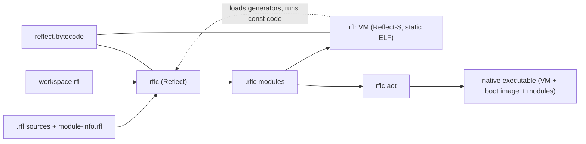
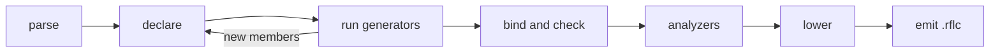

# Architecture

The entry point to the Reflect design documents: what the components are, how they depend on
each other, how the repository and builds are organized, and which tool does what. Decisions and
their history live in [sketchpad.md](sketchpad.md) Part B; examples in [examples.md](examples.md)
(cited as **ex §N**).

## 0. Conventions

Every rule has an ID `AREA-nn` and a status. IDs never change meaning; questions (`Qnn`) refer to
the decision log in sketchpad.md.

| Status | Meaning |
|---|---|
| **[Invariant]** | proposal requirement ([design-proposal.md](design-proposal.md)), not up for debate |
| **[Decided]** | settled by examples.md or an answered question |
| **[Proposed]** | recommendation that stands unless someone objects |
| **[Open]** | needs a decision |

| Prefix | Area | Document |
|---|---|---|
| `ARC`, `CMP`, `BLD` | principles, compiler pipeline, builds | this document |
| `BOOT` | bootstrapping, R0, Reflect-S | [bootstrapping.md](bootstrapping.md) |
| `LEX` | lexical structure, grammar | [grammar.md](grammar.md) |
| `MOD`, `TYP`, `NUL`, `NUM`, `STM`, `MEM`, `SVD`, `GEN`, `OPR`, `DAT`, `EXC`, `FUN`, `UNS`, `CON` | language rules | [type-system.md](type-system.md) |
| `BC` | module file, instructions, verifier | [bytecode.md](bytecode.md) |
| `VM` | virtual machine | [vm.md](vm.md) |
| `GC` | memory management | [memory.md](memory.md) |
| `JIT` | backend, JIT, AOT | [jit-aot.md](jit-aot.md) |
| `META`, `REFL` | annotations, generators, reflection | [reflection.md](reflection.md) |
| `LIB` | standard library | [stdlib.md](stdlib.md) |
| `TST` | testing | [testing.md](testing.md) |
| `LEAN` | formal model | [formal-model.md](formal-model.md) |
| `RM` | milestones | [roadmap.md](roadmap.md) |
| `HR` | features and optimizations to keep possible | [headroom.md](headroom.md) |
| `IC`, `TXN` | proposed Intent Contracts and Transactions | [intent-contracts-and-transactions.md](intent-contracts-and-transactions.md) |

## 1. Components



| Component | Written in | Role | Detail |
|---|---|---|---|
| stage0 | Java 21 | `rflc0` compiler for R0, VM0 interpreter, transliterator; deleted at v0.6 | [bootstrapping.md](bootstrapping.md) |
| `rflc` | Reflect | compiler, generator host, x86-64 backend, AOT linker, delta builder | §4, [jit-aot.md](jit-aot.md) |
| `rfl` | Reflect-S | launcher, loader, verifier, interpreter, JIT, collector, runtime services | [vm.md](vm.md), [memory.md](memory.md) |
| `reflect.bytecode` | Reflect | module reader and writer, assembler, disassembler, verifier, shared by all tools | [bytecode.md](bytecode.md) |
| stdlib | Reflect | `reflect.core` and the modules above it | [stdlib.md](stdlib.md) |
| `rfla`, `rfld`, test runner | Reflect | assembler, disassembler, conformance runner | [testing.md](testing.md) |
| `formal/` | Lean 4 | Featherweight Reflect and proofs; never needed to build Reflect | [formal-model.md](formal-model.md) |

`rflc` is itself a Reflect program: it runs on VM0 until v0.6 and on `rfl` afterwards, and it loads
generator modules into the VM it runs on (reflection.md §3).

## 2. Principles

- **ARC-01 [Decided]** Self-hosting first: a feature lands after the compiler no longer needs to
  wait for it, unless the compiler itself needs it (R0, BOOT-02). [Invariant 1]
- **ARC-02 [Decided]** Nothing outside Reflect to maintain: no C or C++, no libc, no external
  assembler or linker. Java exists only in stage0 until v0.6 (Q01, Q19, Q32).
- **ARC-03 [Decided]** No hidden costs: conversions are explicit except widening and boxing,
  dispatch is non-virtual unless declared, identity is asked for (`Object.referenceEquals`).
- **ARC-04 [Decided]** Reified everything that means something at run time: type arguments,
  nullability, intersections. Tuple element names and aliases are erased.
- **ARC-05 [Decided]** One reflection API, two phases: the same code reads compiler symbols inside
  `rflc` and VM metadata in a program (ex §6.7).
- **ARC-06 [Decided]** Deterministic builds: same inputs, same bytes (BOOT-05).
- **ARC-07 [Decided]** No corners (Q06): precise GC maps, write barriers, handles, safepoints and
  unloadable layers exist before a collector, threads or unloading need them.
- **ARC-08 [Decided]** Java first, C# where Java is weaker (properties, events, structs, ref safety,
  operators, unsigned types, reified generics, static abstract members), Delphi and Smalltalk for
  class-level dispatch, Swift for `mutating`.
- **ARC-09 [Decided]** Proven before stable: v1.0 contains only rules whose Featherweight Reflect
  layer is proven; drafts may run ahead (Q31, Q33, Q34).

## 3. Repository layout

```text
.gitattributes line ends and binary file types
.devcontainer/ VS Code editing in reflect-build
workspace.rfl  members, module path, outputs (§7)
stage0/        Java 21: rflc0, VM0, transliterator (deleted at v0.6)
compiler/      rflc: syntax, binding, lowering, emit, x86-64 backend, AOT
vm/            rfl in Reflect-S: loader, verifier, interpreter, collector, JIT, syscalls, boot image
stdlib/        one directory per module (reflect.core, reflect.collections, ...)
tools/         rfla, rfld, test runner
tests/         conformance tests (testing.md)
  bytecode/    hand-written .rfla format, library, run and invalid tests (v0.0.x)
formal/        Lean 4 project (formal-model.md)
docker/        build and runtime images (§9)
  dev.sh       Linux host wrapper
  dev.ps1      Windows host wrapper
  ci.sh        container jobs, shared by local development and CI
docs/          these documents
```

## 4. Compiler pipeline



1. **Parse** each file into an immutable syntax tree that keeps every token and its trivia, with
   error recovery, so a formatter and language server can reuse it.
2. **Declare** symbols for the module, namespaces, types and members; merge partial parts; resolve
   `module-info.rfl` against the module path; read referenced modules lazily.
3. **Complete lazily**: supertypes, signatures and constraints resolve on first use (javac's
   completers), so declaration order never matters; cycles are reported here.
4. **Generators** run in DAG order on the VM `rflc` runs on; their templates are spliced, parsed
   and declared like source (reflection.md §3).
5. **Bind and check** bodies: lookup, overload resolution, inference, lambdas, patterns, then the
   flow analyses (definite assignment, nullability, checked exceptions, ref safety, reachability,
   exhaustiveness). Constants fold and `const` methods run on demand (reflection.md §5).
6. **Analyzers** read the bound trees (reflection.md §6).
7. **Lower** to a small core: accessors, lambda classes and displays, loops, switch dispatch,
   record and enum members, interpolation, try-with-resources, compound assignment.
8. **Emit** bytecode, stack maps, metadata and debug data, written deterministically.

- **CMP-01 [Proposed]** Compiler symbols implement `reflect.meta` directly, so generators and
  analyzers read compiler data without copies. It arrives with the first generator-enabled `rflc`.
- **CMP-02 [Proposed]** Diagnostics carry a code, a span and fix-its. Codes `RFL0001` to `RFL0999`
  belong to the compiler, `RFL1000` and up to analyzers; tests match code and position.
- **CMP-03 [Proposed]** Single-threaded until threads exist (CON-01), but parsing and declaring
  work per file so they can run in parallel later.
- **CMP-04 [Proposed]** Incremental builds skip a module whose inputs are unchanged: its sources,
  the content hashes of the modules it reads, its options, and the files its generators read
  (recorded in the depfile).

## 5. Runtime structure

`rfl run app.rflc` maps the module files, resolves the module graph, applies the unsafe policy,
loads and links types lazily, and runs `main`. Methods start in the interpreter and are compiled
by the baseline JIT at their first call; `@Precompile` methods compile at load (Q17). Services
(collector, exceptions, class initialization, strings, natives over system calls, reflection,
finalizers, hot reload, dynamic layers) are Reflect-S code inside the same binary. Details:
[vm.md](vm.md), [memory.md](memory.md), [jit-aot.md](jit-aot.md).

## 6. Dependency rules

- **LIB-01 [Proposed]** Standard modules, bottom up; a module requires only modules above it in
  the table, and `requires` cycles are errors (MOD-03):

  | Module | Requires |
  |---|---|
  | `reflect.core` (namespaces `reflect.core` and `reflect.meta`) | nothing |
  | `reflect.functions` | core |
  | `reflect.collections` | core, functions |
  | `reflect.text` | core |
  | `reflect.io` | core, collections, text |
  | `reflect.bytecode` | core, collections |
  | `reflect.meta.dynamic` | core, collections, bytecode |
  | `reflect.meta.compile` | core, collections |
  | `reflect.observable`, `reflect.lint`, `reflect.json`, `reflect.testing` | modules above |

  Contents of each module: [stdlib.md](stdlib.md).
- **LIB-02 [Decided, Q30]** `Class<T>` returns mirrors such as `reflect.meta.Property`, so the
  mirror types live in module `reflect.core` under namespace `reflect.meta` (Java's `java.base`
  holding `java.lang.reflect`). No module named `reflect.meta` exists; `Proxy`, emit and hot
  reload live in `reflect.meta.dynamic`.
- **LIB-03 [Decided]** Only stdlib modules declare `native` methods (ex §2.11); the VM accepts
  natives from a fixed list of trusted stdlib modules.
- **ARC-10 [Proposed]** VM-known types, which the VM creates, lays out or dispatches specially,
  live in `reflect.core`: `Object`, `String`, the primitives, `Array`, `Span<T>` and
  `ReadOnlySpan<T>` (ref structs), `Class<T>`, the nullable wrapper, the tuples, `Destructible`,
  `Lockable` and `Lock`, `WeakReference<T>`, `Throwable` and the exceptions of type-system.md
  §12, `Runtime`, `GC`.
- **ARC-11 [Proposed]** Toolchain dependencies: `rflc` uses `reflect.core`, `reflect.collections`,
  `reflect.io`, `reflect.text`, `reflect.bytecode` and `reflect.meta.compile`; `rfl` uses
  `reflect.core` and `reflect.bytecode` only, so the runtime never depends on the compiler.
  Neither depends on `reflect.observable`, `reflect.json` or `reflect.lint` except as generator or
  analyzer modules loaded into `rflc`.
- **ARC-12 [Proposed]** Layers (MOD-10): the boot layer holds the modules resolved at start-up;
  generators inside `rflc`, emitted modules, proxies and hot-reload deltas each get a child layer
  that can be unloaded once unreachable (Q35).

## 7. Build description

- **BLD-01 [Decided, Q40]** A module's version is a directive in its descriptor; it is written
  into the module file (ex §11.1 `.module demo 0.1.0`). Versions are `major.minor.patch`; a
  module without one is `0.0.0` and cannot be published.

  ```csharp
  // file: demo/module-info.rfl
  module demo {
      version "0.1.0";
      requires reflect.collections;
      main demo.App;
  }
  ```

- **BLD-02 [Decided, Q40]** A declarative `workspace.rfl` at the repository root lists the member
  modules and build options. `rflc` parses it with its own parser; it contains no code.

  ```csharp
  // file: workspace.rfl
  workspace reflect {
      modulePath "deps";                    // prebuilt modules, such as the previous release
      output "out";
      member "stdlib/reflect.core";
      member "stdlib/reflect.collections";
      member "compiler" { aot "rflc"; }
      member "vm" { aot "rfl"; allowUnsafe; }
      member "tests/lang" { severity RFL1001 = error; }
      option "observable.trace" = "false";  // generator option, like -G
  }
  ```

  ```text
  Workspace = "workspace" Ident "{" Directive* "}" ;
  Directive = "member" String ( ";" | "{" MemberOption* "}" )
            | "modulePath" String ";" | "output" String ";" | MemberOption ;
  MemberOption = "aot" String ";" | "allowUnsafe" ";"
               | "option" String "=" String ";"
               | "severity" Ident "=" ( "error" | "warning" | "none" ) ";" ;
  ```

- **BLD-03 [Proposed]** `rflc build` reads the workspace, orders members by `requires` (a cycle is
  an error), skips unchanged members (CMP-04), writes `.rflc` files to the output directory, then
  links `aot` members into executables (jit-aot.md). Without a workspace, `rflc build` takes
  sources, `--module-path` and `--out` on the command line (ex §12.2).
- **BLD-04 [Proposed]** `allowUnsafe` permits building and running a member that declares
  `unsafe;` (UNS-02); test and run commands inherit the permission.

## 8. Tool commands

| Command | Purpose |
|---|---|
| `rflc build [--module-path P] [--out O] [module...]` | compile modules or the workspace |
| `rflc build --deterministic --emit-generated DIR --depfile F` | confined generators, printed generated code, dependency file (ex §12.2) |
| `rflc build -G name=value -W RFL1001=error` | generator option, diagnostic severity |
| `rflc aot --out EXE module...` | ahead-of-time executable, mixed mode (Q43) |
| `rflc delta --base OLD.rflc module` | hot-reload delta (reflection.md §8) |
| `rfl run [--main C] [--allow-unsafe M] [--interpret] app.rflc` | run a module (ex §2.4) |
| `rfl test [paths]` | conformance and unit tests (testing.md) |
| `rfla file.rfla -o file.rflc`, `rfld file.rflc` | assemble, disassemble; round trip is exact |

## 9. Docker images

- **BLD-05 [Decided, Q04]** Linux x86-64 is the only target. Images: `reflect-build` (the previous
  release, or the JDK and stage0 before v0.6, plus Lean for proof jobs) and `reflect-runtime`
  (`rfl` and the stdlib). Windows users run both through Docker.
- **BLD-06 [Decided]** Every build, test and proof job runs in `reflect-build`, on Windows and
  Linux hosts alike; a host needs only Docker and git (plus its standard shell). Jobs have no
  network access. The host wrappers build the Dockerfile-hashed image on demand and run
  `docker/ci.sh`, the shared CI entry point. Jobs grow with the implementation: stage0 or seed
  build, self-build, fixpoint, conformance tiers and Lean proofs (testing.md).

## 10. Glossary

| Term | Meaning |
|---|---|
| stage0 | the Java 21 bootstrap: `rflc0`, VM0 and the transliterator (BOOT-01) |
| `rflc0`, VM0 | stage0's compiler for R0 and its bytecode interpreter |
| R0 | the subset stage0 accepts and `rflc` is first written in (BOOT-02) |
| Reflect-S | ordinary Reflect as the VM's modules use it: `unsafe`, intrinsics and checked uninterruptible regions, compiled to machine code by `rflc` with no C step (BOOT-08) |
| `rflc`, `rfl`, `rfla`, `rfld` | compiler, VM launcher, assembler, disassembler |
| `.rfl`, `.rflc`, `.rfla`, `.g.rfl`, `.d` | source, compiled module, assembly text, generated source, dependency file |
| `workspace.rfl` | the declarative build description (BLD-02) |
| receiver class, `R` | the class a static access dispatches on (SVD-02) |
| type context, dictionary | where shared generic code finds exact type arguments, and its per-instantiation cache (GEN-09, VM-17) |
| static dispatch table | per run-time type table of static virtual members and virtual constructors (VM-18) |
| display | heap object holding captured locals that are assigned (FUN-03) |
| phase | `COMPILE_TIME` (compiler symbols) or `RUN_TIME` (VM metadata) (REFL-01) |
| generator, analyzer | compile-time code that adds members, or reports diagnostics (META-04, META-08) |
| partial | a class or member completed by a generator (META-04) |
| template, splice | `quote` syntax and its `${...}` holes (META-05) |
| layer | modules resolved together; dynamic code, generators and hot reload get unloadable child layers (ARC-12, VM-15) |
| `Lockable` | the marker interface that makes a class's instances lockable (CON-04) |
| boot image | the VM's pre-built heap and code inside its ELF (BOOT-13) |
| seed, fixpoint | the compiler that builds the next one; a compiler that reproduces itself byte for byte (BOOT-05, BOOT-06) |
| quickening | the interpreter rewriting an instruction once its operands are resolved (VM-19) |
| copy-and-patch | a baseline JIT that pastes precompiled machine-code stencils and patches holes (JIT-12) |
| Featherweight Reflect | the family of Lean core calculi (LEAN-01) |
