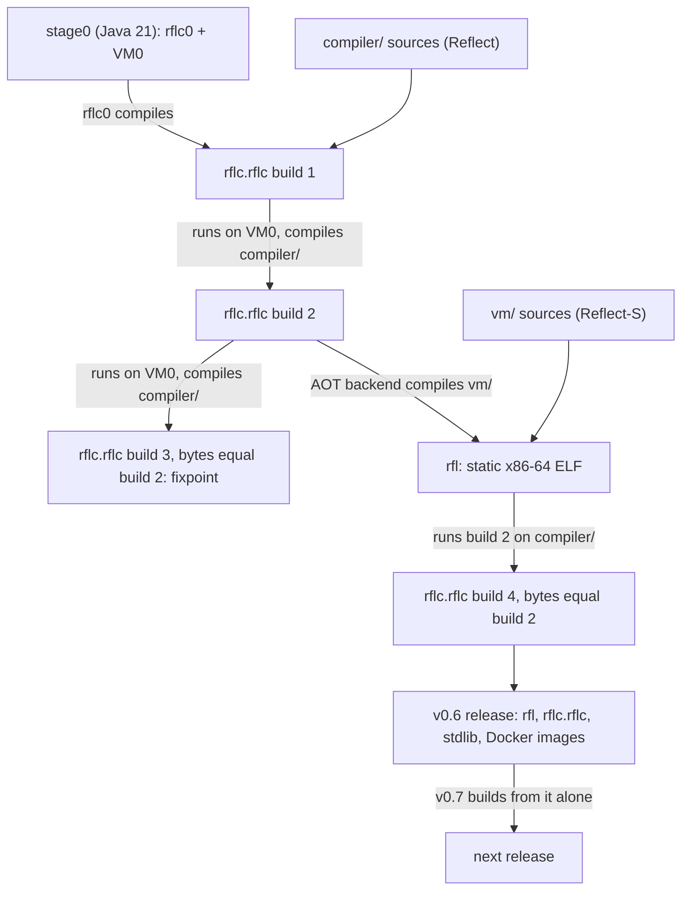

# Bootstrapping

How Reflect comes to build itself with nothing else to maintain (proposal item 1, ARC-01,
ARC-02). Conventions: [architecture.md](architecture.md) §0.

## 1. Constraints

- **BOOT-01 [Decided, Q01, Q02, Q19]** Stage0 is Java 21+ and holds two programs: `rflc0`, a
  compiler for R0, and VM0, a slow bytecode interpreter. No C or C++ appears at any stage; the
  real VM is Reflect-S code that `rflc` compiles ahead of time to machine code (§7). Speed does
  not matter in stage0; avoiding throwaway debt does.
- **BOOT-07 [Decided, Q03, Q32]** A release publishes `rfl`, `rflc.rflc`, the stdlib modules and
  Docker images. Each version builds from the previous release (Rust's model). The first release,
  v0.6, has the native VM and ends the need for Java; stage0 is then tagged and deleted.

## 2. The chain

| Step | Compiler | Runs on | Produces |
|---|---|---|---|
| 1 | `rflc0` (Java) | JVM | stdlib and `rflc` build 1 |
| 2 | build 1 | VM0 | build 2 (differs from build 1: different compilers) |
| 3 | build 2 | VM0 | build 3, byte-identical to build 2 |
| 4 | build 2 with the AOT backend | VM0 | `rfl` |
| 5 | build 2 | `rfl` | build 4, byte-identical to build 2 |
| 6 | release | | v0.6; stage0 deleted |
| later | previous release | `rfl` | next release |

## 3. Stage0

- **BOOT-10 [Proposed]** Stage0 is built with plain `javac` and `jar` from a script in the build
  image; no Maven or Gradle, since it is deleted at v0.6. Packages:
  `reflect.stage0.compiler` (`rflc0`), `reflect.stage0.vm` (VM0), `reflect.stage0.translit`,
  `reflect.stage0.bytecode` (the module format), `reflect.stage0.tools` (command lines), and
  `reflect.stage0.lib`, the facade that mirrors `reflect.collections` (§5).
  `sh stage0/build.sh` uses `javac --release 21` and writes `out/stage0/stage0.jar`, with
  `reflect.stage0.tools.Main` as its entry point.
- **BOOT-11 [Proposed]** `rflc0` has the pipeline of `rflc` (architecture.md §4) without
  generators, analyzers or `const` methods, restricted to R0. It emits the same module format
  through a Java port of the writer, which is checked against `rfld` output in tests.
- **BOOT-04 [Proposed]** VM0:
  - loads the same `.rflc` files as `rfl` and interprets the stack bytecode directly with a
    `switch`, with no register form, quickening or JIT;
  - represents a Reflect object as a Java object holding its run-time type and a slot array,
    arrays as Java arrays, and `String` as `java.lang.String` (both UTF-16);
  - borrows the JVM's collector, and implements finalization with `java.lang.ref.Cleaner`
    references drained only at the defined points (memory.md §6);
  - creates one run-time type per instantiation, nullability included, so reified generics and
    static virtual dispatch behave as on `rfl`;
  - implements natives as Java methods (console, files, time, exit);
  - throws a Java exception that wraps the Reflect `Throwable`, and maps a JVM
    `StackOverflowError` to the Reflect one;
  - runs generators for as long as `rflc` runs on it, and has no verifier, JIT or pointers.

  Target: build 2 compiles the compiler in minutes.

## 4. R0

- **BOOT-02 [Proposed]** R0 is the subset that stage0 accepts and that `rflc` is first written
  in. Everything outside R0 becomes usable in `compiler/` through feature staging (§6).

  | In R0 | Not in R0 |
  |---|---|
  | modules, file-scoped namespaces, imports | namespace blocks, generic aliases |
  | classes, interfaces with default methods, `virtual`/`override`, nested types | static virtual members, virtual constructors |
  | generics with bounds and wildcards, reified by VM0 | intersections, generic virtual methods, generic exceptions, `catch (E e)` |
  | primitives except unsigned, `String`, interpolation, arrays, nullability | unsigned types, structs, ref safety, `Span<T>`, tuples |
  | properties (auto and computed), simple enums, class records | events, operators, indexers, `@Flags`, per-constant enum bodies |
  | sealed types, `switch` with type patterns | record patterns, guards |
  | lambdas, method references, checked exceptions, try-with-resources | extension methods, varargs, iterators |
  | `const` over literals | `const` methods, generators, analyzers, `unsafe` |

## 5. R0-shaped Java and the transliterator

- **BOOT-03 [Decided, details Proposed]** R0-shaped Java (ex §12.3) is Java written so that a
  mechanical transliterator prints the equivalent Reflect:

  | Stage0 Java | R0 |
  |---|---|
  | `package a.b;` | `namespace a.b;` |
  | `reflect.stage0.lib` collections (`size()`, `get(i)`) | `reflect.collections` (`size` property, `get(i)`) |
  | `@Virtual` on a method | `virtual` |
  | `@Override` | `override` |
  | `static final class Nested` | `final class Nested` |
  | `Integer`, `List<Integer>` | `int`, `List<int>` |
  | `a.equals(b)` on strings | `a == b` |
  | `yield v;` in a switch expression | `return v;` (Q12) |
  | `non-sealed` | `unsealed` |
  | `@Nullable T` (JSpecify), checked by `rflc0` | `T?` |
  | `@Property` getter and setter pair | a property |
  | simple `enum` | value-type `enum` |
  | records, sealed interfaces, lambdas, method references, `var`, checked exceptions | the same |

  Stage0 Java must avoid: inner and anonymous classes, raw types, streams, Java reflection, `==`
  on boxed values or strings, `switch` with fallthrough, enums with bodies, static initialization
  that depends on order across classes, and any method that Java dispatches virtually without
  `@Virtual` or `@Override` (the transliterator rejects overriding without them).
- **BOOT-12 [Proposed]** The transliterator reads stage0 with the JDK's `com.sun.source.tree` API
  (no extra dependency), rejects anything outside R0-shaped Java with a source position, and
  prints `compiler/`. It is rerun until the switch-over at v0.3 (roadmap.md), after which
  compiler work happens only in Reflect and stage0 receives bug fixes only.

## 6. Determinism, fixpoint and feature staging

- **BOOT-05 [Proposed]** `rflc` output depends only on its inputs: sorted metadata tables, no hash
  or directory order, no timestamps or absolute paths, deterministic compile-time code
  (reflection.md §9), culture-invariant formatting. CI checks the fixpoint (build 2 equals
  build 3) and that `rflc` produces identical bytes on VM0 and on `rfl`.
- **BOOT-06 [Proposed]** Feature staging, a simpler form of Rust's `cfg(bootstrap)`: `compiler/`
  may use a feature once the seed compiler supports it. The seed is the latest chain build before
  v0.6 and the previous release afterwards. CI builds the compiler with the seed, then with
  itself; both must succeed.

## 7. The native VM and Reflect-S

- **BOOT-08 [Decided, Q01, Q19; details Proposed]** Reflect-S is not a separate language,
  compiler or backend. It is ordinary Reflect as the VM's own modules use it, compiled by `rflc`
  like any module and turned into machine code by `rflc`'s x86-64 backend (jit-aot.md): no C step,
  no libc. Three things set it apart:
  1. The VM's modules declare `unsafe;` and use pointers and system calls (type-system.md §14).
  2. A VM-only analyzer checks regions marked `@Uninterruptible` (Jikes RVM's term): code reachable
     from the collector, allocator, stack walker and interpreter fast paths allocates no managed
     objects, throws nothing and contains no safepoints. The loader, verifier, reflection and JIT
     use the whole language and the collector they implement.
  3. A few compiler intrinsics express what pointers cannot (Jikes RVM's "magic"), in class
     `reflect.vm.Magic`: the current frame pointer and return address for stack walks, the
     address of an object and the object at an address (for the collector), and the stack
     pointer switch used when calling into compiled code.

  Code using those pointers and intrinsics runs only as machine code inside `rfl`, since VM0 has no
  pointer support; shared libraries such as `reflect.bytecode` stay plain Reflect. The name is
  historical: references.md once modeled it on Squeak's subset translated to C; the models are
  Jalapeño (Jikes RVM) and Maxine.
- **BOOT-13 [Proposed]** The boot image: `rflc aot` compiles the `vm` member and the stdlib modules
  it uses, pre-runs their static initializers where they are deterministic, and writes the code
  plus the resulting heap objects (run-time types, strings, tables) into the ELF's data, so `rfl`
  starts without loading itself. Static initializers that read the environment run at start-up
  instead.
- **BOOT-14 [Proposed]** The first `rfl` (v0.6) has the interpreter and the mark-sweep collector,
  without the JIT (v0.8). It runs `rflc` interpreted, which must already beat VM0 on the JVM.

## 8. Releases, trust and retirement of Java

- Release artifacts: `rfl` (static ELF), `rflc.rflc`, the stdlib `.rflc` files, `reflect-build` and
  `reflect-runtime` images (architecture.md §9). A checkout builds with
  `rfl run rflc.rflc build` using the previous release found through `modulePath` in
  `workspace.rfl`.
- **BOOT-15 [Proposed]** At v0.6 stage0 is tagged `stage0-final` and deleted; nothing in the
  repository refers to Java afterwards.
- **BOOT-16 [Proposed]** Trusting-trust audit (Thompson, Wheeler): `stage0-final` can rebuild one
  historical `rflc`, and replaying the release chain from it must reproduce release bytes. It is
  an occasional audit, not a CI job.
