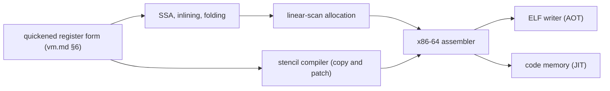

# Backend, JIT and AOT

How Reflect becomes machine code without external tools: one x86-64 backend in `rflc`, used ahead
of time for the VM and applications and at run time by the VM's JIT. Conventions:
[architecture.md](architecture.md) §0.

## 1. Backend

- **JIT-01 [Decided, Q01, Q04]** `rflc` contains the only native backend: x86-64, writing machine
  code and ELF files itself, with no external assembler or linker. It is a library
  (`reflect.compiler.backend`) that `rflc aot` uses and that the VM links for its JIT.
- **JIT-08 [Proposed]** Two code generators share the backend's assembler, frame layout and stack
  maps:
  - the **optimizing compiler**: register-form input converted to SSA, inlining (guided by
    `@Inline` and `@ForceInline`, META-10), constant folding, null-check and bounds-check
    elimination, linear-scan register allocation. AOT uses it from v0.6, since the VM itself must
    be fast; after v1.0 it also serves as the JIT's second tier;
  - the **stencil compiler**: the baseline JIT's copy-and-patch generator (§4).

## 2. x86-64 and ELF

- **JIT-09 [Proposed]** Floating point uses SSE2 scalar instructions only: no x87, no fused
  multiply-add except `Math.fma`, so results match the interpreter and `const` evaluation bit for
  bit (NUM-04, JIT-07).
- **JIT-10 [Proposed]** System calls use the kernel convention (number in `rax`, arguments in
  `rdi rsi rdx r10 r8 r9`); the VM installs its signal handlers on an alternate stack to turn a
  guard-page hit into `StackOverflowError` (vm.md §6).
- **JIT-11 [Proposed]** The ELF writer produces static executables: `.text` (code), `.rodata`
  (constants, metadata of precompiled modules), `.data` (the boot image's heap, BOOT-13), `.bss`,
  an entry point that sets up the VM stack and calls the VM's start routine, and no dynamic
  section or interpreter. Section contents are emitted in a deterministic order (BOOT-05).

## 3. Tiers

- **JIT-02 [Decided, Q17]** Execution tiers:
  - tier 0, the interpreter (vm.md §6), for cold code, static initializers, debugging, hot reload
    and `--interpret`;
  - tier 1, the baseline JIT, compiling each method at its first call (the .NET model; proposal
    item 4's "lazy, on first use");
  - tier 2, after v1.0: the optimizing compiler at run time with profiles from tier 1, speculative
    devirtualization and deoptimization (§9).
- **JIT-03 [Decided, Q17]** `@Precompile` requests eager compilation: at module load under the
  JIT, always under the AOT compiler.

## 4. Baseline JIT: copy and patch

- **JIT-12 [Proposed]** Copy-and-patch (Xu and Kjolstad; CPython 3.13):
  - every operation of the quickened register form has a **stencil**, machine code with holes for
    operands, constants, call targets and jump targets;
  - stencils are written in Reflect-S and compiled when the VM is built by the optimizing compiler,
    which records the holes as relocations; clang, which builds CPython's stencils, is not needed;
  - compiling a method copies one stencil per operation into code memory and patches the holes,
    microseconds per method;
  - call sites keep the interpreter's caches (VM-19) as data the code reads;
  - each call site and safepoint gets a stack map, and each frame records how registers map to
    interpreter slots, the metadata tier 2's deoptimization will need.

## 5. Calling convention and frames

- **JIT-05 [Proposed]** Compiled Reflect code uses its own convention: arguments in registers then
  on the stack, the receiver class `R` (SVD-09) and the method-instantiation dictionary in
  dedicated registers, so implicit receivers cost nothing. The syscall convention appears only at
  `extern` boundaries; System V arrives with C library calls after v1.0 (Q28).
- **JIT-13 [Proposed]** Frames keep a frame pointer chain so the collector, exceptions and
  `Magic.framePointer()` (BOOT-08) can walk compiled frames; each return address keys a stack map
  and an unwind entry. Adapters convert between interpreted and compiled frames (vm.md §6).

## 6. Ahead-of-time compilation

- **JIT-04 [Decided, Q43]** `rflc aot --out app module...` builds a mixed-mode executable for
  applications in v1.0, with the machinery that builds `rfl` itself:
  - the runtime, the boot image and the application's modules compiled by the optimizing
    compiler;
  - generic instantiations found by analysis are compiled; others run as shared code with
    run-time dictionaries (GEN-08);
  - metadata is kept, since reflection is first-class; reflective calls use generated stubs;
  - the interpreter and the JIT stay in the binary for emit, proxies, hot reload and anything not
    precompiled;
  - static initializers that are deterministic run at build time (BOOT-13).
- **JIT-14 [Proposed]** A closed-world option that drops the interpreter, JIT and unused metadata
  comes after v1.0.

## 7. Code memory

- **JIT-06 [Proposed]** Code memory is mapped writable, filled, then made executable, never both
  at once. Compiled methods address constants through a per-method table the collector sees
  (memory.md §4). Each layer owns its code (VM-15), so unloading a layer frees it; hot reload
  invalidates code that inlined or devirtualized a replaced method (vm.md §11).

## 8. Correctness

- **JIT-07 [Proposed]** Compiled code computes exactly what the interpreter does: strict IEEE,
  the same overflow behavior, the same evaluation order, the same exceptions at the same points.
  Differential tests run the conformance suite in every tier and under AOT (testing.md).

## 9. Later: the optimizing tier

- **JIT-15 [Proposed]** After v1.0, tier 2 recompiles hot methods with profiles: inlining across
  virtual calls guarded by class-hierarchy analysis, with dependencies invalidated by class
  loading and hot reload; escape analysis and scalar replacement; on-stack replacement for long
  loops; deoptimization back to the interpreter using the frame metadata of JIT-12.
