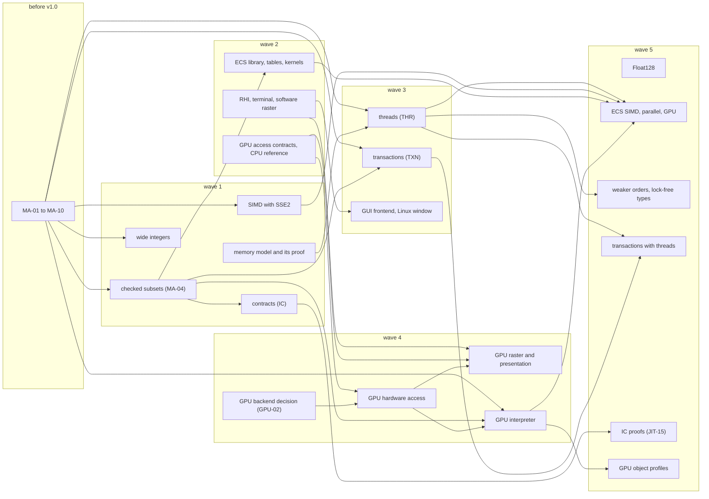

# Proposals: meta-analysis

A working document for the unscheduled proposals in this folder. It evaluates each proposal
against the baseline, orders their implementation, records where the language must change, and
lists the decisions that must come before v1.0, so that no proposal later needs a breaking change.
It changes with every new proposal (§0). Conventions: [architecture.md](../architecture.md) §0.

The *baseline* is the design in the documents outside this folder. No proposal changes a baseline
rule, and this document changes none either. Its entries are recommendations (**[Proposed]**) or
choices (**[Open]**). When an entry is accepted, the owning rule changes and the entry records
where it went (*Went to*), as [headroom.md](../headroom.md) §0 does for its entries.

| Term | Meaning |
|---|---|
| checked subset | restrictions that the compiler, the verifier or the VM checks for a piece of code (a method, a contract clause or a transaction body) and for every method that it calls, such as an ECS kernel (ECS-15) or Reflect-G (GPU-08) |
| C-library gate | the decision to allow calls into C libraries; UNS-04 defers it until after v1.0, and GPU-02 and RND-05 need it for some routes |
| execution context | the state of one running thread: its frames, allocation context, pending exception and handles |
| wave | a group of work in the recommended order (§7) |

## 0. Maintaining this document

When a proposal is added or changes:

1. Put it in `docs/proposals/`. Add its prefix to [architecture.md](../architecture.md) §0 and a
   paragraph to the unscheduled proposals of [roadmap.md](../roadmap.md).
2. Add a row to the index in §1.
3. Answer the checklist of §2 and add a subsection to §3.
4. Add each baseline rule that it changes to the change register (§5).
5. Compare it with the entries of §4 and §8, the shared mechanisms of §6 and every other
   proposal. Add an entry for each new conflict or deadline.
6. Update the graph and the waves of §7.
7. Check that every relative link resolves and every rule ID has one definition (the `docs` job of
   Q56, once it exists).
8. Add a dated line to the log (§9).

An entry is closed when its owning rule changes. It keeps its ID and records *Went to*.

## 1. Summary

| Proposal | Prefixes | Adds | Needs first | Platform gate | Wave |
|---|---|---|---|---|---|
| [Intent Contracts and Transactions](intent-contracts-and-transactions.md) | `IC`, `TXN` | method contracts, checked at run time unless proven; undo of managed stores when an exception escapes a block | IC: MA-04; TXN: MA-04, MA-05, MA-06 | none | IC 1, TXN 3 |
| [Entity-Component Systems](entity-component-systems.md) | `ECS` | component structs, system classes, world-owned tables, checked kernels | spans (DAT-03); MA-04, MA-09, MA-10 | none | 2 |
| [Threads, Atomics and Lock-free Semantics](threading.md) | `THR` | OS threads, monitors, `volatile` fields, atomic cells, a memory model | the memory model (CON-02); MA-02, MA-05, MA-06, MA-08 | none | 3 |
| [GPU Access, Reflect-G and a GPU-resident Interpreter](gpu.md) | `GPU` | device, resource and command APIs; a checked device subset; a bytecode interpreter on the GPU | MA-04, MA-06, MA-07, MA-08 | the backend decision of GPU-02; the C-library gate for a user-space driver | contracts 2, hardware 4 |
| [Platform-agnostic Rendering, GUI and Terminal UI](rendering.md) | `RND` | one RHI with raster and cell profiles; separate GUI and terminal frontends | waits for readiness in the library; for GPU raster, GPU access | the packaging of providers (RND §10); the C-library gate for systems other than Linux | terminal 2, GUI 3, GPU raster 4 |
| [128-bit Arithmetic and SIMD](wide-arithmetic-and-simd.md) | `WID`, `SIMD` | `Int128`, `UInt128`, `Float128`; `Vector128<T>` and `Mask128<T>` | MA-01, MA-03; a format extension (BC-20) | none | integers and SIMD 1, `Float128` 5 |

The wave column lists where each main part starts. Most proposals also have extensions in wave 5
(§7.2).

Findings:

1. No proposal adds work to R0 or the self-hosting path, and none has a milestone (§3).
2. Ten decisions before v1.0 keep every proposal possible (MA-01 to MA-10, §4). If they come
   late, MA-02 and MA-10 cause source breaks, MA-01 changes observable results, and the others
   cause rework in the compiler, the VM or the library, or a change to a proposal.
3. The first deadlines are close: MA-01 binds VM0's floating-point arithmetic in v0.0.5, and MA-02
   binds `rflc0` in v0.1.
4. Two of the ten are gaps in the baseline today, independent of any proposal: the bits of a NaN
   result are observable but not specified (MA-01), and NUL-03 narrowing misses a write by a
   static initialiser (MA-02). Q92 closed MA-01 on 2026-10-23.
5. Three proposals add four checked subsets, next to the baseline's `const` methods and
   `@Uninterruptible` regions. One checker can serve all six (MA-04, §6.1).
6. Hardware GPU access waits for the backend decision of GPU-02, and also for the C-library gate if
   that decision is a user-space driver. GPU raster rendering builds on it. A terminal UI and a
   software-rendered window on Linux need only system calls (§6.7).
7. The order has five waves after v1.0 (§7). Wave 1 builds the shared mechanisms together with
   the two most self-contained features: wide integers with SIMD, and contracts.
8. Six conflicts or gaps in or between the proposals need a decision when a proposal is adopted
   (MA-11 to MA-16, §8).

## 2. Checklist

Each proposal is evaluated with these questions:

| Question | Answer in |
|---|---|
| What does it add, and in which layers: syntax, types, module format, VM, library? | §3 |
| Which baseline decisions does it rely on? Could a change before v1.0 remove one? | §3, §6.6 |
| Which baseline rules must change, and is each change additive after v1.0? | §4, §5 |
| Does it add critical module content, which older readers must reject (BC-20)? | §5.3 |
| Does it need a platform decision (ARC-02, LIB-07, UNS-04, VM-01)? | §6.7 |
| Which shared mechanism does it use: checked subsets, the store path, the execution context, admissible type arguments? | §6 |
| Which proof layer must exist before it becomes stable (ARC-09, TST-06)? | §3 |
| How does it interact with each other proposal? | §3, §8 |
| What must exist first, and what does it unblock? | §7 |

## 3. The proposals

Each subsection states what the proposal adds, the baseline decisions it relies on, what it still
needs, what this analysis found and the verdict.

### 3.1 Intent Contracts and Transactions (IC, TXN)

- **Adds.** IC: `requires` and `ensures` clauses with `old(e)` and `result`, checked at run time
  unless proven (IC-07 to IC-09). TXN: `transaction { }` blocks that restore logged managed
  stores when an exception escapes (TXN-01), with nested savepoints (TXN-09).
- **Relies on.** Calls go through descriptors or patchable stubs (VM-10). Readers reject unknown
  critical content (BC-20). An interior pointer resolves to its object (GC-12), pointers reach
  managed memory only inside `fixed` (UNS-01, UNS-06), and finals never change (BC-23).
- **Needs.** IC: contract metadata (IC-12), a purity check (IC-06), two new exceptions (IC-10) and
  a proof layer, FR-contract. TXN: a check on every managed store in every tier, primitive stores
  included (TXN-06 to TXN-08), verified boundaries (TXN-05) and a proof layer, FR-transaction
  (both layers in IC §5.1).
- **Open in the proposal.** IC-13, TXN-13, TXN-14, TXN-15.
- **Found.** MA-12 to MA-16 (§8). TXN builds on MA-04, MA-05 and MA-06.
- **Verdict.** IC is mostly compiler work with a small VM part (MA-15): wave 1. TXN changes every
  store in every tier: wave 3, after THR by priority (§7.3).

### 3.2 Entity-Component Systems (ECS)

- **Adds.** `component` structs and `system` classes (ECS-01 to ECS-03), worlds with archetype
  tables (ECS-07 to ECS-11), leased batch views (ECS-12, ECS-13) and `@Kernel` updates that AOT
  can specialise (ECS-15 to ECS-18).
- **Relies on.** Structs and spans (DAT-01, DAT-03); reified generics, so a query for `C<A>` does
  not match `C<B>` (GEN-02, ECS §2.1); mixed-mode AOT with an interpreter and JIT fallback
  (JIT-04, ECS-17).
- **Needs.** Role metadata (ECS-19), verifier checks for kernels and leases (ECS-20), a checked
  subset (ECS-15) and two declaration words (ECS-01).
- **Open in the proposal.** Module and API names, chunk sizes, filters and tags, stable order,
  deferred structural commands, layout migration and the proof layer (ECS §10). A GPU target and
  a parallel scheduler each need a separate proposal (ECS §10).
- **Found.** MA-10 (the declaration words), MA-09 (span element access if FR-ref lags) and MA-04
  (a kernel breaks when a helper in another module changes). Worlds and tables can start as a
  library with a generator (META-04) over annotated partial classes, which needs no grammar
  change. ECS §7 predates the SIMD proposal: explicit vectors (SIMD-01) now give kernels a
  defined path to SIMD.
- **Verdict.** Wave 2. First the library, then the words, the metadata and the kernels, on the
  checked-subset framework of wave 1.

### 3.3 Threads, Atomics and Lock-free Semantics (THR)

- **Adds.** OS threads with `join` (THR-02, THR-03), a memory model based on Java's (THR-04 to
  THR-06), monitors on `Lockable` objects (THR-07), `volatile` fields (THR-08) and sequentially
  consistent `Atomic<T>` cells (THR-09, THR-10).
- **Relies on.** One thread until after v1.0, with `volatile` and `synchronized` reserved (CON-01,
  LEX-03); lock words only in `Lockable` objects (CON-04, VM-23); initialisation states that
  record the running thread (VM-07); precise roots, barriers, handles and safepoint polls (GC-02,
  GC-13); boxes without identity, which a reference compare-and-set (CAS) rejects (DAT-09,
  THR-10).
- **Needs.** The memory model, written and proven before threads ship (CON-02, THR-17); an audit
  of lazily published VM state (THR-15); a stop-the-world collector that stops every thread
  (THR-14).
- **Open in the proposal.** THR-11 (weaker orders); racy construction of objects with non-null
  fields (THR §4.2); static race prevention, causality rules and the other items of THR §10.
- **Found.** MA-02 (NUL-03 narrowing); MA-05, MA-06 and MA-08 (the structure of `rfl` in v0.6);
  MA-11 (128-bit values); MA-16 (contracts). Racy publication of an object with non-null fields
  needs a new exception in FR-null's theorem or a publication rule for constructors (THR §4.2).
- **Verdict.** The largest change of semantics, and the source of most v0.6 decisions. Write the
  memory model from wave 1; implement in wave 3.

### 3.4 GPU Access, Reflect-G and a GPU-resident Interpreter (GPU)

- **Adds.** Devices, resources, commands and completion with capability checks (GPU-03 to
  GPU-07); Reflect-G, a checked device subset (GPU-08 to GPU-10); a bytecode interpreter that runs
  on the GPU (GPU-11 to GPU-14).
- **Relies on.** Strict arithmetic in every tier (NUM-03, NUM-04, JIT-07); layout private to the
  VM, so transfer layouts can differ from host layouts (HR-18, GPU-18); rejection of unknown
  critical content (BC-20, GPU-17); deterministic compile-time code (META-09, GPU §9).
- **Needs.** A backend and driver decision (GPU-02). A user-space driver is a C library, and
  UNS-04 allows C library calls only after v1.0, through Reflect's own loader. A direct
  kernel-driver interface needs only system calls, but brings driver-specific interfaces and
  "substantial maintenance" (GPU-02). A device-lowering path, which JIT-01 does not allow today
  ("the only native backend"). A device package (GPU-17) and a device proof layer (GPU-19).
- **Open in the proposal.** GPU-02 and the list in GPU §12.
- **Found.** MA-06 (C code owns `%fs`), MA-07 (an optimiser that knows no target), MA-08 (guest
  images made from canonical bytecode) and MA-04 (Reflect-G as a checked subset). The CPU
  reference backend (GPU-20 step 1) needs no driver.
- **Verdict.** Design the access contracts together with the RHI of RND, and build the CPU
  reference backend, in wave 2. Hardware access and the interpreter wait for the backend decision
  of GPU-02: wave 4.

### 3.5 Platform-agnostic Rendering, GUI and Terminal UI (RND)

- **Adds.** One rendering hardware interface (RHI) with a raster and a cell profile (RND-03),
  windows and terminal sessions owned by the platform layer (RND-04), one frame lifecycle
  (RND-06) and separate GUI and terminal frontends (RND-07, RND-08).
- **Relies on.** GPU-03 to GPU-07 for raster resources (RND-03); the finaliser drain at
  `Runtime.idle()`, which an event loop calls (GC-04); system calls without libc (UNS-04).
- **Needs.** A packaging decision for platform providers (RND §10): natives are limited to trusted
  stdlib modules (LIB-03), and a module that uses `extern` is unsafe and loads only with
  `--allow-unsafe` (UNS-02). Waits for input, timers and writable output (RND-04), where LIB-09
  and VM-08 offer blocking IO only. Terminal modes, size changes and termination signals
  (RND §7.1). Unicode segmentation and width tables (RND-08), next to the Unicode tables that
  LEX-02 already needs.
- **Open in the proposal.** RND-05 and the list in RND §10.
- **Found.** RND-04 lists Windows and macOS providers, but the baseline runs only on Linux x86-64
  (VM-01, BLD-05), and those systems publish their system interface as libraries (§6.7). On
  Linux, a software-rendered window needs only system calls (§6.7).
- **Verdict.** RHI contracts, test backends and the native terminal in wave 2, after the packaging
  decision. The GUI frontend over software raster targets, with a Linux window that presents
  through shared memory, in wave 3. GPU raster in wave 4. Other operating systems after the
  C-library gate and new targets.

### 3.6 128-bit Arithmetic and SIMD (WID, SIMD)

- **Adds.** `Int128`, `UInt128` and `Float128` as VM-known primitive structs (WID-02 to WID-08);
  `Vector128<T>` and `Mask128<T>` with a finite set of operations (SIMD-01 to SIMD-05); a
  versioned extension of the format and the verifier (WID-10, WID-11, SIMD-07).
- **Relies on.** Strict IEEE arithmetic and equal results in every tier (NUM-04, JIT-07); the
  generic-math interfaces (LIB-05); spans for safe loads and stores (DAT-03, SIMD-06); free
  signature codes and opcodes (BC-03, BC-04, §6.5); VM-known types in `reflect.core` (ARC-10).
- **Needs.** An explicit extension of JIT-09 (SIMD-08); a calling convention for 16-byte values
  (WID-13); a lane constraint (SIMD-10); a numeric proof model (WID-15).
- **Open in the proposal.** WID-16, WID-17, SIMD-10, SIMD-11.
- **Found.** MA-01: SIMD-04 asks for "the scalar numerical semantics for each lane" and a
  canonical lane NaN, but keeps scalar NaN results as they are. MA-03 (conversions with existing
  numeric types). MA-11 (threads). WID-02 does not say whether `Int128` can back an enum (DAT-05;
  the `backing` column of BC-11 holds `I8` to `U64`) or appear as a `switch` case constant
  (STM-02). The integer vectors A01 to A11, the binary128 limits and the lane cases of SIMD-09
  agree with an independent recomputation made on 2026-10-21 (JavaScript `BigInt` for the
  integers, IEEE doubles for the lanes); it is not a repository test.
- **Verdict.** Integers and SIMD in wave 1: they need no platform gate and no new run-time
  semantics, and they test the format-extension path that IC, TXN, ECS, THR and GPU also need.
  `Float128` is a separate, large task: wave 5. Spell the lane constraint as a bound, not as a
  new word (§5.1).

## 4. Decisions before v1.0

| ID | Keeps possible | Judgement | Decide by | If late |
|---|---|---|---|---|
| MA-01 | one NaN rule for scalar, wide and vector values | want | v0.0.5 | observable results change |
| MA-02 | null narrowing that stays sound with threads | want | v0.1 | source break |
| MA-03 | new numeric types in generic math | want | v0.4 | library rework |
| MA-04 | one checker for every checked subset | want | v0.5 | four more checkers |
| MA-05 | transaction logs, atomic updates, new collectors | want | v0.6 | VM rework |
| MA-06 | threads, fibres, transactions, C libraries | want | v0.6 | compiled-code rework |
| MA-07 | device lowering, a second CPU backend | want | v0.6 | optimiser rework |
| MA-08 | quickening with threads, GPU guest images | want | v0.6 | interpreter rework |
| MA-09 | ECS updates if FR-ref lags | keep open | v0.9 | ECS-04 changes |
| MA-10 | `component` and `system` declarations | want | v1.0 | source break |

The judgements follow [headroom.md](../headroom.md) §0: *want* means plan for it, because the step
is cheap; *keep open* means the step only avoids ruling it out. *Decide by* is the first stage that
builds on the choice.

- **MA-01 [Decided, Q92]** One NaN rule for every floating-point format.
  - *Went to:* NUM-04, which gives `float` and `double` the positive quiet NaN with payload 0,
    `0x7FC00000` and `0x7FF8000000000000`, and DAT-09 and BC-04, which cite it (Q92 of
    [v0.0.x/sketchpad.md](../v0.0.x/sketchpad.md)). VM0 follows it from v0.0.5
    ([v0.0.x/README.md](../v0.0.x/README.md) §7.6). WID-07, SIMD-04 and GPU-09 follow when their
    proposals are adopted, and WID-17 still fixes the bits of binary128 and of other lane formats.
  - *Today:* NUM-04 fixes rounding, contraction, extended precision, `==` and `equals`, but not the
    bits of a NaN that an operation returns. IEEE 754 does not fix them either (IEEE 754-2019
    §6.2). DAT-09 compares boxes by bit pattern, so safe code can observe these bits. `.rfla`
    writes exact NaN payloads (BC-08, `Real` with `bits`). WID-07 gives binary128 one positive
    quiet NaN. SIMD-04 gives each lane format one, keeps "the NaN payload behaviour of existing
    scalar operations", and also asks for "the scalar numerical semantics for each lane".
  - *Problem:* on one machine the bits already depend on how a result is computed. With Java 21
    on x86-64, `0.0 / 0.0` folded by `javac` is `7ff8000000000000`, and the same division at run
    time is `fff8000000000000`; `Math.sqrt(-1.0)` at run time is `fff8000000000000` (measured
    2026-10-21; not a repository test). `rflc0` folds constants in Java from v0.1 (BOOT-11,
    [architecture.md](../architecture.md) §4 step 5), VM0 computes in Java from v0.0.5 (BOOT-04),
    `rfl` computes in SSE2 code (JIT-09), and a later AArch64 backend (HR-23) or GPU float
    profile (GPU-09) can return other bits. So one program can give different results in two
    implementations, against JIT-07 and TST-07, a folded constant can differ from the same
    expression at run time (NUM-04), and a vector lane can differ from the same scalar operation.

    ```reflect
    // future: illustrative; both values are NaN
    double a = 0.0 / 0.0;
    double b = Math.sqrt(-1.0);
    boolean same = (Object) a == (Object) b;    // DAT-09 compares bits; NUM-04 leaves them open
    ```

  - *Step:* NUM-04 states one rule for `float`, `double`, `Float128` and vector lanes. An
    arithmetic operation that returns a NaN (`+`, `-`, `*`, `/`, `%`, square root, `Math.fma`, a
    conversion between floating-point formats) returns the canonical quiet NaN of its format.
    Sign operations such as negation change only the sign bit. Loads, stores, boxing, bit
    conversions and reinterpretation keep every bit. WID-07 and SIMD-04 then follow NUM-04, and
    WID-17 only chooses the bit patterns.
  - *Alternative:* NaN bits stay open, and every operation that exposes bits (box comparison and
    hashing, bit conversions, `reinterpret`) makes a NaN canonical first. Arithmetic needs no extra
    instructions, but `fromBits` and `toBits` can no longer keep payloads (WID-03, WID-07), and
    DAT-09 would compare NaN boxes by value, which Q61 rejected.
  - *Cost:* the rule is cheap to state; its run-time cost depends on the bit pattern. On x86-64,
    both measured invalid operations returned a NaN with the sign bit set, so the positive quiet
    NaN that WID-07 asks for costs extra instructions after each operation that can return a
    NaN. A NaN input with a payload needs them for any pattern. Measure before WID-17
    fixes the bits.
  - *Decide by:* v0.0.5, where VM0 first computes floating-point results (v0.0.x README §7.6
    commit 5). Tests can observe the bits from v0.0.7 (box comparison, §7.8 commit 4). `rflc0`
    writes folded float constants into modules from v0.1, and `const` methods add results in v0.5
    (REFL-11).
- **MA-02 [Proposed]** A narrowed field read uses the value that was tested.
  - *Today:* NUL-03 narrows "other fields of `this` until the next call, assignment or event
    raise". Each use can read the field again.
  - *Problem with threads:* another thread can write the field between the test and the use.
    THR §4.2 says that old source "may need a diagnostic and a local-copy fix", which is a source
    break after v1.0.
  - *Problem in one thread, today:* a static field read is no call, assignment or event raise, but
    its first execution runs the class's static initialiser (VM-07), and that initialiser can
    write the field. Evaluation is left to right (STM-05), so `Limits.MAX` runs before `name` is
    read:

    ```reflect
    // illustrative: both classes are in one namespace of one module
    public final class Session {
        public static Session? current;
        String? name;

        int greet() {
            current = this;
            if (name != null) {
                int total = Limits.MAX + name.length;   // NUL-03 narrows name; the read gives null
                return total;
            }
            return 0;
        }
    }

    final class Limits {
        public static final int MAX = reset();          // static final, not const: read at run time
        static int reset() { Session.current!.name = null; return 10; }
    }
    ```

    The compiler accepts `name.length`. In the interpreter and the JIT, the program throws
    `NullPointerException` there: memory safety holds, but the narrowed type was wrong.
  - *Step:* narrowing applies to a value. The compiler loads a narrowed field of `this` once, at
    the test, and each use until the narrowing ends reads that value. In one thread this differs
    from today only when code that NUL-03 cannot see, such as a static initialiser, writes the
    field; the program then reads the tested value, which has the narrowed type. With threads the
    rule stays sound and needs no new diagnostic. A `volatile` field is not narrowed, because each
    of its reads is a separate observation (THR §4.2).
  - *Alternative:* narrowing also ends at every access to a static field of another class. This
    closes the problem in one thread, but not the problem with threads.
  - *Decide by:* v0.1: R0 includes nullability (BOOT-02), so `rflc0` implements NUL-03 first.
    FR-null (v0.4) must prove the chosen reading.
  - *Goes to:* NUL-03, ex §2.8, FR-null ([formal-model.md](../formal-model.md) §4).
- **MA-03 [Proposed]** Conversions that accept numeric types added later.
  - *Today:* `Number<T>` declares `fromChecked<U extends Number<U>>(U)`, `fromWrapping` and
    `fromSaturating` (LIB-05). No rule says how `T` converts a `U` that it does not know.
  - *Problem:* WID-02 adds `Int128`, `UInt128` and `Float128` to the generic-math interfaces. If
    each type converts only the types it knows, every existing type must change for each new
    type, and user-defined types never learn the new ones. Adding an abstract member to
    `Number<T>` after v1.0 is breaking (BC-09). A later `static virtual` member with a default
    stays compatible, but types compiled before it then never convert to the new types.

    ```reflect
    // future: illustrative
    static T convert<T extends Number<T>, U extends Number<U>>(U value) {
        return T.fromChecked(value);    // T = int, U = Int128: int is older than Int128
    }
    ```

  - *Step:* before v1.0, specify each conversion in two steps: `T.fromChecked(u)` first asks `T` to
    convert from `U`; if `T` does not know `U`, it asks `U` to convert itself to `T`. .NET 7 uses
    this design (`TryConvertFromChecked` and `TryConvertToChecked` in `INumberBase<TSelf>`). A new
    type then implements both directions, and no existing type changes.
  - *Decide by:* v0.4, which brings static abstract members and operators (roadmap).
  - *Goes to:* LIB-05.
- **MA-04 [Proposed]** One checker for every checked subset.
  - *Today:* `const` methods call only `const` methods (META-07). A VM-only analyser checks that
    `@Uninterruptible` code allocates no managed objects, throws nothing and has no safepoints
    (BOOT-08). Three proposals add four subsets of their own (§6.1). Calls to instance methods of
    another module use `callvirt` (BC-06), and BC-09 lists no change of a method body as breaking.
  - *Problem:* six checkers would repeat overlapping analyses (allocation, throwing, virtual
    calls, recursion, system calls), and each new one needs its own verifier rules and proofs. A
    change in another module that BC-09 does not list as breaking can stop a dependent kernel or
    device entry from loading (ECS-16, GPU-10):

    ```reflect
    // future: illustrative
    // module geometry 1.0
    public final class Grid {
        public static int index(int x, int y, int width) { return y * width + x; }
    }
    // module geometry 1.1: index() now also prints a message. BC-09 does not list this change
    // as breaking, but an @Kernel update or a @GpuEntry method that calls index() no longer loads.
    ```

  - *Step:* build the `const` checker (v0.5) and the `@Uninterruptible` checker (v0.6) on one
    framework. It computes an effect summary for each method (allocates, throws, can reach a
    safepoint, calls virtually, recurses, reads or writes statics, makes system calls, uses unsafe
    code) and checks each subset as a rule over the summaries of the method and its callees. A
    method that another module calls from a checked subset declares that subset, as a `const`
    method does today. BC-09 then lists the removal of such a declaration as breaking.
  - *Decide by:* v0.5 (`const` methods, META-07).
  - *Goes to:* META-07, BOOT-08, BC-09; later IC-06, ECS-15, GPU-08, TXN-12.
- **MA-05 [Proposed]** One path for every managed store.
  - *Today:* every reference store runs the write barrier (GC-02). HR-21 asks that VM code and JIT
    stencils load managed references through one accessor. No rule covers primitive stores or
    bulk writes in VM and library code. TXN-08 says the reference-only barrier "is not enough".
  - *Problem:* `rfl` is Reflect-S code with pointers and `Magic` intrinsics (BOOT-08). If its bulk
    operations write managed objects through raw pointers, a later transaction log (TXN-06), an
    atomic reference update with barriers (THR-14) or a generational or concurrent collector
    (memory.md §9) must find and change each of those places.

    ```text
    store kind          path from v0.6                     later, on the same path
    reference           barrier(object, slot), store       + transaction log, atomic access
    primitive           store                              + transaction log (TXN-08)
    struct copy         copy, barrier for each reference   + log of the old value
    copy, fill, clear   one accessor for a range           + log of the range (TXN, bulk writes)
    ```

  - *Step:* VM and trusted library code write managed memory only through named accessors
    (reference store, primitive store, struct copy, range copy, fill, clear). The interpreter, the
    stencils and the optimising compiler emit one sequence for each store kind. Reflective writes
    (`Field.set`) use the same accessors. Unsafe code then needs one more rule later: while a
    transaction is active, a store through a pointer in a module outside the trusted release
    throws `TransactionEffectError` (TXN-12). A pointer reaches managed memory only inside `fixed`
    (UNS-01, UNS-06), but a guard at `fixed` alone is not enough, because a pin can start before
    the transaction.
  - *Decide by:* v0.6 (`rfl` in Reflect-S).
  - *Goes to:* GC-02, HR-21, BOOT-08.
- **MA-06 [Proposed]** One accessor for the current execution context.
  - *Today:* run-time state lives in one `Runtime` object (CON-02). Allocation goes through one
    allocation context while the VM has one thread (GC-10). HR-23 already asks for thread-local
    state "through one accessor rather than `%fs` offsets", for AArch64, and THR §2 proposes one
    current-context accessor.
  - *Problem:* if compiled code finds the context at a fixed address or at fixed `%fs` offsets,
    then threads (THR-02), fibres (HR-19), the transaction stack (TXN-04), AArch64 (HR-23) and C
    libraries, which keep their thread-local storage below `%fs` on x86-64 (HR-23), each need a
    change to all compiled code.
  - *Step:* HR-23's step, with the reasons of four proposals and a stated content. One accessor
    returns the current execution context: frames, allocation context, pending exception and
    handles, and later the transaction stack and monitor ownership. Compiled code reaches the
    context only through this accessor. How the accessor finds the context (a register, `%fs` or
    `%gs`) stays private to the VM, so a later C-library gate can leave `%fs` to C code.
  - *Decide by:* v0.6, as HR-23.
  - *Goes to:* HR-23, CON-02, VM-20, JIT-05.
- **MA-07 [Proposed]** An optimiser that knows no target.
  - *Today:* `rflc` contains "the only native backend: x86-64" (JIT-01). The optimising compiler
    goes from the register form through SSA (static single assignment form), inlining and folding
    to linear-scan register allocation and the x86-64 assembler (JIT-08). No rule says where
    target-specific code starts. GPU-18 asks to keep "target-specific lowering behind the backend
    boundary".
  - *Problem:* if x86-64 instructions, registers or calling conventions enter the SSA form, a
    device lowering (GPU-11), an AArch64 backend (HR-23) and new kinds of values (WID-11: a
    16-byte value is one stack value) each need a second optimiser.
  - *Step:* the SSA form of JIT-08 holds no x86-64 instructions, registers or calling-convention
    details. Instruction selection, register allocation, the calling convention and the assembler
    sit behind one backend interface. A 16-byte value is one SSA value, not a pair.
  - *Decide by:* v0.6 (the optimising compiler for AOT).
  - *Goes to:* JIT-08. JIT-01 changes only when a second backend is accepted.
- **MA-08 [Proposed]** Quickened code is a private cache of canonical bytecode.
  - *Today:* an operation rewrites itself once its operand is resolved, and call sites keep
    caches inline (VM-19); the register form caches resolved tokens (VM-16). THR-15 asks for
    "indivisible state transitions", and GPU-12 keeps the CPU interpreter's quickening caches out
    of GPU images.
  - *Problem:* if a rewrite changes several words in place, a second thread can execute a
    half-written operation. If a tool reads quickened state back as bytecode, GPU images and hot
    reload depend on VM-private data.
  - *Step:* the register form and its quickened operations are VM-private data made from the
    immutable canonical bytecode (BC-01). Each rewrite publishes one aligned word, or a pointer to
    a new operation, so a reader sees the old or the new operation. Nothing reads quickened state
    back as bytecode.
  - *Decide by:* v0.6.
  - *Goes to:* VM-05, VM-16, VM-19.
- **MA-09 [Proposed]** Span element access survives the FR-ref fallback.
  - *Today:* if FR-ref lags, v1.0 ships without `ref` returns, `ref` fields and `scoped`, and
    `Span<T>` stays VM-implemented (DAT-03, LEAN-05). The fallback does not say whether a span
    element can change in place.
  - *Problem:* ECS-04's update writes component fields in place through a span:

    ```reflect
    // future: ECS-04
    public void update(scoped Span<Position> positions, Batch batch) {
        for (int i = batch.start; i < batch.end; i++) {
            positions[i].x += 1.0f;    // needs a reference to element i, as ldelema gives for arrays
        }
    }
    ```

    Without element references, each update must copy a value out and back, which ECS-05 does not
    describe.
  - *Step:* the fallback keeps in-place element access through the VM-implemented `Span<T>`, as
    arrays keep it through `ldelema` (BC-04). ECS-04's fixed signature (spans and one `Batch`, with
    a `void` result) cannot let a span escape, so ECS can drop `scoped` if the fallback removes
    it.
  - *Decide by:* v0.9, when the proof track decides FR-ref or its subset. Span element access is
    first built in v0.4 (roadmap).
  - *Goes to:* LEAN-05, DAT-03.
- **MA-10 [Proposed]** `component` and `system` become contextual words.
  - *Today:* LEX-03 does not list `component` or `system`. ECS-01 proposes to reserve them "upon
    adoption" and calls this "a source-compatibility change". A contextual keyword is a keyword
    "only where their production can start" (LEX-07 rule 11), as `record` is.
  - *Problem:* a word that becomes reserved after v1.0 breaks every program that uses it as a
    name. LEX-07 rule 11 alone is not enough either: namespace segments are lowercase (MOD-05),
    so a member such as `system.Clock clock;` starts where a declaration can start.
  - *Step:* when ECS-01 is adopted, `component` and `system` become contextual keywords at the
    start of a declaration, and only when an identifier follows them. Before v1.0, forbid
    `component` and `system` as names of types and type parameters. Then no program changes
    meaning. The same refinement of LEX-07 rule 11 also fits `record` today.

    ```reflect
    // future: ECS-01 with contextual words
    public system Movement {            // a declaration: an identifier follows `system`
        system.Clock clock;             // a field: `.` follows, so `system` is a namespace
    }
    var system = new Movement();        // a local variable named system
    ```

  - *Alternative:* VM-known marker interfaces, as `Lockable` is (CON-04); ECS §2.1 considers this
    option. Such interfaces need no grammar change, but then the roles live in the type hierarchy
    and not in declarations that the compiler controls (ECS-19).
  - *Decide by:* v1.0.
  - *Goes to:* LEX-03, LEX-07, MOD-05.

## 5. Where the language changes

*After v1.0* says whether the change can come after v1.0 without breaking a program or a module.
"Additive" means that it breaks neither.

### 5.1 Syntax and names

| Rule | Change | Needed by | After v1.0 |
|---|---|---|---|
| LEX-03, grammar.md §3.3 | contextual `component` and `system` | ECS-01 | additive with MA-10, otherwise a source break |
| grammar.md §3.4 (`Method`) | `requires` and `ensures` clauses; `old(e)` and `result` inside them | IC-01 to IC-05 | additive: today a method's signature ends with a block or `;` |
| grammar.md §3.6 (`Statement`) | `transaction` blocks | TXN-01 | additive: `transaction {` is no statement today |
| LEX-03, grammar.md §5, CON-01 | `volatile` and `synchronized` in use | THR-07, THR-08 | additive: both are reserved for later |
| grammar.md §3.3 (`Bound`) | a lane constraint | SIMD-01, SIMD-10 | additive as a bound such as `T extends struct & Lane`, with `Lane` a sealed interface that permits only the ten lane primitives (GEN-01, DAT-06); a new word repeats the problem of MA-10 |
| MOD-02, MOD-06 | new types in namespace `reflect.core`: `Int128`, `UInt128`, `Float128`, `Atomic<T>` | WID-02, THR-09 | binary-compatible; a source change for code that names a global-namespace type of the same name: it found that type at MOD-06 step 6 and now finds the new type at step 5, with MOD-06's hiding warning. SIMD-01's namespace `reflect.core.simd` avoids this |

### 5.2 Types, values and statements

| Rule | Change | Needed by | After v1.0 |
|---|---|---|---|
| NUM-01, NUM-02, TYP-03 | three primitive structs; promotion and widening only in expressions that contain one | WID-02 to WID-04 | additive: WID-04 keeps existing expressions |
| NUM-03 | 128-bit integer semantics | WID-05, WID-06 | additive |
| NUM-04 | the NaN rule, binary128 and per-lane semantics | WID-07, SIMD-04, GPU-09 | see MA-01 |
| NUL-03 | narrowed field reads | THR §4.2 | see MA-02 |
| NUL-04, FR-null | racy publication of objects with non-null fields | THR §4.2 | open: a new exception in FR-null's theorem, or a publication rule for constructors |
| GEN-10, BC-11 (`GenericConstraint`) | admissible type arguments for `Atomic<T>`, vector lanes, transfer layouts and kernel components | THR-09, SIMD-01, GPU-04, ECS-15 | additive as VM-known bounds; `rflc` and the verifier implement each test (§6.4) |
| DAT-03, LEAN-05 | span element access in the FR-ref fallback | ECS-04, SIMD-06 | see MA-09 |
| DAT-05, STM-02 | `Int128` and `UInt128` as enum backing types and `switch` constants | WID-02 | additive; WID-02 does not decide it |
| MEM-02, BC-12, VM-04 | inherited contracts on overrides | IC-11 | see MA-15 |
| EXC-05 | `ContractViolationError`, `ContractEvaluationError`, `TransactionEffectError`, an ECS access error, a wrapper for thread failures | IC-10, TXN-12, ECS-12, THR-02 | additive: new rows |
| CON-01, CON-02, CON-04 | threads, the memory model, monitors | THR | additive: CON-02 keeps these possible |
| CON-03, STM-06 | no suspension inside a transaction | TXN-15 | additive: only new code is affected |
| MOD-09, VM-12 | exit waits for started threads | THR-03 | additive: only when threads are in use |

### 5.3 Module format and verifier

| Rule | Change | Needed by | After v1.0 |
|---|---|---|---|
| BC-02 | a header flag for experimental modules | HR-06 | additive: BC-20 rejects unknown flags |
| BC-03 | signature codes `I128`, `U128`, `F128`, `V128`, `M128` | WID-10 | additive in a new formatMinor (§6.5) |
| BC-04 | wide, vector and transaction-boundary instructions | WID-11, SIMD-07, TXN-05 | additive in a new formatMinor |
| BC-11 | contract rows, role and kernel metadata, a `volatile` field flag, device entries | IC-12, ECS-19, ECS-15, THR-08, GPU-17 | additive in a new formatMinor; the semantics are critical content (BC-20), and only source locations go to DEBUG (IC-12) |
| BC-18 | transaction regions | TXN-04 | additive: a new region kind |
| BC-19 | verification types for 16-byte values | WID-11, SIMD-07 | additive |
| BC-07 | checks for checked subsets, leases, monitors, `volatile`, 16-byte values and transaction boundaries | ECS-20, THR-16, WID-11, GPU-10, TXN-05 | additive; the verifier exists from v0.7 |
| BC-09 | compatibility of contracts, declared subsets and component layouts | IC, ECS, MA-04 | written when each is adopted |

### 5.4 Runtime and backend

| Rule | Change | Needed by | After v1.0 |
|---|---|---|---|
| VM-02 | concurrent updates of the header word (identity hash, destroy bits) | THR-15 | VM-private (HR-18) |
| VM-07 | other threads wait for a running initialiser | THR-15 | designed for it: the running thread is recorded |
| VM-16, VM-19 | atomic publication of quickened code | THR-15, GPU-12 | see MA-08 |
| GC-02 | one path for every store; barriers for atomic updates | TXN-06 to TXN-08, THR-14 | see MA-05 |
| GC-04 | no finaliser drain inside a transaction | TXN-12 | additive: only new code is affected |
| GC-10 | one allocation context for each thread | THR-14 | designed for it |
| JIT-01 | a second backend: device lowering, AArch64 | GPU-11, HR-23 | a policy change; see MA-07 |
| JIT-05 | 16-byte arguments; System V calls at C boundaries | WID-13, GPU-02 | VM-internal: no program depends on the convention |
| JIT-09 | packed SSE2; optional SSE4 and AVX | SIMD-08 | a change of a [Proposed] rule |
| JIT-07, TST-08 | concurrent differential tests compare allowed outcomes | THR-17 | a test change |

### 5.5 Platform and library

| Rule | Change | Needed by | After v1.0 |
|---|---|---|---|
| ARC-02, LIB-07, UNS-04 | C drivers and system libraries | GPU-02, RND-05 | a policy change; the roadmap puts C library calls after v1.0 |
| VM-01, BLD-05, JIT-11 | other operating systems; executables that use a dynamic loader | RND-04 | a policy change and new targets |
| LIB-03, VM-08, UNS-02 | natives or `extern` calls in platform providers | RND §10, GPU-03 | providers as trusted stdlib modules, unsafe modules, or a new native-module rule |
| ARC-10 | VM-known `Atomic<T>`, wide scalars, vectors and masks | THR-02, WID-02, SIMD-01 | additive |
| LIB-01 | modules `reflect.concurrent`, `reflect.gpu`, `reflect.platform`, `reflect.render.*`, `reflect.ui.*` and one for ECS | THR-02, GPU-03, RND-02, ECS §2.2 | additive; `reflect.core` requires none of them |
| LIB-05 | conversions with new numeric types | WID-02 | see MA-03 |
| LIB-08 | Unicode segmentation and width tables | RND-08 | additive |
| LIB-09, VM-08, VM-22 | waits for readiness, terminal modes, signals delivered as events | RND-04, RND §7.1 | additive; blocking IO stays (HR-19) |
| META-07, BOOT-08 | one checker for checked subsets | IC-06, ECS-15, GPU-08, TXN-12 | see MA-04 |
| LEAN-01, TST-02, TST-06 | new proof layers; experimental features | all | proof work before each feature becomes stable (ARC-09) |

## 6. Shared mechanisms

### 6.1 Checked subsets

| Subset | Owner | Checked by | Main restrictions |
|---|---|---|---|
| `const` methods | META-07, META-09, REFL-11 | `rflc` | call only `const` methods; constant-pool types; instruction, recursion and memory budgets |
| `@Uninterruptible` | BOOT-08, GC-13 | a VM-only analyser | no managed allocation, no throw, no safepoint |
| contract expressions | IC-06 | `rflc` | no assignment, allocation, arbitrary call, getter or overloaded operator |
| ECS kernels | ECS-15, ECS-16, ECS-20 | `rflc` and the verifier | no allocation, boxing, managed references in components, reflection, I/O, virtual or unresolved calls, recursion, explicit throws or handlers; helpers checked transitively |
| Reflect-G | GPU-08, GPU-10 | `rflc` and the package verifier | no allocation, boxing, host references, pointers, unrestricted virtual calls, reflection, emit, recursion, exceptions, monitors, CPU threads or system calls; helpers checked transitively |
| transaction bodies | TXN-12, TXN-13 | `rflc` and VM guards | no unsupported effects (I/O, system calls, unmanaged writes); in the first subset, no allocation and no first class initialisation |

The same questions return. Five of the six subsets restrict allocation. Three restrict throwing
(`@Uninterruptible`, kernels, Reflect-G). Three restrict calls that can dispatch virtually:
contracts forbid arbitrary calls, and kernels and Reflect-G forbid virtual calls. Three restrict
I/O or system calls (kernels, Reflect-G, transaction bodies). Two forbid recursion (kernels,
Reflect-G). MA-04 answers these questions once for each method.

### 6.2 One store path

TXN logs stores (TXN-06), THR updates references atomically through the collector's barriers
(THR-14), a later collector changes the barrier (GC-02, memory.md §9), and ECS must not bypass a
transaction (ECS §5). All four need the same place in each store: MA-05.

### 6.3 One execution context

The proposals add state to each execution context: frames and handles (THR-02, THR-14), the
pending exception (THR §2), the transaction stack (TXN-04), monitor ownership (THR-07) and scoped
values (HR-19). GPU §9 confines each command encoder to one host context. MA-06 gives this state
one home.

### 6.4 Admissible type arguments

| Type | Admits | Owner |
|---|---|---|
| `Atomic<T>` | integral primitives, `boolean`, managed references | THR-09 |
| `Vector128<T>`, `Mask128<T>` | the ten lane primitives | SIMD-01 |
| `DeviceBuffer<T>` | defined, reference-free transfer layouts | GPU-04 |
| ECS kernel components | reference-free components | ECS-15 |
| pointer element types | unmanaged types (baseline) | UNS-01 |

Recommendation: one mechanism for all five. A VM-known type in `reflect.core` serves as a bound in
a `GenericConstraint` row (BC-11). For a sealed interface such as `Lane`, the ordinary bound check
is enough (`T extends struct & Lane`). For a set that no bound expresses, such as the admissible
types of `Atomic<T>` or an `Unmanaged` bound, the VM defines the test, and `rflc` and the verifier
implement the same test; THR-09 calls such a check "not a new general-purpose generic constraint
syntax". GEN-10's reporting then applies: a compile error, or `TypeLoadError` at reflective
instantiation. The format needs no change. UNS-01's "unmanaged" (primitives, pointers, structs
without references) is the one definition of reference-free; GPU-04 adds layout rules on top of
it.

### 6.5 Free space in the module format

A proposal that takes from this space records it here.

| Space | Free today | Needed by |
|---|---|---|
| one-byte opcodes | inside families: `0B`–`0F`, `16`–`17`, `42`–`47`, `65`–`67`, `81`–`87`, `B1`–`B7`, `C4`–`C7`, `CF`, `E5`–`E7`, `EE`–`EF`, `F2`–`F3`; in no family: `F4`–`FD` | WID-11, SIMD-07, TXN-05 |
| opcodes after `FE` | inside families: `10`–`1F`, `34`–`3F`, `52`–`5F`, `66`–`6F`; in no family: `70`–`FF` | WID-11, SIMD-07, TXN-05 |
| signature codes | `0E`, `0F`, `1B`–`1F`, `24` and up | WID-10 |
| verification types | `0D` and up | WID-11, SIMD-07 |
| table IDs | `18` and up | IC-12, GPU-17 |
| header flags | bit 2 and up (HR-06 proposes bit 2) | HR-06 |
| `TypeDef` flags | `80` and up | ECS-19 |
| `Field` flags | `80` and up | THR-08 |
| `Method` flags | `8000` and up | IC-12, ECS-15, GPU-17 |
| region kinds | `02` and up | TXN-04 |
| `GenericParam` kinds | `03` and up | none, if §6.4 is adopted |

Source: the opcode table of BC-04 (bytecode.md §5.1), BC-02, BC-03, BC-11, BC-18 and BC-19.

### 6.6 Baseline decisions the proposals rely on

Reversing one of these before v1.0 would block the proposals named.

| Decision | Rule | Relied on by |
|---|---|---|
| one thread until after v1.0; `volatile` and `synchronized` reserved | CON-01, LEX-03 | THR-07, THR-08 |
| lock words only in `Lockable` objects | CON-04, VM-23 | THR-07 |
| precise roots, write barriers, handles, safepoint polls | GC-02, GC-13 | THR-14, TXN-11 |
| an interior pointer resolves to its object | GC-12 | TXN-07: the log holds an owner and a path |
| pointers only to unmanaged data; `fixed` for pinning | UNS-01, UNS-06 | TXN-12 through MA-05 |
| layout private to the VM | HR-18 | GPU-18, THR §2 |
| finals stay final | BC-23 | THR-06, TXN-13 |
| boxes without identity | DAT-09 | THR-10 |
| rejection of unknown critical content | BC-20 | IC-12, IC §5, THR-16, GPU-17, WID-10 |
| calls through descriptors or patchable stubs | VM-10 | MA-15 |
| strict IEEE arithmetic and equal results in every tier | NUM-04, JIT-07 | WID-07, SIMD-04, GPU-09, ECS-18 |
| reified generics | VM-03, GEN-02 | THR-09, SIMD-01, GPU-08, ECS §2.1 |
| mixed-mode AOT keeps the interpreter and the JIT | JIT-04 | ECS-17 |
| layers that can be unloaded | VM-15, MOD-10 | GPU-17, ECS §8 |
| deterministic compile-time code | META-09, REFL-10 | GPU §9, THR §8.2 |
| VM-known types in `reflect.core` | ARC-10 | THR-02, WID-02, SIMD-01 |

### 6.7 The C-library gate and the platforms

- **Today.** ARC-02, LIB-07 and UNS-04 allow no C code and no libc. C library calls come after
  v1.0, through Reflect's own dynamic loader (roadmap, After v1.0). `rfl` is one static ELF
  without a program interpreter (VM-01, JIT-11).
- **Depends on the gate.** GPU-02 lists two hardware routes. A user-space driver, as in a
  Vulkan-style backend, is a C library with its own loader and driver interface, so it waits for
  the gate. A direct kernel-driver interface needs only system calls, but one command and memory
  interface for each driver, with "substantial maintenance" (GPU-02). Hardware GPU access (GPU-20
  steps 2 and 3), GPU raster rendering (RND-03 reuses GPU-03 to GPU-07) and the GPU interpreter
  (GPU-20 step 4) wait for this choice. On macOS, Apple does not support binaries that call the
  kernel directly and gives no compatibility guarantee for its system-call interface
  ([Apple QA1118](https://developer.apple.com/library/archive/qa/qa1118/_index.html)). Windows
  documents its system interface as Win32 functions in system libraries, for example
  [`CreateFileW`](https://learn.microsoft.com/en-us/windows/win32/api/fileapi/nf-fileapi-createfilew)
  in `Kernel32.dll`. The Windows and macOS providers of RND-04 therefore need the gate and new
  targets.
- **Does not depend on the gate.** On Linux, a terminal session needs only system calls (`ioctl`
  for terminal modes and sizes, `poll`, `read`, `write`), which UNS-04 already binds. A Wayland
  client talks to the compositor over a Unix-domain stream socket and passes file descriptors as
  ancillary data ([Wayland, "Wire Format"](https://wayland.freedesktop.org/docs/book/Protocol.html)),
  and `wl_shm.create_pool` takes a file descriptor that the compositor maps as pixel memory
  ([`wl_shm`](https://wayland.app/protocols/wayland#wl_shm)). A software-rendered window on Linux
  therefore needs only system calls. It still needs Reflect implementations of keyboard maps, font
  rasterisation and text shaping (RND-07), which are large, and each provider needs the packaging
  decision of RND §10.
- **Keeps the gate cheap.** MA-06 leaves `%fs` free for C code. JIT-05 already limits the System V
  convention to C calls.

### 6.8 Headroom entries the proposals depend on

| Entry | Status, decide by | Used by |
|---|---|---|
| HR-06 experimental modules | Proposed, v1.0 | every proposal: each starts experimental (TST-02, TST-06) |
| HR-08 build-time initialisation | Proposed, v0.6 | THR-06: pre-run initialisers follow the publication rules |
| HR-18 layout private to the VM | Proposed, v0.4 | GPU-18, THR §2 |
| HR-19 lightweight threads | Open, v0.6 | THR §10, CON-03 |
| HR-21 load barriers | Proposed, v0.6 | THR-14, MA-05 |
| HR-22 data-race safety | Open, v1.0 | THR §10, parallel ECS scheduling (ECS §7) |
| HR-23 AArch64 | Proposed, v0.6 | THR-15, MA-06, MA-07 |

## 7. Order of implementation

### 7.1 Dependencies

An arrow points from what must exist first to what needs it. A wave also reflects priority
(§7.3), so an item can follow another item without an arrow between them.



### 7.2 Waves

Waves 2 to 5 can overlap wherever §7.1 has no arrow between two items.

| Wave | Content | Needs | Unblocks |
|---|---|---|---|
| 0, before v1.0 | MA-01 to MA-10; the headroom entries of §6.8; no proposal code | the stages named in §4 | every wave |
| 1 | the checker of MA-04 for new subsets; wide integers, then SIMD with SSE2 (WID-15 steps 1 to 4); IC with run-time checks; the text of the memory model and its proof plan (THR §10 step 2) | v1.0 | ECS kernels, Reflect-G, THR |
| 2 | ECS stages 1 to 3 (ECS §10); RND-12 steps 1 to 3, with waits for readiness and Unicode tables in the library; GPU access contracts and the CPU reference backend (GPU-20 step 1), designed together with the RHI | ECS: the subsets of wave 1; RND: the packaging decision of RND §10 | the GUI, GPU hardware, ECS extensions |
| 3 | THR's first subset (THR §10 step 3); TXN's first subset, with TXN-13 to TXN-15 settled; the GUI frontend over software raster targets (RND-12 step 5), with a Linux window provider that presents through shared memory (§6.7) | MA-02, MA-05, MA-06, MA-08; the memory model proven; for TXN, MA-04 | parallel ECS, TXN with threads |
| 4 | the backend decision of GPU-02 and, for a user-space driver, the C-library gate (UNS-04, RND-05); GPU hardware access (GPU-20 steps 2 and 3); GPU raster and GPU presentation (the rest of RND-12 step 4); the GPU interpreter (GPU-20 step 4) | MA-06, MA-07 | ECS on the GPU |
| 5 | `Float128` and optional acceleration (WID-15 steps 5 and 6); ECS SIMD and parallel scheduling (ECS §10 stage 4; a parallel scheduler needs its own proposal); ECS on the GPU (GPU-20 step 5; ECS §10 asks for a separate proposal); weaker orders and certified lock-free types (THR §10 step 4); static race checking and lightweight threads (THR §10 step 5); IC proofs with the optimising JIT tier (JIT-15); TXN with threads (TXN-15); GPU object profiles (GPU-20 step 5) | the items named | - |

### 7.3 Reasons for the order

1. **Shared mechanisms first.** The checker of MA-04 serves IC, ECS, GPU and TXN. The
   format-extension path (a new formatMinor under BC-20, verification types, opcodes) serves every
   proposal except RND. Wide integers test this path against exact vectors (WID-14, SIMD-09).
2. **Work without the C-library gate first.** Waves 1 to 3 need no C-library gate. Wave 2 needs
   the packaging decision of RND §10 for platform providers. Wave 4 waits for the backend decision
   of GPU-02.
3. **Library work before run-time semantics.** ECS, RND and the GPU contracts change few baseline
   rules (§5). THR and TXN change the store path and the memory model, and they need new proofs
   (THR-17, IC §5.1).
4. **THR before TXN, by priority.** THR unblocks parallel ECS, TXN with threads, weaker orders and
   lightweight threads (HR-19). TXN unblocks none of these. The first TXN subset allows one
   mutator only (TXN-15), so it can come first if it is needed earlier.
5. **The GUI before GPU raster.** The GUI uses the same raster contract on a software target
   (RND-03), so it does not wait for GPU-02. This splits step 4 of RND-12: the Linux window
   provider with software presentation moves to wave 3, and the GPU backend stays in wave 4.
6. **Long work starts before its wave.** The memory model and its proof (wave 3; CON-02 asks for
   the model before threads ship), the binary128 helpers and their oracle (wave 5, WID-15 step 5)
   and the device proof layer (wave 4, GPU-19) can run in parallel with earlier waves.

## 8. Conflicts and gaps in the proposals

- **MA-11 [Open]** 128-bit values under threads.
  - *Finding:* THR-05 promises that "scalar accesses to supported primitive fields are
    non-tearing, including aligned 64-bit integers", and THR-09 admits "integral primitives" in
    `Atomic<T>`. WID-02 makes `Int128` and `UInt128` primitive structs that implement the
    generic-math interfaces, and WID-09 says that their ordinary access "is not a 128-bit atomic
    operation".
  - *Example:* under a data race, a read of an `Int128` field can get the low word of one write and
    the high word of another.
  - *Resolution:* THR-05 and THR-09 name the primitives up to 64 bits. A 128-bit value follows
    THR-05's rule for struct copies.
  - *Owner:* THR, when WID is adopted.
- **MA-12 [Open]** `result` in contracts.
  - *Finding:* IC-05 makes `result` the return value in `ensures`, and binds parameter names to
    their incoming values. `result` is also an ordinary parameter name: LIB-05's `Parsable<T>`
    declares `tryParse(String, out T)`, and ex §3.1 and ex §9.1 name that parameter `result`. In
    a contract on a method with a parameter named `result`, the name has two meanings.

    ```reflect
    // future: IC-05
    static int clamp(int result, int limit)
        ensures result <= limit          // the return value, or the parameter `result`?
    { /* ... */ }
    ```

  - *Resolution:* use a designator that no identifier can be, such as the reserved word `return`
    (`ensures return <= limit`), or forbid a parameter named `result` in a method with `ensures`
    clauses. The first breaks nothing; the second makes some existing signatures unusable with
    contracts.
  - *Owner:* IC-05.
- **MA-13 [Open]** Contract purity and properties.
  - *Finding:* IC-06's first subset rejects property getters. LIB-06 makes `size`, `length` and
    `isEmpty` properties, and `String.length` is one (NUM-05). So the first subset rejects
    `requires s.length > 0`.
  - *Resolution:* admit getters that the checker of MA-04 shows to be read-only and free of loops
    and unchecked calls, or getters that declare such a subset, as `const` methods do.
  - *Owner:* IC-06, IC-13.
- **MA-14 [Open]** Allocation inside a transaction.
  - *Finding:* TXN-13 disallows application allocation while a transaction is active, until it is
    settled. TXN-01 rolls back when an exception escapes, but application code usually allocates
    the exceptions that it throws, and EXC-06 records a stack trace at construction. In the first
    subset, only exceptions that the VM raises, or exceptions allocated before the transaction
    began, can trigger a rollback. IC §4 also expects a `ContractViolationError` to roll back a
    transaction, while TXN-13 exempts only "VM allocations needed for logs and exception
    reporting".

    ```reflect
    // future: TXN-01 under TXN-13
    transaction {
        from.balance -= amount;
        if (from.balance < 0) { throw new IllegalStateException("overdrawn"); }   // allocates: rejected
    }
    ```

  - *Resolution:* stores into objects allocated in the current savepoint need no undo entry,
    because nothing older reaches such an object except through a logged store; TXN-13 already
    asks how savepoints tell older allocations apart. At the least, exempt exception objects,
    `ContractViolationError` included.
  - *Owner:* TXN-13.
- **MA-15 [Open]** Contracts added to overridable members.
  - *Finding:* IC-11 checks inherited contracts at the entry of every implementation, and IC-08
    asks for checks on every invocation path, across separate compilation. An implementation in
    another module, compiled before the contract was added, has no check in its body. BC-09 does
    not mention contracts.
  - *Resolution:* the VM adds the inherited checks when it builds the dispatch tables (VM-04,
    VM-18); VM-10's patchable stubs allow this. Otherwise BC-09 lists the addition of a contract to
    an overridable member as breaking.
  - *Owner:* IC-11, BC-09.
- **MA-16 [Open]** Contracts over shared state.
  - *Finding:* IC-03 captures `old(e)` at entry, and IC-09 checks postconditions at exit. With
    threads, another thread can change shared state in between, so a correct method can fail its
    postcondition. IC assumes one thread (IC §1, CON-01), and THR has no rule for contracts.
  - *Example:* `ensures account.balance == old(account.balance) + amount` (IC §2.1) fails when
    another thread makes a deposit to the same account at the same time.
  - *Resolution:* a contract over shared mutable state holds only under the synchronisation that
    the method documents, such as a held monitor; an analyser warns about unprotected shared reads
    in contracts.
  - *Owner:* IC, with THR.

Document issues:

| Document | Issue | State |
|---|---|---|
| [roadmap.md](../roadmap.md) | no entry for the WID and SIMD proposal | fixed 2026-10-21 |
| [sketchpad.md](../sketchpad.md) C.2 | listed one of the six proposals | fixed 2026-10-21: one row for this folder |
| [headroom.md](../headroom.md), introduction | names the THR and GPU proposals only | open; §6.8 lists the dependencies |
| [entity-component-systems.md](entity-component-systems.md) §1 | item 3 contains the misspelling "sychronization", and its reference to `nvcc` gates is unclear | open |
| [entity-component-systems.md](entity-component-systems.md) §7, [threading.md](threading.md), [gpu.md](gpu.md) | written before the WID and SIMD proposal; they do not cite it | open; §3.2 and MA-11 record the relations |

## 9. Log

| Date | Change |
|---|---|
| 2026-10-21 | Created. The six proposals moved from `docs/` to `docs/proposals/`, with their links. Entries MA-01 to MA-16. Roadmap entry for the WID and SIMD proposal. Revised the same day after an adversarial review of every citation, quotation and count. |
| 2026-10-23 | MA-01 closed by Q92 of [v0.0.x/sketchpad.md](../v0.0.x/sketchpad.md): NUM-04 gives the canonical NaN of `float` and `double`, and DAT-09 and BC-04 cite it. |
