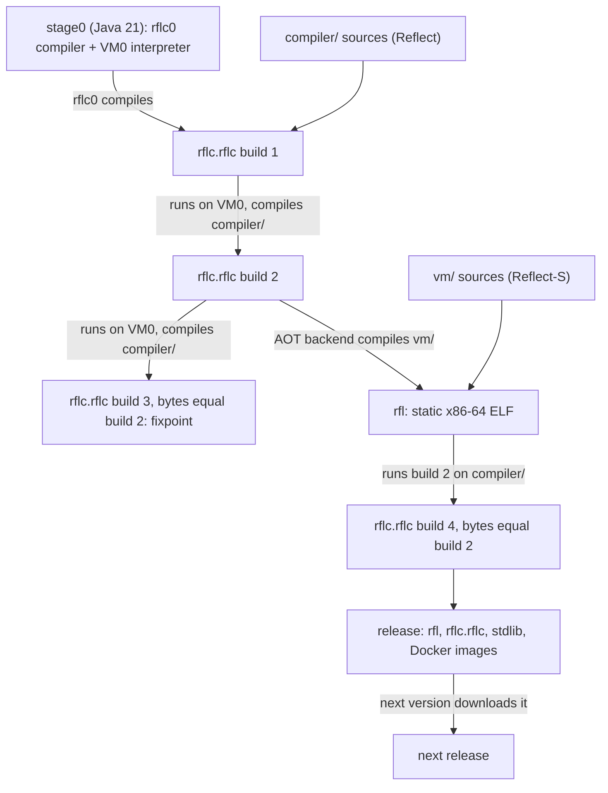
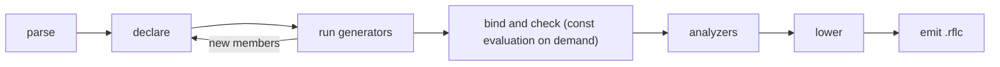
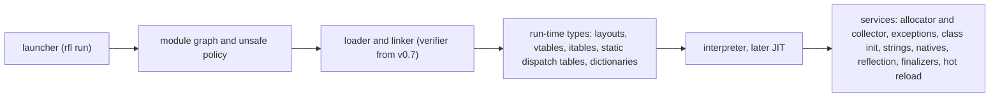

# Reflect sketchpad

Working document for the Reflect language: the intent behind each decision, the rules the
examples leave implicit, how each feature is implemented, and the open questions. It feeds the
later documents (bootstrapping, architecture, bytecode, VM, memory, JIT/AOT, reflection, type
system, Lean 4 model) and changes freely until those exist.

- Inputs: [design-proposal.md](design-proposal.md) (requirements), [examples.md](examples.md)
  (syntax baseline, cited as **ex §N**), [references.md](references.md) (prior art).
- One home per topic: syntax shown in examples.md is cited, not repeated. Code here shows rules,
  edge cases and lowerings that the examples do not.
- Code fences follow examples.md: `csharp` is Reflect, `text` is bytecode or console output.

## Progress log

| Part | Content | Status |
|---|---|---|
| 0 | Conventions | done |
| A | Housekeeping: dead references, errors, deviations from the proposal | done |
| B | Questions and answers | Q01 to Q34 answered |
| C | Requirements traceability, document plan | done |
| D | Language design, area by area | done (D.1 to D.18) |
| E | Implementation: bootstrap, compiler, bytecode, VM, GC, JIT/AOT, reflection, stdlib, tests, Lean, roadmap | done (E.1 to E.11) |
| F | Glossary | done |

## 0. Conventions

Every rule carries a status:

- **[Invariant]** proposal requirement, not up for debate.
- **[Decided]** settled by examples.md or by an answer in Part B.
- **[Proposed]** my recommendation; it stands unless you object.
- **[Open]** waiting for an answer; the question ID points into Part B.

Rules are numbered `AREA-nn` (for example `SVD-03`), questions `Qnn`. The IDs used in
examples.md and references.md (`F31`, `SV4`, `G1`, ...) have no register (A.2) and are not reused.

| Prefix | Area | Prefix | Area |
|---|---|---|---|
| `LEX` | lexical structure, grammar | `EXC` | exceptions |
| `MOD` | modules, namespaces, visibility | `FUN` | lambdas, functional interfaces |
| `TYP` | types, subtyping, inference | `META` | annotations, generators, const, analyzers |
| `NUL` | null safety, arrays | `REFL` | reflection |
| `NUM` | primitives, numerics, strings | `UNS` | unsafe code, natives |
| `STM` | statements, expressions | `CON` | concurrency, async |
| `MEM` | classes, members, properties, events | `BOOT` | bootstrapping, R0, Reflect-S |
| `SVD` | static virtual dispatch | `BC` | module file, bytecode |
| `GEN` | generics, reification | `VM` | virtual machine |
| `OPR` | operators | `GC` | memory management |
| `DAT` | structs, records, enums, sealed types, tuples | `JIT` | JIT, AOT |
| `LIB` | standard library | `TST` | testing |
| `LEAN` | formal model | `CMP` | compiler pipeline |

## A. Housekeeping

Nothing in examples.md or references.md was edited except the Q12 change (A.6) and the wording of
the Reflect-S entry in references.md (lines 62 and 63, same line count); these lists are for you
to fix or delete. Line numbers refer to commit `00d6207`. The Q12 change added one line after
line 611, so in the current examples.md add 1 to every line number above 611.

### A.1 Links to missing documents or sections

examples.md has no §13 (its contents list stops at 12) and links four files that do not exist.

| examples.md line | Reference | Where the topic lives now |
|---|---|---|
| 635 | `see §13` (jagged arrays) | D.4 |
| 1700 | `see §13` (imports of generated files) | D.15 |
| 1764 | `see §13` (field shorthand) | D.15 |
| 2068 | `see §13` (const arrays) | D.15 |
| 2958 | `see §13` (enum `==`) | D.12 |
| 2965 | `see §13` (undeclared enum values) | D.12 |
| 3471 | `see §13` (`->` is the lambda arrow) | D.17 |
| 2858 | `[architecture §6](architecture.md#6-dependency-rules)` | E.8 (layering of `reflect.core`) |
| 2912 | `[scratchpad §9.3](../scratchpad.md#93-enums-d-s18)` | D.12 (this sketchpad is a different file) |
| 3062 | `[grammar §4](grammar.md#4-ambiguities-and-how-they-are-resolved-p)` | D.1 |
| 3104 | `[reflection §1](reflection.md#1-api-surface-reflectmeta)` | D.16 |
| 3566 | `(reflection §3)` (generator options) | D.15 |

### A.2 Decision IDs without a register

| File and line | ID | Context |
|---|---|---|
| examples 1472 | `F2` | `String` implements `Equatable<String>` |
| examples 1473 | `F97` | primitives implement `Equatable` |
| examples 2310, 3574 | `R0` | bootstrap language subset; defined in BOOT-02 |
| examples 2452 | `F39–F41` | threads after v1.0 |
| examples 2572 | `O3` | no implicit conversions |
| examples 2872 | `S18`, `F1` | records |
| examples 3091 | `V8` | finalizer as a safety net |
| examples 3096 | `F52` | a destroyed object is not null |
| examples 3351 | `[P name]` | `$receiver` |
| examples 3392, 3421 | `[P shape]` | lowered events and captures |
| examples 3563 | `B6`, `F42`, `F43` | deterministic builds, confined generator IO, depfile |
| references 8 | `G1` | reified generics with shared and specialized code |
| references 15 | "Featherweight Reflect" | core calculus; defined in E.10 |
| references 23 | `F31` | wildcard restrictions |
| references 38 | `SV4` | late static binding |
| references 45 | `R4` | one reflection API, two implementations |
| references 48 | `F10` | quasi-quotes |
| references 63 | "Reflect-S" | Reflect as the VM's modules use it, defined in BOOT-08; the entry no longer says "subset translated to C" |
| references 77 | `V2` | stack versus register bytecode |
| references 87 | `F17`, `F51` | baseline JIT |
| references 101 | `V7` | alternatives to borrow checking |
| references 103 | `F39` | memory model |
| references 112 | `F-4` | mechanized VM model |
| references 120 | `F49` | custom operators |

Status markers in examples.md use six spellings: `[Prosposal shape]` (1700, typo),
`[Proposed shape]` (1893), `[Proposed API]` (2037), `[Proposal API]` (3241), `[Proposal syntax]`
(3311, 3462) and `[Proposal keyword]` (3438). A single `[Proposed]` would match the tag used here.

### A.3 Leftovers of removed references

- A space before punctuation where an ID was cut: lines 95, 344, 523, 811, 956, 1083, 1645, 1794,
  2008, 2353, 2894, 2912, 2982, 2983, 3106, 3171, 3208.
- An empty comment: line 2421 (`GC.collect(); //`).
- 159 lines end in spaces, mostly comments that lost an ID.
  `sed -i 's/[[:space:]]*$//' docs/examples.md` removes them; review with `git diff`.

### A.4 Errors and inconsistencies in examples.md

1. Line 2738: `println(Object.referenceEquals);` has no arguments. Intended:
   `println(Object.referenceEquals(s1, s2)); // prints: false`.
2. Lines 152 and 1956: namespace `demo.tools` exists in module `demo` (Blocks.rfl) and in module
   `demo.tools` (AutoToString.rfl), and `demo` requires `demo.tools` (line 46). Q13 forbids split
   namespaces, so the block needs another name (A.6).
3. Line 1035: the rule is undecided ("error, or `Shapes<?>` with a warning").
4. Lines 1805, 1847, 1853: `classWide` is declared and read, but `ObservableGenerator` (ex §6.3)
   ignores it and always raises `propertyChanged`.
5. Lines 2395, 2405: `reflect.core.Natives.alloc/free` are public, so any module can double-free.
   They belong behind `unsafe` (D.17, Q18).
6. Line 3064: "9.6 Missing" is a placeholder title for destructible objects. The block has no
   `// file:` line and mixes declarations with statements, and `T extends class & Destructible`
   repeats the kind (`Destructible` is already a class).
7. Line 2310: "catching by type argument (not in R0)", yet `Throwing.retry` above it already
   catches `E`. Either `retry` is not R0 or the note is wrong.
8. Line 51: `unsafe; // Raw access to pointers (?)`. The flag also gates proxies, emit and reading
   annotation instances (ex §6.1, §10.4, §10.5); see D.17.
9. ex §6.5, last sentence: "`const`-ness may also be applied to `enums`" has no example; D.15
   proposes a meaning.

### A.5 Deviations from the design proposal

| Proposal | examples.md | Question |
|---|---|---|
| Item 8: `@Property`, `value.onValueChanged().addListener(x -> ...)` | `@Observable` generator; `valueChanged` and `propertyChanged` events; listeners get `PropertyChange<T>` | Q14: examples kept |
| Item 9: "overriding assignment operators" | compound assignment operators and property setters; plain `=` is not overloadable | Q15: examples kept |
| Item 5 snippet: `void <K extends Kind> Function(K kind)`, `Value`, `string` | `function<K extends Kind>(K kind)`, lowerCamelCase members, `String` | Q16: examples kept |
| Item 6: "prefer a Rust model and avoid a GC" | tracing GC plus C# 11 ref safety; `Borrow` types open | Q05: examples kept |
| Item 4: eager JIT "requested by annotation" | only `@Inline` and `@ForceInline` (ex §6.6) | Q17: `@Precompile` added |
| Item 1: a minimal standard library may use external tooling, "C++ for example" | Java stage0 and VM0 only; the VM is Reflect-S compiled by `rflc` | Q01, Q19: no C or C++ |
| Item 2: "templating and generics day one" | reified generics; templating is the generators' quasi-quotes (ex §6.3) | none |

### A.6 Example changes the answers require

| examples.md | Change | Answer |
|---|---|---|
| §2.9 rejected block | added: `yield` in a block arm is an error (done) | Q12 |
| §2.2 Blocks.rfl, lines 152 and 157 | rename the `demo.tools` block, for example to `demo.measure` | Q13 |
| §6.5 line 2068 | `public const ReadOnlyArray<int> SMALL_PRIMES = { 2, 3, 5, 7 };` | Q27 |
| §8.3 `Accumulator` | `public mutating void operator +=(long x)` | Q24 |
| §8.5 line 2738 | `Object.referenceEquals(s1, s2)` (A.4 item 1) | none |
| §9.6 | title "Destructible objects", a `// file:` header, declarations apart from statements | Q26 |
| §2.1 `module demo` | drop `requires reflect.meta;`, add `requires reflect.meta.dynamic;` (proxies, emit, hot reload) | Q30 |
| §2.1 `reflect.lint`, §6.2 `reflect.observable` | drop `requires transitive reflect.meta;` (the namespace is in `reflect.core`) | Q30 |
| §10.4 to §10.6 | `import reflect.meta.dynamic;` for `Proxy`, `ModuleBuilder`, `HotReload` | Q30 |

## B. Questions and answers

Answer in chat, in the question prompts, or by editing the **Answer** lines. Answers become
[Decided] rules and are dated.

### B.1 Batch 1: foundations (answered 2026-10-19)

**Q01. What is the VM written in?** v1.0 must maintain itself (proposal item 1). ex §11.4 shows
VM code in Reflect (`vm/src/gc/Pages.rfl`), references.md then modeled "Reflect-S" on Squeak's
VM subset translated to C (reworded since), and the proposal allows C++ for the first runtime.
*Recommendation:* a C++ VM for v0.x, ported to Reflect-S and compiled ahead of time by `rflc`
before v1.0. **Answer:** "Whatever the most direct path is to not needing any external tooling
and will not require maintenance of another language toolchain, follow the Java model explicitly
- allowed to be very slow from the start if necessary to avoid tech debt." Reading, confirmed in
Q19: no C++ at any stage. Stage0 is a Java compiler plus a slow Java-hosted interpreter (VM0)
that runs the first `rflc`; the real VM is written in Reflect (Reflect-S, BOOT-08) and compiled
by `rflc`'s own x86-64 backend into a static ELF that calls Linux directly, so neither a C
toolchain nor libc is needed. See E.1.

**Q02. Which language is stage0 written in?** ex §12.3 uses "R0-shaped Java" transliterated once
into the first `rflc`. *Recommendation:* Java 21+. **Answer:** Java 21+. [Decided]

**Q03. How does a fresh checkout bootstrap after self-hosting?** *Recommendation:* commit a
portable seed (the `rflc` bytecode plus a prebuilt VM), as OCaml (`boot/`) and Zig (`zig1.wasm`)
do. **Answer:** download the previous release binary (Rust model); the first release is built
through the stage0 chain. See E.1.

**Q04. Which platforms must v1.0 support?** This drives the JIT/AOT backends, the natives and
whether pointer size can vary. *Recommendation:* Linux x86-64 first, 64-bit only.
**Answer:** Linux x86-64 only; Docker images for tooling and builds; Windows users run Reflect
through Docker. Pointers are 8 bytes and little-endian everywhere, so `sizeof` of a
pointer-holding struct is a constant (D.17, E.6).

**Q05. Memory model.** Proposal item 6 prefers a Rust model if feasible; the examples use a
tracing GC with C# 11 ref safety (ex §9.1) and leave `Borrow` types open. *Recommendation:* GC
plus ref safety; evaluate `Borrow` types after v1.0. **Answer:** as recommended. [Decided]

**Q06. Collector path.** *Recommendation:* non-moving mark-sweep, then Immix (mostly
non-moving, so pinning stays cheap), generational later. **Answer:** "Simple first GC for proven
implementation. Extensive changes will come later to improve performance / generational GC -
ensure we do not implement ourselves into a corner." So: a non-moving mark-sweep collector first,
with every hook a moving, generational collector needs present from day one (E.5).

**Q07. Threads.** ex §7.7 defers threads past v1.0. *Recommendation:* a single-threaded VM until
then, with class initialization, GC safepoints and the JIT designed for threads.
**Answer:** as recommended. [Decided] (D.18)

**Q08. Bytecode shape.** *Recommendation:* stack-based on disk like ex §11 (compact, easy to emit
and verify); the VM converts it to a register or quickened form for speed. **Answer:** as
recommended. [Decided] (E.3)

**Q09. Reified nullability.** ex §2.10 and §3.5 make `List<String>` and `List<String?>` distinct
run-time classes and check nullability on array stores. *Recommendation:* keep.
**Answer:** keep. [Decided] (D.4)

**Q10. Annotation instances.** Reading them needs `unsafe;` because they are proxies (ex §6.1).
*Recommendation:* the compiler generates one implementation class per annotation type; no proxy,
no `unsafe;`. **Answer:** deferred; proxies are not a commitment. Both options and their
consequences are in D.15. [Open]

**Q11. Non-null fields during construction.** A base constructor that calls an overridden method,
or an early `this` escape, can observe an unassigned non-null field. *Recommendation:* field
initializers run before `super(...)` (C# order), statements may precede `super(...)` (Java 25),
and early escapes warn. The VM null-checks every dereference, so memory safety does not depend
on this. **Answer:** Java/Kotlin order, warnings only. [Decided] (D.7)

**Q12. Value of a switch-expression block arm.** ex §2.9 uses `return`. *Recommendation:* Java's
`yield`; `return` inside a switch expression stays an error. **Answer:** "Use `return` and update
example, yield should be reserved for enumerator/iterator use later (C# model)." ex §2.9 now also
rejects `yield` in a block arm. [Decided] (D.1, D.6)

### B.2 Batch 2: language details (answered 2026-10-19)

Each question names the rule its answer settles.

**Q13 (MOD-04).** May two modules contain the same namespace? *Recommendation:* no, as Java.
**Answer:** no. [Decided]

**Q14 (MEM-17, META-04).** Proposal item 8: keep `@Observable` with generated `xChanged` and
`propertyChanged` events, or the proposal's `value.onValueChanged().addListener(...)`?
*Recommendation:* keep the events. **Answer:** keep the events. [Decided]

**Q15 (OPR-09).** Is overloading plain `=` required? *Recommendation:* no; setters and compound
assignment operators cover the uses. **Answer:** no. [Decided]

**Q16 (A.5).** Java naming (lowerCamelCase members, `String`) and type parameters after the
method name, as in the examples? *Recommendation:* yes. **Answer:** as in the examples. [Decided]

**Q20 (STM-06).** Iterators with `yield return`: before or after v1.0? *Recommendation:* after
v1.0, keeping v1 small. **Answer:** "Define what 'tree walks' mean in this context and how they
could be useful here? They would be a late stage feature at best (close to v1 release if
before)." Late feature, close to v1.0 at best [Decided]; STM-06 explains tree walks.

**Q21 (MEM-09).** Extension methods as a general feature with C#'s scoping? *Recommendation:*
yes. **Answer:** yes, with C#'s scoping. [Decided]

**Q22 (MEM-10).** Varargs syntax? *Recommendation:* Java's `Object?... args`. **Answer:** Java's syntax. [Decided]

**Q24 (DAT-02).** Methods called on read-only struct locations? *Recommendation:* Swift's
`mutating`, methods read-only by default. **Answer:** `mutating`. [Decided]

**Q25 (META-06).** Template hygiene? *Recommendation:* library names bind where the template is
written. **Answer:** as recommended. [Decided]

**Q26 (DAT-08).** Destructible objects: which accesses throw, and `destroy()` or
`Object.destroy(x)`? *Recommendation:* the guarded members of DAT-08 and a protected
`destroy()`. **Answer:** as recommended. [Decided]

**Q27 (META-07).** `const` arrays? *Recommendation:* a read-only type. **Answer:** a read-only type (META-07). [Decided]

### B.3 Batch 3: implementation (answered 2026-10-19)

**Q17 (JIT-03).** Annotation for eager compilation? *Recommendation:* `@Precompile`; otherwise
tier 1 compiles at a method's first call. **Answer:** as recommended. [Decided]

**Q18 (UNS-02).** What `unsafe` gates, and may the VM refuse unsafe modules?
*Recommendation:* the four rules of UNS-02. **Answer:** all four. [Decided]

**Q19 (BOOT-01).** Is the reading of Q01 in B.1 right? **Answer:** correct. [Decided]

**Q23 (MEM-16, GC-05).** Weak references in `reflect.core`? *Recommendation:* yes, plus a
weak-listener wrapper. **Answer:** as recommended. [Decided]

**Q28 (UNS-04).** Calling C libraries? *Recommendation:* after v1.0; it needs our own dynamic
loader because there is no libc. **Answer:** after v1.0. [Decided]

**Q29 (GC-04).** When do finalizers run? *Recommendation:* also after every `GC.collect()` and
at idle points the program declares. **Answer:** as recommended. [Decided]

**Q30 (LIB-02).** Where do `Class<T>`'s reflective members live? *Recommendation:* namespace
`reflect.meta` inside module `reflect.core` (Java's `java.base` model). **Answer:** as
recommended. [Decided] A.6 lists the example changes.

**Q31 (LEAN-05).** Is the Lean model a parallel track or a gate? *Recommendation:* parallel,
FR-core, FR-null and FR-static first. **Answer:** a gate: a rule ships only after its layer is
proven. [Decided] Q33 and Q34 set its scope.

**Q32 (E.11).** Roadmap; and should the first binary release come as soon as `rfl` runs `rflc`
(v0.6) so Java leaves earlier? *Recommendation:* yes. **Answer:** yes, v0.6. [Decided]

**Q33 (LEAN-05).** What does the gate apply to? *Recommendation:* v1.0 only: drafts may
implement and use rules before their proofs. **Answer:** as recommended. [Decided]

**Q34 (LEAN-05).** If a hard layer (FR-wild, FR-ref) lags, what goes into v1.0?
*Recommendation:* a smaller provable subset of each feature. **Answer:** as recommended.
[Decided]

<!-- questions:end -->

## C. Requirements and document plan

### C.1 Traceability

| # | Proposal requirement | Status | Designed in | Future document |
|---|---|---|---|---|
| 1 | Compiles itself soon; no outside tooling to maintain | Invariant | E.1, E.2, E.11 | bootstrapping.md |
| 2 | Reflection at run time and compile time; generics from day one | Invariant | D.9, D.15, D.16, E.7 | reflection.md, type-system.md |
| 3 | Java/C#-like syntax | Invariant | D.1 to D.14 | grammar.md |
| 4 | VM with custom bytecode; lazy JIT, AOT, inlining | Desired | E.3, E.4, E.6 | bytecode.md, vm.md, jit-aot.md |
| 5 | Static virtual dispatch | Desired | D.8, E.3, E.4 | type-system.md, vm.md |
| 6 | Memory safety | Desired | D.4, D.12, D.17, E.5 | memory.md |
| 7 | Annotations, functional interfaces, lambdas, callbacks | Invariant | D.10, D.14, D.15 | reflection.md |
| 8 | Generated methods, property dispatch | Invariant | D.10, D.15 | reflection.md |
| 9 | Operator overloading (custom operators under discussion) | Invariant | D.11 | type-system.md |
| - | v0.0.1 to v0.9.9 drafts, then a self-maintaining v1.0.0 | Invariant | E.11 | roadmap.md |

### C.2 Document plan

You asked for bootstrapping, architecture, bytecode, AOT/JIT, reflection, type system, VM and a
Lean 4 model. The rest of the list keeps each topic in one place.

| Document | Scope | Built from |
|---|---|---|
| `bootstrapping.md` | stage0 and VM0 in Java, R0, transliteration rules, fixpoint test, release chain, retiring Java, Docker images | E.1, E.11 |
| `architecture.md` | components, module layering and dependency rules, repository layout, tool commands | E.2, E.8 |
| `grammar.md` | lexical grammar, EBNF, disambiguation, reserved words | D.1 |
| `type-system.md` | types, subtyping, conversions, inference, null safety, generics, static virtual rules, wildcards, ref safety, operators, exhaustiveness | D.2 to D.14 |
| `bytecode.md` | module file, metadata tables, signatures, instruction set, `.rfla` syntax, verification rules | E.3 |
| `vm.md` | loader, run-time types, object layout, dispatch, interpreter, exceptions, class initialization, natives, hot reload | E.4 |
| `memory.md` | allocator, collector, barriers, finalization, destructible objects, pinning | E.5, D.12 |
| `jit-aot.md` | tiers, x86-64 backend, baseline and optimizing JIT, AOT, boot image | E.6 |
| `reflection.md` | `reflect.meta`, both implementations, generators, analyzers, const evaluation, proxies, emit | D.15, D.16, E.7 |
| `stdlib.md` | modules, layering, natives | E.8 |
| `testing.md` | test file format, conformance suite, bootstrap and differential tests | E.9 |
| `formal-model.md` and `formal/` | Lean 4 model and proofs | E.10 |
| `roadmap.md` | milestones v0.0.1 to v1.0.0 | E.11 |

examples.md stays the home of examples; once a document exists, the sketchpad section it absorbs
shrinks to a link.

### C.3 Principles that settle conflicts

1. **Self-hosting first.** A feature lands after the compiler no longer needs to wait for it,
   unless the compiler itself needs it (E.1, R0).
2. **No hidden costs.** Conversions are explicit except widening and boxing, dispatch is
   non-virtual unless declared, identity comparison is asked for (`Object.referenceEquals`).
3. **Reified everything that has a meaning at run time.** Type arguments, nullability and
   intersections exist at run time; tuple element names and aliases do not.
4. **One API, two phases.** Reflection reads compiler symbols inside `rflc` and VM metadata in a
   program (ex §6.7).
5. **Deterministic builds.** Same inputs, same bytes: compile-time code is sandboxed, floating
   point is strict IEEE, nothing depends on hash or file-system order.
6. **No corners (Q06).** Precise GC maps, write barriers, handles and safepoints exist before a
   collector needs them; threads, moving GC and the optimizing JIT plug in later.
7. **Java first, C# where Java is weaker.** Java supplies modules, checked exceptions, sealed
   types, records, wildcards and `instanceof`; C# supplies properties, events, structs, ref
   safety, operators, unsigned types, reified generics and static abstract members; Delphi and
   Smalltalk supply class-level dispatch.

## D. Language design

Each section lists rules beyond what the examples show, then implementation notes and open
items. "Lowering" means the compiler's rewrite of a construct into simpler Reflect or bytecode.

### D.1 Lexical structure and grammar (LEX)

- **LEX-01 [Proposed]** Source files are UTF-8 (a BOM is ignored) with extension `.rfl`; each
  module root holds `module-info.rfl`; generator output uses `.g.rfl`. Line ends: LF, CRLF or CR.
- **LEX-02 [Proposed]** Identifiers follow Unicode UAX #31 (`ID_Start`, `ID_Continue`, plus `_`),
  compared after NFC normalization. `$` never appears in source; it is reserved for
  compiler-generated names (ex §11.3). A lone `_` is a discard, not an identifier.
- **LEX-03 [Decided]** Keyword classes:
  - Reserved: `abstract boolean break byte case catch char checked class const continue default
    do double else enum event explicit extends extern false final finally float for if
    implements import in instanceof int interface long namespace native new null operator out
    override private protected public ref return short sizeof stackalloc static struct super
    switch this throw throws true try ubyte uint ulong unsafe ushort using virtual void while`.
  - Reserved for later: `async await goto infix postfix precedence prefix synchronized volatile`
    (ex §7.6 to §8.6), `yield` for iterators (Q12), and `fixed` [Proposed] for pinning once the
    GC may move objects (Q06).
  - Contextual, keywords only in their position: `get set field value add remove var record
    sealed permits unsealed partial scoped mutating when where nameof quote member expr stmt`, and in
    `module-info.rfl` only: `module requires transitive exports opens to provides with uses main`.
- **LEX-04 [Proposed]** Comments are `//`, `/* */` (not nested) and `/** */` documentation
  comments. Unlike Java there is no Unicode-escape preprocessing: `\u` is meaningful only inside
  char and string literals.
- **LEX-05 [Proposed]** Literals:
  - Integers: decimal, `0x`, `0b`, with `_` between digits; suffixes `u` (uint), `L` (long), `UL`
    (ulong); lowercase `l` is rejected. An unsuffixed literal is `int` and must fit it, hex and
    binary included, so `0xFFFF_FFFF` needs `u` (ex §2.7 rejects `3_000_000_000`).
  - A constant converts implicitly to any integral type that holds its value (C#): `byte b = -1`,
    `ubyte ub = 255`, `new Rgb(255, 0, 0)` (ex §9.2).
  - Floating point: `1.5f` is float, `2.5e-3` and `2.5d` are double; no hex floats.
  - `char`: one UTF-16 code unit; escapes `\t \n \r \0 \\ \' \" \uXXXX`.
  - Strings: the same escapes plus `\u{1F600}` for any code point (stored as a surrogate pair).
  - Interpolation `$"...{expr}...{expr:format}..."` with `{{` and `}}`. A hole may contain string
    literals; a top-level `:` starts the format, so conditionals need parentheses (ex §2.8). No
    text blocks or raw strings in v1; `"""` is reserved.
- **LEX-06 [Decided]** The lexer never produces `>>`, `>>>`, `>>=` or `>>>=`. It emits single `>`
  tokens flagged "adjacent to the previous token" and the parser joins them in expression
  context, so `List<List<int>>` closes two type-argument lists (ex §12.1).
- **LEX-07 [Proposed]** Disambiguation rules, taken from C# where the syntax matches:
  1. After a well-formed type-argument list, the next token decides: one of
     `( ) ] } : ; , . ? == != | ^ && || & [ ::` means type arguments (`max<int>(3, 4)`,
     `Box<int>.count`), anything else means relational operators.
  2. `(X) e` is a cast when `X` is a primitive type, or when `X` parses as a type and the next
     token is an identifier, literal, `(`, `!`, `~` or a keyword that starts an expression.
     `(a) - b` stays a subtraction; `(int) -b` is a cast.
  3. A parenthesized list followed by `->` is a lambda parameter list (ex §9.5).
  4. `(a, b)` is a tuple, `(a)` a parenthesized expression, `(int, String) x` a tuple-typed
     declaration.
  5. An intersection after `instanceof` must be parenthesized (ex §3.8).
  6. In a statement, `A<B> c;` and `int* p;` are declarations (try declaration first).
  7. `T?` in a type position is nullable; after `instanceof T`, a `?` followed by an expression
     and `:` is the conditional operator.
  8. `~Name(` starts a finalizer only in member-declaration position.
- **LEX-08 [Decided]** A switch-expression block arm gives its value with `return` (ex §2.9);
  `yield` stays reserved for iterators (Q12, Q20).

Grammar sketch for `grammar.md` (EBNF, abbreviated; `?` optional, `*` repetition):

```text
CompilationUnit = Import* ( FileNamespace TypeDecl* | ( NamespaceBlock | TypeDecl )* ) ;
FileNamespace   = "namespace" QualifiedName ";" ;
NamespaceBlock  = "namespace" QualifiedName "{" Import* ( NamespaceBlock | TypeDecl )* "}" ;
Import          = "import" "static"? QualifiedName ";"
                | "using" Ident TypeParams? "=" Type ";" ;
TypeDecl        = Annotation* Modifier* ( ClassDecl | InterfaceDecl | StructDecl | RecordDecl
                | EnumDecl | AnnotationDecl ) ;
ClassDecl       = "class" Ident TypeParams? ( "extends" Type )? ( "implements" Types )?
                  ( "permits" Types )? Where? Body ;
StructDecl      = "struct" Ident TypeParams? ( "implements" Types )? Where? Body ;
RecordDecl      = "record" "struct"? Ident TypeParams? "(" Params? ")" ( "implements" Types )? Body ;
EnumDecl        = "enum" Ident ( ":" IntegralType )? "{" Constants ( ";" Member* )? "}" ;
MethodDecl      = Annotation* Modifier* Type Ident TypeParams? "(" Params? ")"
                  ( "throws" Types )? Where? ( Block | ";" ) ;
TypeParams      = "<" TypeParam ( "," TypeParam )* ">" ;
TypeParam       = Ident ( "extends" Bound ( "&" Bound )* )? ;
Bound           = "class" | "struct" | Type ;
Where           = "where" Ident "extends" Bound ( "&" Bound )* ( "," Ident "extends" ... )* ;
Type            = ( PrimitiveType | QualifiedName TypeArgs? | TupleType ) ( "[" "]" | "*" | "?" )* ;
TypeArgs        = "<" TypeArg ( "," TypeArg )* ">" ;
TypeArg         = Type | "?" ( ( "extends" | "super" ) Type )? | "(" Type ( "&" Type )+ ")" ;
```

`throws` precedes `where`: `void f<T>(T x) throws IOException where T extends Comparable<T> { }`.

### D.2 Modules, namespaces, visibility (MOD)

- **MOD-01 [Decided]** A module is one `.rflc` file: the unit of compilation, versioning, access
  and the `unsafe` capability. Directive meanings (ex §2.1):

  | Directive | Meaning |
  |---|---|
  | `requires M;` | M is readable at compile time and run time |
  | `requires transitive M;` | modules that read this one also read M |
  | `requires static M;` | compile time only: annotation types, generators, analyzers; optional at run time |
  | `exports N;` | public types of namespace N are accessible to readers |
  | `opens N;`, `opens N to M;` | every member of N is reflectively accessible (to M only) |
  | `provides S with I, J;` | service providers: a `public static S provider()` or a public parameterless constructor |
  | `uses S;` | the module looks up providers of S |
  | `unsafe;` | the module may contain unsafe code (D.17) |
  | `main C;` | default entry class for `rfl run` |

- **MOD-02 [Proposed]** `reflect.core` is required and its namespace imported implicitly (as
  `java.lang`), which is why the examples use `String`, `Math`, `GC` and `Span` without imports.
- **MOD-03 [Proposed]** The module version comes from the build manifest and is written into the
  `.rflc` header (ex §11.1 `.module demo 0.1.0`). `requires` carries no version range; the module
  path supplies exactly one module per name, and a `requires` cycle is an error.
- **MOD-04 [Decided, Q13]** A namespace belongs to exactly one module, as Java forbids split
  packages, so package-private access, `opens` and namespace-wide reflection stay well defined.
  Blocks.rfl (ex §2.2) must rename its `demo.tools` block (A.6).
- **MOD-05 [Proposed]** Namespace segments must start with a lowercase letter (an error, not a
  convention), and type names should start with an uppercase one (a warning). In `a.b.C.d`,
  the parser then knows where namespaces end without symbol tables, which Java cannot do.
- **MOD-06 [Proposed]** Lookup of a simple type name, innermost first:
  1. type parameters of enclosing members and types;
  2. nested types of enclosing types, inherited ones included;
  3. types of the current namespace (all files of the module), then of each enclosing namespace
     by name prefix, in both file-scoped and block form (C#; ex §2.2 shows `Units` found from
     `demo.geometry`);
  4. aliases and imports of the enclosing namespace blocks, then of the file;
  5. `reflect.core`; 6. the global namespace.

  Two imports providing the same name are an error only where the name is used. A type that
  hides a name from an outer step warns (ex §2.2 `Scratch`). Lookup ignores accessibility, so a
  found but inaccessible type is an error rather than a fallback (ex §2.2 `Draft`).
- **MOD-07 [Decided]** `import static T;` imports all static members of `T`; aliases
  (`using A<X> = ...;`) are scoped to their file or namespace block, never exported, and erased
  at compile time (ex §2.2 rules: no alias in a target, every parameter used, bounds checked at
  each use, `?` only for a parameter used once).
- **MOD-08 [Decided]** Visibility (ex §2.3): `public`; `protected` (subclasses plus the same
  namespace in the same module, as Java); package-private (same namespace, same module);
  `private` (the top-level type and everything nested in it). A public type in a namespace that is
  not exported is module-internal. Overrides may not reduce visibility; accessors never exceed
  their member.
- **MOD-09 [Proposed]** Entry and exit (ex §2.4, §7.5): `main` comes from the descriptor or
  `--main`; it returns `void` (exit code 0) or `int`. An uncaught exception prints its stack trace
  to stderr and exits with 1. Before exit the VM runs one full collection and drains the
  finalizer queue once.
- **MOD-10 [Open]** Modules created or loaded at run time (emit, hot reload, plugins) need a
  container with its own resolution, like Java's `ModuleLayer`. Needed by v0.6 (ex §10.4, §10.5).

### D.3 Types, subtyping, conversions, inference (TYP)

- **TYP-01 [Decided]** Kinds of types:

  | Kind | Examples | Stored | Nullable form |
  |---|---|---|---|
  | reference: class, interface, array, record, annotation | `String`, `List<T>`, `int[]`, `Point3` | heap, by reference | `T?`, same representation, distinct at run time |
  | value: primitive, struct, record struct, enum, tuple | `int`, `Vec2`, `Rgb`, `Color`, `(int, String)` | inline | `T?`, a wrapper with a has-value flag |
  | ref struct | `Span<T>` | stack only | none |
  | pointer (unsafe) | `int*`, `PageHeader*` | inline | `null` is a valid pointer |
  | type parameter | `T` | by kind | `T?` needs a kind (`class` or `struct`) |
  | intersection | `Runnable & Retryable` | reference | none |
  | wildcard | `? extends Shape` | type arguments only | none |

- **TYP-02 [Proposed]** Subtyping, the relation the Lean model and the VM's cast check implement:

  ```text
  T <: T                         S <: T and T <: U  =>  S <: U
  class C<X> extends D<U>        =>  C<T> <: D<U[X := T]>   (likewise implements)
  T <: T?                        S <: T  =>  S? <: T?        (reference types only)
  null <: T?                     T <: Object <: Object?     (T a non-null reference type)
  S <: T, both reference types   =>  S[] <: T[]  and  S[] <: T?[]   (checked stores)
  T[] <: Array
  A & B <: A,  A & B <: B        S <: A and S <: B  =>  S <: A & B
  T <: U  =>  C<T> <: C<? extends U>        L <: T  =>  C<T> <: C<? super L>        C<T> <: C<?>
  (int count, String label)  ≡  (int, String)          (element names are not part of the type)
  ```

  Value types are not subtypes of `Object`; they convert to it by boxing. `int` to `int?` is a
  wrapping conversion, `String` to `String?` is subtyping.
- **TYP-03 [Decided, details Proposed]** Conversions:
  - Implicit: identity, subtyping, numeric widening (D.5), constant narrowing that fits (LEX-05),
    boxing to `Object`, `Object?` or an implemented interface, value-type wrapping `T` to `T?`,
    `null` to any nullable type, element-wise tuple conversion, lambda or method reference to a
    functional interface.
  - Explicit (a cast): numeric narrowing, unboxing, reference narrowing (`ClassCastException`),
    user-defined `explicit operator` (ex §8.1), enum to and from its backing type (D.12), pointer
    casts (D.17). A cast of `null` to a non-null type throws `NullPointerException` (NUL-05).
  - Never: user-defined implicit conversions (ex §8.1), implicit narrowing, `long` with `ulong`.
  - A boxed value's class is the value type's class: `((Object) 42).getClass() == int.class`.
- **TYP-04 [Proposed]** Overload resolution follows C#'s "better function member": a conversion
  is better when it is identity, then subtyping, then numeric widening, then boxing. Ties go to
  the non-generic candidate, then the one with more specific parameters, then the non-variadic
  form; anything still tied is an ambiguity error. Type arguments are inferred per candidate
  first.
- **TYP-05 [Decided]** Inference (ex §3.6) picks among candidates and never synthesizes a type:
  1. Collect bounds: lower bounds from argument types, exact bounds from `ref`/`out` arguments
     and invariant positions. Lambdas wait until their parameter types are fixed (C#'s phases).
  2. Fix each variable: the candidates are its lower bounds plus the target type; the result is
     the candidate every lower bound converts to (`pick(1, 2L)` is `long`). None or several is an
     error that asks for explicit type arguments.
  3. Nullability is part of the bounds: `List.of("a", null)` is `List<String?>`.
  4. The one exception is a `throws` type parameter: its bounds are joined into an intersection
     (ex §3.8), or `RuntimeException` when the body throws nothing checked (ex §7.3).

  Diamonds (`new ArrayList<>()`) take arguments from the target or the constructor arguments;
  `var` takes the initializer's type, intersections included.
- **TYP-06 [Proposed]** Type checking is bidirectional and local (Dunfield, Krishnaswami): every
  expression is checked against an expected type or synthesizes one; there is no whole-program
  inference.
- **TYP-07 [Decided]** No hiding anywhere. Redeclaring an inherited member's signature without
  `override` is an error (ex §2.5), as is redeclaring a non-virtual one; a new parameter list
  adds an overload. A name is a field, property, event, nested type or method group, never two
  of them (ex §2.5 `describe`).

### D.4 Null safety and arrays (NUL)

- **NUL-01 [Decided, Q09]** Nullability is reified: for reference types, `T` and `T?` are distinct
  run-time types. `List<String>` and `List<String?>` are two classes sharing code, array stores
  check element nullability, and reflection reports it (ex §2.10, §3.5).
- **NUL-02 [Decided]** Types are non-null unless written `T?`. Operators: `a?.b` (short-circuits
  the rest of the chain; `nick?.length` is `int?`), `a ?? b`, `a ??= b`, postfix `a!` (throws
  `NullPointerException` on null), and `x == null`, which every type allows (ex §4.7).
  [Proposed] additions: `a?[i]`, and `throw` as the right operand of `??`.
- **NUL-03 [Decided, details Proposed]** Flow analysis narrows `T?` to `T`:
  - Subjects: locals, parameters, `final` fields of `this` (stable), and other fields of `this`
    until the next call, assignment or event raise (ex §2.8). Nothing longer than `this.f` is
    tracked.
  - Conditions: `x != null`, `!(x == null)`, `x instanceof T t`, `x ??= e`, a completed `x!`,
    `if (x == null) { return; }`, short-circuit `&&` and `||`, and patterns in `switch`.
  - A local that a lambda assigns is never narrowed (Kotlin's rule); loops are solved to a
    fixpoint.
- **NUL-04 [Decided, Q11]** Construction follows Java: `super(...)` runs first, then field
  initializers in textual order, then the rest of the constructor.
  Every path must definitely assign each non-null field without an initializer, each `final`
  field exactly once and each get-only auto-property (ex §2.8 `Person`). Warnings, not errors,
  flag the remaining holes: calling an overridable method on `this` in a constructor, and letting
  `this` escape (argument, field of another object, lambda capture) before all non-null fields
  are assigned. A field read in such a case yields `null` and the next dereference throws; memory
  safety holds because the VM checks every dereference.
- **NUL-05 [Proposed]** Run-time checks where static guarantees end:
  - A cast of `null` to a non-null type throws `NullPointerException`; to `T?` it succeeds.
  - `instanceof` is false for `null`, even against a nullable type, so pattern variables are
    never null.
  - Generic code: `(T) o` checks non-null when `T` is instantiated with a non-null type.
  - Reflection: `Field.set`, `Method.invoke` and constructors reject `null` for a non-null target
    with `IllegalArgumentException`; reflective results are typed `Object?`.
  - Array stores of `null` into non-null element arrays: `ArrayStoreException` (ex §2.10).
- **NUL-06 [Proposed]** Generics and null:
  - An unconstrained `T` has the implicit bound `Object?` and may be instantiated with nullable
    types (`Box<String?>`), so members of a `T` value need narrowing first; `T extends Object`
    or any non-null bound allows direct use.
  - `T extends class` admits only non-null reference types and `T extends struct` only non-null
    value types; `T?` means the nullable form of either (ex §3.1).
  - `default(T)` needs `T extends struct` (ex §3.3); `default(T?)` is `null`.
- **NUL-07 [Decided, details Proposed]** Arrays:
  - Type suffixes read left to right: `String?[]` is an array of nullable strings, `String[]?` a
    nullable array, `int[]?[]` an array of nullable `int[]` (ex §2.10, the jagged case of line
    635), `int?[]` an array of `int?` values.
  - `new T[n]` needs a zero value: value types (all zero bits) or nullable references.
    `new String[n]` and `new int[][n]` are errors; use an initializer, `Array.filled(n, v)` or a
    nullable element type.
  - Reference arrays are covariant (`Square[] <: Shape[]`, `String[] <: String?[]`) and every
    store checks the exact element type, nullability included; value-type arrays are invariant.
  - `Span<T>` over an array requires its exact element type, otherwise writes through the span
    would bypass the store check; a mismatch throws `ArrayStoreException` (ex §2.10).
  - Lengths are `int`; indexes are checked (`IndexOutOfBoundsException`). No rectangular
    `int[,]` arrays in v1. Every array type extends `reflect.core.Array`.

```csharp
// rejected
String[][] grid = new String[][3];         // error: elements would start as null; use new String[]?[3]
static String show<T>(T x) { return x.toString(); }   // error: T's bound is Object?; narrow x or bound T
```

### D.5 Primitives, numerics, strings (NUM)

- **NUM-01 [Decided]** Primitives are structs of `reflect.core` with keyword aliases (ex §2.7
  confirms `int` as `Int32`; the other names are [Proposed]):

  | Keyword | Struct | Bytes | Keyword | Struct | Bytes |
  |---|---|---|---|---|---|
  | `boolean` | `Boolean` | 1 | `uint` | `UInt32` | 4 |
  | `byte` (signed) | `Int8` | 1 | `long` | `Int64` | 8 |
  | `ubyte` | `UInt8` | 1 | `ulong` | `UInt64` | 8 |
  | `short` | `Int16` | 2 | `float` | `Float32` | 4 |
  | `ushort` | `UInt16` | 2 | `double` | `Float64` | 8 |
  | `char` (UTF-16 unit) | `Char` | 2 | `int` | `Int32` | 4 |

  No `decimal` and no pointer-sized integer: the only target is 64-bit (Q04), so unsafe code uses
  `long` and `ulong`. Numeric primitives implement `Equatable`, `Comparable`, `Parsable`,
  `Addable` and `Number` (ex §3.1, §4.6, §4.7).
- **NUM-02 [Decided]** Binary numeric promotion, C#'s rules:
  1. `double` if either operand is `double`, else `float` if either is `float`;
  2. `ulong` if either is `ulong` and the other unsigned; a signed operand is an error unless it
     is a non-negative constant (ex §2.7 rejects `1L + 1UL`);
  3. `long` if either is `long`, or if one is `uint` and the other signed (ex §2.7: `i + ui`);
  4. `uint` if either is `uint`; otherwise `int` (`byte + byte` is `int`, ex §4.6).
- **NUM-03 [Decided, details Proposed]** Integer arithmetic wraps; `checked(e)` and `checked { }`
  trap on `+ - * ++ --`, unary `-` and narrowing casts with `ArithmeticException` (ex §2.7). The
  context is lexical and does not reach into called methods. Also:
  - Integer division by zero always throws; `int.MIN_VALUE / -1` wraps unchecked and throws
    checked. `%` truncates toward zero.
  - Shift counts are masked to the operand width; `>>` is arithmetic for signed operands and
    logical for unsigned ones; `>>>` is always logical.
  - Float-to-integer conversion saturates and maps NaN to 0 unchecked (Java); checked, it throws.
  - Inside `checked`, a user-defined `operator checked +` wins over `operator +` (ex §4.6).
- **NUM-04 [Proposed]** Floating point is strict IEEE 754: round-to-nearest-even, no fused
  multiply-add except `Math.fma`, no extended precision. `==` follows IEEE (`NaN != NaN`,
  `0.0 == -0.0`); `equals` compares bits after canonicalizing NaN (Java). `Math` is written in
  Reflect rather than calling a host libm, so `const` evaluation inside the compiler (D.15) and
  run time produce identical bits.
- **NUM-05 [Decided, details Proposed]** Strings:
  - `String` is a final, immutable sequence of UTF-16 code units; unpaired surrogates are allowed.
    `length` is a property; `charAt(i)` and the indexer `s[i]` return a `char`.
  - `==` compares values because `String` declares `operator ==` (ex §8.5); identity needs
    `Object.referenceEquals`.
  - `+` concatenates and converts the other operand with `String.valueOf(Object?)`.
  - Literals are interned by the VM; strings work as `switch` constants.
  - Interpolation lowers to appends on a stack-allocated builder; format specifiers follow .NET
    custom numeric formats (`{pct:0.0}`) and are always culture-invariant, for determinism.
  - The VM may store Latin-1-only strings one byte per unit (Java's compact strings); programs
    cannot tell.

### D.6 Statements and expressions (STM)

- **STM-01 [Decided]** Java's statements: blocks, local declarations (`var`, `final`), `if`,
  `while`, `do`, classic `for` (one shared variable), enhanced `for` (a fresh variable per
  iteration), labeled `break` and `continue`, arrow-only `switch`, `try`/`catch`/`finally` with
  multi-catch, try-with-resources, `throw`, `return`, plus `checked { }` and `unsafe { }`.
- **STM-02 [Decided, details Proposed]** `switch` (ex §2.9, §9.4):
  - Arrow arms never fall through; `case A, B ->` lists constants; `default ->` and `throw` arms.
  - Case constants: integral, `char`, `String`, enum constants and `const` fields.
  - Patterns with `when` guards; an arm dominated by an earlier one is an error.
  - Switch expressions must be exhaustive (enums, sealed hierarchies, or `default`); switch
    statements only when they use patterns (Java 21).
  - `case null ->` is allowed for a nullable selector; without it a null selector throws
    `NullPointerException`; for a non-null selector it is an error.
- **STM-03 [Decided, Q12]** A switch-expression block arm returns its value with `return` and
  must end in `return e;` or `throw` on every path. A `return` there never leaves the method, and
  `break` or `continue` may not jump out of a switch expression. The arm compiles inline: its
  `return` jumps to the join point carrying the value.
- **STM-04 [Decided, details Proposed]** Enhanced `for`, in order of preference:
  1. arrays: an indexed loop that reads `length` once;
  2. any type with an accessible `iterator()` (instance or extension method) whose result has
     `boolean hasNext()` and `T next()`, matched by name, so a struct iterator never boxes
     (C#'s struct enumerators with Java's method names, ex §2.9, §3.7);
  3. otherwise `Iterable<T>`.

  An iterator that implements `AutoCloseable` is closed when the loop exits (C#).

  ```csharp
  // lowered: for (String s : list) { body }
  var $it = list.iterator();          // a struct iterator stays on the stack
  while ($it.hasNext()) {
      final String s = $it.next();    // fresh per iteration, which is what lambdas capture
      body
  }
  ```

- **STM-05 [Decided, details Proposed]** Expressions:
  - Evaluation is left to right: operands before operators, arguments in order; a compound
    assignment evaluates its target once (ex §8.3).
  - Special forms: `nameof(x)` (a constant string), `sizeof(T)` (D.17), `default(T)`, `T.class`,
    `checked(e)`, `x::m`, lambdas, switch expressions, `throw` in switch arms.
  - Patterns: type patterns `T t`, record patterns `R(P1, ..., Pn)` (nested), with [Proposed]
    `var x` and `_` inside record patterns. Pattern variables follow Java's flow scoping:
    `if (!(o instanceof T t)) { return; } use(t);`.
  - Tuples: literals `(a, b)`, deconstruction `var (lo, hi) = range(xs);` and [Proposed]
    assignment `(x, y) = (y, x);`.
  - Not in v1 unless asked: object initializers, collection literals, `with` expressions, local
    functions, catch filters.
- **STM-06 [Decided, Q20]** Iterators (C# model) are a late feature, close to v1.0 at best:
  `yield return e;` and `yield break;` in a method returning `Iterable<T>` or `Iterator<T>`,
  lowered to a state-machine class like `async` (D.18).

  What "tree walks" meant: much of `rflc` visits trees (syntax trees, bound trees, lowering
  passes, analyzers such as ex §6.4's `m.body.calls`). An iterator lets a recursive traversal
  hand out nodes one at a time:

  ```csharp
  public static Iterable<Node> descendants(Node root) {
      yield return root;
      for (Node child : root.children) {
          for (Node d : descendants(child)) { yield return d; }
      }
  }

  for (Node n : descendants(body)) {             // the lambdas of a method body, found lazily
      if (n instanceof LambdaNode l) { lower(l); }
  }
  ```

  Without iterators the same walk builds a full `List<Node>` first, or needs a visitor class,
  or a hand-written iterator with an explicit stack. Iterators save code, not capability, and
  nested `yield` costs time proportional to the depth per node, so `rflc` can do without them.

### D.7 Classes, interfaces, members (MEM)

- **MEM-01 [Decided]** Member kinds: fields, `const` fields, methods, constructors, static
  initializers, properties, indexers, events, operators, conversion operators, finalizers and
  nested types. [Proposed] No instance initializer blocks, local classes or anonymous classes:
  field initializers, constructors and lambdas cover their uses.
- **MEM-02 [Decided]** Instance methods, properties, indexers and events are non-virtual unless
  declared `virtual` or `abstract`, and non-virtual calls compile to direct calls (ex §2.5).
  Overriding needs `override`, implementing an interface member too (ex §2.6); `final override`
  stops further overriding; a `final` class has no subclasses. [Proposed] Overrides may narrow
  the return type of methods and get-only properties, instance and static alike (ex §4.2).
- **MEM-03 [Decided]** Interfaces hold abstract methods, properties and events (implicitly
  `public abstract`), `default` methods, private methods, static methods and static abstract or
  virtual members (D.8), plus [Proposed] `const` fields; never instance fields. Default-method
  conflicts (ex §2.6): a class member wins, then the unique most specific default, otherwise
  the class must override; `Named.super.label()` names a parent and `super.label()` works when
  exactly one parent provides the member. [Proposed] No explicit interface implementation (C#'s
  `String Named.label()`) in v1; one override serves both interfaces, as in Java.
- **MEM-04 [Decided]** Nested types never capture an outer instance and see the private members
  of their enclosing types (ex §2.5).
- **MEM-05 [Decided]** `final` fields are assigned once; `const` fields are compile-time
  constants and implicitly static (D.15); a static field has one storage per class, or per
  instantiation for generic classes (D.9).
- **MEM-06 [Decided, details Proposed]** Constructors use Java's syntax and chaining:
  `this(...)` or `super(...)` comes first, an omitted call means `super()`, and a class without
  constructors gets a public parameterless one (or forwarders for inherited virtual
  constructors, SVD-06). Static field initializers and `static { }` blocks run in textual order,
  once per class or per instantiation, before first use (E.4). If they throw, the first use gets
  `ExceptionInInitializerError` and later uses get a new one with the same cause. A static
  initialization cycle behaves as in Java (the nested request sees default values, possibly
  `null` in a non-null static); the compiler warns about cycles it can see within a module.
- **MEM-07 [Decided, details Proposed]** `Object` declares virtual `equals(Object?)`,
  `hashCode()` and `toString()`, the final `getClass()`, typed `Class<? extends T>` for a
  receiver of static type `T`, and `static boolean referenceEquals(Object?, Object?)`. No `wait`,
  `notify`, `clone` or `finalize`; finalizers are `~C()` (E.5).
- **MEM-08 [Decided, Q11]** Construction order and its warnings: NUL-04.
- **MEM-09 [Decided, Q21]** Extension methods are a general feature (ex §2.10: `asSpan<T>(this
  T[] array, ...)`, called as `numbers.asSpan(2, 5)`; STM-04 uses them). C#'s rules: they are
  static methods whose first parameter says `this`; they are in scope where their declaring
  class's namespace is imported or the class statically imported; instance members always win.
- **MEM-10 [Decided, Q22]** Variadic parameters use Java's syntax, `Object?... args`: last
  parameter only, typed as an array, and the expanded form loses ties (TYP-04). They serve
  `invoke(null, 2, 3)` (ex §10.5) and `List.of("a", 1, "b")`.
- **MEM-11 [Proposed]** No default parameter values or named arguments in v1 (annotations keep
  their named elements): both complicate overload resolution and binary compatibility.

### D.8 Static virtual dispatch (SVD)

Proposal item 5. Statics follow Smalltalk's metaclass idea without metaclass objects: every
static access has a **receiver class** and virtual statics dispatch on it.

- **SVD-01 [Decided]** Static methods, properties and (in interfaces, ex §4.6) operators can be
  `virtual`, `abstract`, `override` or `final override`; constructors can be `virtual`.
  [Proposed] Static operators in classes may be virtual too; static events cannot.
- **SVD-02 [Decided]** The receiver class `R` comes from the syntax of the access:

  | Access | `R` | Example (ex §4.1, §4.2, §4.5) |
  |---|---|---|
  | `C.m`, a class name | `C`, fixed at compile time | `Kind.value` is `NO_KIND` |
  | `e.m`, an instance expression | run-time class of `e`; `null` throws | `kind.value` |
  | `T.m`, a type parameter | the reified type argument | `K.value` |
  | `k.m`, a `Class<? extends C>` value | the class `k` refers to, unless `Class<T>` has a member `m` | `k.value` |
  | unqualified `m` in an instance member | `this.getClass()` | `Probe.fromInstance()` |
  | unqualified `m` in a static member | the caller's `R`, forwarded | `Kind.describe()` |
  | `super.m` in a static override | the parent's implementation, same `R` | `SubProbe.value` |

  A virtual static resolves to the most-derived implementation visible from `R`.
- **SVD-03 [Decided]** Non-virtual static methods also receive `R`, so `Cube.describe()` runs
  `Kind.describe` with `R = Cube` and its unqualified `value` reads `CUBE_KIND` (late static
  binding, PHP's `static::`).
- **SVD-04 [Decided]** Storage (ex §4.3): a class declaring `static override` on an
  auto-property owns storage; other subclasses share the nearest overrider's. Each generic
  instantiation owns all of its statics.
- **SVD-05 [Decided]** Restrictions (ex §4.2, §4.4):
  1. no hiding: a static named like an inherited one must be a `static override` of a virtual or
     abstract static;
  2. settable overrides keep the exact type; get-only ones may narrow it;
  3. `final static override` ends overriding;
  4. a concrete class implements every inherited `static abstract`;
  5. a `static abstract` read through a class name is a compile error; at run time an `R` that
     lacks the implementation throws `AbstractMemberError`;
  6. a type with unimplemented static abstracts cannot be a type argument when the parameter's
     bound has static abstracts (C# 11);
  7. [Proposed] a warning when a static method is called through a class name that leaves static
     abstracts unimplemented, since `Polygon.summary()` otherwise fails only at run time.
- **SVD-06 [Decided]** Virtual constructors (Delphi):
  - `public virtual Kind(int size)` declares a constructor slot; `override Cube(int size)`
    re-declares it.
  - A subclass without constructors inherits every virtual constructor through a synthesized
    `override Sphere(int size) { super(size); }`, so its own field initializers still run.
  - A subclass that declares any constructor overrides every inherited virtual one (ex §4.5
    `Pyramid`).
  - `new K(x)` (bound declares the constructor) and `k.create(x)` build an instance of `R`. An
    abstract `R` throws `InstantiationError`; a statically known abstract class is an error.
  - [Proposed] No C#-style `new()` constraint: a parameterless virtual constructor in the bound
    serves.
- **SVD-07 [Decided]** When a static and a member of `Class<T>` share a name, `k.x` means the
  `Class<T>` member and the static's declaration gets a warning (ex §4.5).
- **SVD-08 [Proposed]** Static members declared in interfaces dispatch through `R` like class
  statics: `T.zero`, `provider.type.kindName` and `shape.kindName` work; `Shape.kindName` is an
  error while abstract. A default method reading an abstract static sees the implementing class:

  ```csharp
  public interface Tagged2 {
      static abstract String kindName { get; }
      default String tag() { return $"<{kindName}>"; }   // R = this.getClass()
  }
  ```

- **SVD-09 [Proposed]** `R` is passed by the VM's calling convention, not as a declared parameter.
  ex §11.1 gives only static methods of non-final or generic classes a hidden first argument, so
  making a class non-final would change the signature of all its static methods and break
  compiled callers. E.3 keeps `R` out of signatures: `call C::m` passes `C`, and `call.recv C::m`
  takes `R` from the stack.
- **SVD-10 [Proposed]** Lambdas and method references capture what they need to find `R`:
  `() -> k.value` reads `k`'s class when it runs, `k::create` binds the class value, and an
  unqualified static inside a lambda in a static method captures the method's `R`.

Implementation (E.4): next to its vtable, every run-time type has a static dispatch table with
one slot per static virtual member and virtual constructor. Abstract slots hold stubs that throw
`AbstractMemberError` or `InstantiationError`. A `Class<T>` value points at its run-time type, so
`k.value` is one indirect call.

### D.9 Generics and reification (GEN)

- **GEN-01 [Decided]** Classes, interfaces, structs, records and methods can be generic. Type
  parameters follow the method name (C# position) and use Java's bounds: kinds `class` and
  `struct` first, then at most one class, then interfaces, joined with `&`; `where` clauses add
  bounds after the parameter list (ex §3.1).
- **GEN-02 [Decided]** Every instantiation is its own run-time class, with its own statics,
  static initialization, `Class<T>` object and nullability (ex §3.1, §3.5). Tuple element names
  and aliases do not exist at run time.
- **GEN-03 [Decided]** Operations that need reification and are legal on type parameters
  (ex §3.3, §7.3): `T.class`, `instanceof T`, `(T) o`, `catch (E e)`, `new T(...)` through a
  virtual constructor (SVD-06), `new T[n]` for element types with a zero value, `default(T)`,
  `T.m` (D.8), and `getClass()` returning the exact instantiation.
- **GEN-04 [Decided]** Variance is use-site only: `?`, `? extends T`, `? super T` (Java) in the
  types of fields, parameters, locals and results, in nested type arguments, casts and
  `instanceof`, where the VM checks each argument (ex §3.3). Wildcards are never instantiated
  and never direct supertype arguments. [Proposed] No declaration-site `in`/`out` (C#, Kotlin);
  expressions of wildcard type go through Java's capture conversion.
- **GEN-05 [Decided]** ex §3.7 adopts the four restrictions of Tate, Leung and Lerner
  (inheritance, parameter, intersection, equivalence) plus Java's rule against wildcard
  supertype arguments, so subtyping is decidable in the compiler and in the VM's casts.
  type-system.md must copy the formal statements from the paper; the Lean model proves the
  implemented algorithm terminates under them (E.10); if that proof lags, v1.0 limits wildcards
  to a proven fragment (LEAN-05). [Proposed] The undecided case of ex §3.7
  (`Shapes<? extends Object>` where the bound is `Shape`) is an error with a fix-it to
  `Shapes<?>`.
- **GEN-06 [Decided]** Intersections (ex §3.8): at most one class component and it comes first;
  the VM sorts the interface components by qualified name, so `Runnable & Retryable` and
  `Retryable & Runnable` are one run-time type. They appear in type arguments, casts,
  parenthesized `instanceof`, and as inferred types of `var` and `throws` parameters, never as
  declared types of fields, parameters or locals.
- **GEN-07 [Proposed]** Generic virtual methods (`R accept<R>(Visitor<R> v)` overridden in
  subclasses) are allowed. They dispatch through a per-class cache keyed by method and type
  arguments, since one vtable slot cannot hold every instantiation (as in the CLR). `rflc` itself
  can avoid them by switching over sealed hierarchies.
- **GEN-08 [Proposed]** Instantiation is lazy, so polymorphic recursion such as
  `void f<T>(int n) { if (n > 0) { f<List<T>>(n - 1); } }` works under the interpreter and JIT;
  the AOT compiler falls back to shared code with run-time dictionaries for instantiations it
  cannot enumerate (E.6). Expansion through inheritance
  (`class C<T> extends D<C<C<T>>>`) is rejected because loading the hierarchy would not
  terminate (ECMA-335 §II.9.2).
- **GEN-09 [Decided, details Proposed]** Implementation follows Kennedy and Syme:
  - Instantiations whose type arguments are all reference types share one body, nullability
    included; each combination of value-type arguments gets its own body.
  - Shared code finds exact type arguments through a type context: the run-time type of `this`
    for instance members, the receiver class for statics (D.8, which already carries the
    instantiation), and a hidden method-instantiation argument for generic methods (ex §11.1).
  - Each instantiation has a dictionary of lazily filled slots: derived types (`List<T>` becomes
    `List<String>`), method entry points, field offsets and sizes.
  - The interpreter runs value-type instantiations from the shared bytecode using the
    dictionary's layouts; the JIT specializes them (E.4, E.6).
- **GEN-10 [Decided]** Constraint violations are compile-time errors; reflective
  `instantiate` throws `TypeLoadError` (ex §7.8).
- **GEN-11 [Decided]** Generic exception classes are allowed and `catch` matches the exact type
  argument (ex §7.3), unlike Java.
- **GEN-12 [Proposed]** One canonical spelling of run-time type names serves reflection, error
  messages and `.rfla`: qualified names, arguments in angle brackets, `?` for nullability,
  intersections in parentheses (`reflect.collections.List<(reflect.core.Runnable &
  demo.generics.Retryable)>`), primitives by struct name (ex §3.3 prints
  `reflect.collections.List<reflect.core.Int32>`).

### D.10 Properties, indexers, events (MEM, continued)

- **MEM-12 [Decided, details Proposed]** Properties are C#'s (ex §5.1): accessors with `field`
  (C# 14) and `value`, auto and get-only auto properties (the latter assignable in
  constructors), computed properties, initializers, static, abstract, virtual, override,
  interface and partial properties (D.15). An accessor may narrow its accessibility, never widen
  it, and may declare `throws`. Properties are not variables: no `ref`, no `out`. Compound
  assignment and `++` call `get` then `set` and evaluate the receiver once. [Proposed] No `init`
  accessors in v1.
- **MEM-13 [Decided, details Proposed]** Lowering (ex §11.1): methods `get_X` and `set_X`, a
  property row in the metadata linking them, and a backing field `X$field` for auto properties
  and properties that use `field`. Declaring a method named `get_X` next to a property `X` is an
  error.
- **MEM-14 [Decided, details Proposed]** Indexers (ex §8.4): `this[...]`, overloaded by parameter
  types, may throw, lowered to `get_Item` and `set_Item`. `grid[x, y] ??= v` calls `get_Item`, then
  `set_Item` only when the result is null. No static indexers.
- **MEM-15 [Decided]** Events (ex §5.2, §11.3):
  - The event type is a functional interface. Field-like events get a compiler-generated listener
    list; custom events write `add` and `remove`; events can be static, abstract, interface
    members or overrides.
  - Outside the declaring class only `+=` and `-=` exist; only the declaring class raises.
    [Proposed] Subclasses raise through a protected method the class offers (C# convention).
  - A raise snapshots the listeners and runs each in subscription order. The first exception is
    rethrown after all listeners ran, later ones are attached as suppressed; an `Error` ends the
    raise at once, carrying earlier failures as suppressed. No listeners: nothing happens.
  - `-=` removes the last listener that `equals` the argument, so lambda and method-reference
    equality matters (FUN-05).
  - An event of a throwing functional interface raises under its `throws` clause (ex §5.2
    `Saver`).
- **MEM-16 [Decided, Q23]** Listener lists hold strong references, so a long-lived source keeps
  its subscribers alive (the classic C# leak). `reflect.core` provides `WeakReference<T>` and a
  weak-keyed table (GC-05), and the library offers a weak-listener wrapper, [Proposed]
  `ok.clicked += WeakListener.of(this, Window::onClick);`, which does nothing once its target is
  collected.
- **MEM-17 [Decided]** `@Observable` is a library generator over partial classes (D.15), not a
  language feature; it is how the examples meet proposal item 8 (Q14 covers the proposal's
  shape).

### D.11 Operators (OPR)

- **OPR-01 [Decided]** Overloadable (ex §8.1 to §8.4, §4.6):
  - unary `+ - ! ~ ++ --`;
  - binary `+ - * / % & | ^ << >> >>>`;
  - comparisons, declared in pairs: `==` with `!=`, `<` with `>`, `<=` with `>=`;
  - compound assignments `+= -= *= /= %= &= |= ^= <<= >>= >>>=` as instance methods returning
    `void` (C# 14);
  - `checked` variants of `+ - * / ++ --`, unary `-` and explicit conversions (C# 11);
  - `explicit operator` conversions; indexers (D.10).

  Never overloadable: `&& || ?: ?? ??= ?. = . :: instanceof new`, postfix `!`, implicit
  conversions (ex §8.1) and plain assignment (Q15).
- **OPR-02 [Decided, details Proposed]** Declarations are `public static` (compound assignments
  excepted), take at least one parameter of the containing type or its `T?`, and `++`/`--` take
  and return the containing type. [Proposed] `==`, `!=` and the ordered comparisons must return
  `boolean`, and declaring `==` without overriding `equals` and `hashCode` warns.
- **OPR-03 [Proposed]** Resolution (C#): the candidates are the user-defined operators of both
  operand types and their base classes, plus static abstract operators of type-parameter bounds
  (ex §4.6). If any is applicable, predefined operators are ignored; otherwise the predefined
  ones apply. Value-type operators lift to `T?`: `Vec2? + Vec2?` is `null` when either side is.
- **OPR-04 [Decided]** What `==` means (ex §4.7, §8.5):

  | Operands | `==` compares |
  |---|---|
  | numeric primitives | values, floats per IEEE |
  | `boolean`, `char`, enums | values |
  | `String` | values (declared operator) |
  | records and record structs | components (generated operator) |
  | tuples | elements, [Proposed] |
  | classes without `operator ==` | identity |
  | structs without `operator ==` | error |
  | type parameters | needs a bound declaring `==`, such as `Equatable<T>` |
  | anything with `null` | null test |

  Operators are static, so static types choose: two strings typed `Object` compare by identity
  (as in C#). [Proposed] A `reflect.lint` analyzer flags `==` on `Object` or interface operands.
- **OPR-05 [Decided]** Compound assignment (ex §8.3): an instance `operator op=` updates in
  place; without one, `x op= y` means `x = x op y` with `x` evaluated once. An in-place struct
  operator needs a variable (local, field, array element, `ref`), never a property result.
- **OPR-06 [Decided]** `x++` evaluates to the old value and stores `operator ++(x)`; `++x`
  evaluates to the new value (C#).
- **OPR-07 [Decided]** Generic math uses static abstract interface operators (ex §4.6); the
  numeric primitives implement them, and `byte`'s `Addable` wraps at 8 bits even though the
  predefined `+` promotes to `int`. The interface hierarchy itself is a stdlib task (E.8).
- **OPR-08 [Decided]** Custom operators come after v1 (ex §8.6, Swift's model). [Proposed] A new
  operator token must be a character sequence that is a syntax error today: `|>` qualifies, while
  `<-` does not (`x<-1` is valid now).
- **OPR-09 [Decided, Q15]** Plain `=` is not overloadable: references copy identity, struct copies
  are bitwise (the GC and JIT rely on that), and property setters already intercept assignment
  to members.

### D.12 Structs, ref safety, records, enums, sealed types, tuples, destructible objects (DAT)

- **DAT-01 [Decided, details Proposed]** Structs (ex §9.1) are values: copied on assignment,
  zeroed by `default(S)` and in new arrays, boxed when converted to `Object` or an interface,
  never extended (they may implement interfaces), never finalized (ex §7.5). Reference-typed
  fields must be nullable because zeroing makes them `null`. [Proposed] A constructor leaves
  unassigned fields at zero (C# 11), and a parameterless constructor cannot be declared, so
  `new S()` and `default(S)` are the same value.
- **DAT-02 [Decided, Q24]** Struct methods are read-only unless marked `mutating` (Swift). A
  read-only method may not assign fields of `this` or call `mutating` methods on it, and a
  `mutating` call on a read-only location (a `final` field, an `in` parameter, a property or
  method result) is an error, so the compiler never makes hidden copies. Constructors and
  in-place operators (`operator +=`, ex §8.3) assign `this`; the operators must say
  `mutating` (A.6). The flag is in the metadata and the verifier tracks read-only references.

  ```csharp
  public struct Tally {
      public int count;
      public mutating void increment() { count++; }
      public int peek() { return count; }        // assigning count here would be an error
  }
  final class Holder { public final Tally t = new Tally(); }
  // holder.t.peek() is fine; holder.t.increment() is an error: t is final
  ```
- **DAT-03 [Decided, details Proposed]** Ref safety follows C# 11 (ex §9.1): `ref`, `in` and
  `out` parameters (call sites repeat `ref` and `out`), `ref` returns and locals, `scoped`, and
  ref structs that never reach the heap (no boxing, no fields outside ref structs, no captures,
  no type arguments, no array elements). Escape rules (safe-context and ref-safe-context) reject
  dangling references. [Proposed] User-declared `ref struct` types with `ref` fields, so `Span<T>`
  is plain Reflect (`ref T start; int length;`), and `ReadOnlySpan<T>` for strings. A `ref` may
  point inside an object, which the collector must handle (E.5). `Borrow` types wait until after
  v1.0 (Q05). Under the Lean gate (LEAN-05), if FR-ref lags, v1.0 ships without `ref` returns,
  `ref` fields and `scoped`, and `Span<T>` stays implemented by the VM.
- **DAT-04 [Decided, details Proposed]** Records (ex §9.2): `record` is a class, `record struct`
  a value. Components become get-only properties and a canonical constructor that a compact
  constructor can validate; `equals`, `hashCode`, `toString` (`Point3[x=1, y=2, z=3]`), `==` and
  `!=` are generated; record patterns deconstruct them. [Proposed] Class records are implicitly
  final and extend nothing (Java), though they may implement interfaces.
- **DAT-05 [Decided, details Proposed]** Enums (ex §9.3):
  - Value types over an integral backing type (`int` by default); constants count from 0 unless
    given values.
  - [Proposed] `ordinal` is the declaration index and a cast gives the backing value:
    `Level.HIGH.ordinal` is 1 while `(int) Level.HIGH` is 200 (ex §9.3 only shows `Color`, where
    they coincide).
  - `name`, `valueOf(String)`, `values()` (a fresh array per call, as Java), exhaustive `switch`
    without `default`, `Comparable` by ordinal; `==` and `!=` compare backing values (the §13
    reference at line 2958). No ordered comparison operators.
  - Casting an undeclared value to a plain enum throws (line 2965); [Proposed]
    `ClassCastException`. A `@Flags` enum accepts any combination of declared bits and rejects
    other bits; its `toString` joins names (`"READ | WRITE"`). `@Flags` enums alone get bitwise
    operators and have no per-constant fields or bodies.
  - Because the value is only the backing integer, per-constant fields and bodies are lowered
    to static tables and a switch on the value:

    ```csharp
    // lowered: Planet.mass and Op.apply (ex §9.3) [Proposed shape]
    public struct Planet {
        private final int value$;                          // the whole enum value
        private static final double[] mass$ = { 3.303e+23, 5.976e+24 };
        public double mass { get { return mass$[ordinal]; } }
    }
    public struct Op {
        private final int value$;
        public int apply(int a, int b) {
            switch (value$) {
                case 0 -> { return a + b; }                // ADD's body
                default -> { return a * b; }               // MUL's body
            }
        }
    }
    ```

  - `const` and enums (A.4 item 9) [Proposed]: enum constants are constant expressions (in
    `const` fields, annotation arguments, `case` labels), and a `const` method of an enum may run
    at compile time on a constant receiver because per-constant data built from constant
    arguments is constant too. This answers the `(?)` at ex §9.3 line 2937:
    `public const double surfaceGravity()` folds `Planet.EARTH.surfaceGravity()`.
- **DAT-06 [Decided, details Proposed]** Sealed hierarchies (ex §9.4): `sealed` classes and
  interfaces list `permits`; every permitted subtype is `final`, `sealed` or `unsealed` (Java's
  `non-sealed`) and lives in the same module; switches and patterns check exhaustiveness.
  [Proposed] `permits` may be omitted when all subtypes are in the same file.
- **DAT-07 [Decided, details Proposed]** Tuples (ex §9.5) are value types
  (`reflect.core.Tuple2<T1, T2>` and so on, [Proposed] names) whose element names are metadata.
  They deconstruct, convert element-wise and [Proposed] compare element-wise with `==`;
  beyond 8 elements they nest (C#).
- **DAT-08 [Decided, Q26]** Destructible objects (ex §9.6, titled "Missing"):
  - `Destructible` is an abstract class the VM knows. [Proposed] Two header bits: *destroying*,
    set when `destroy()` starts so a nested call returns at once, and *destroyed*, set in the
    `finally`.
  - Guarded accesses throw `ObjectDestroyedException`: entry to any instance method or accessor
    declared in a `Destructible` subclass, and field accesses through a receiver other than
    `this`. Exempt: `destroyed`, and `Object`'s `equals`, `hashCode`, `toString` and
    `getClass`, so destroyed objects can still sit in collections and be logged. The cost is one
    header test per guarded access; the JIT removes repeated ones.
  - Destruction stays the protected `destroy()`, so each class decides who may destroy it.
    ex §9.6 should be titled "Destructible objects" (A.6).

### D.13 Exceptions (EXC)

- **EXC-01 [Decided]** Java's hierarchy: `Throwable` splits into `Exception` (checked, except the
  `RuntimeException` subtree) and `Error` (unchecked). Checking follows JLS 11.2 for methods,
  constructors, property and indexer accessors (ex §5.1, §8.4), event raises (ex §5.2) and lambda
  bodies against their target's `throws` (ex §7.3). Static and field initializers cannot throw
  checked exceptions.
- **EXC-02 [Decided]** Exception transparency (ex §7.3): a type parameter `E extends Exception`
  in a `throws` clause, inferred by TYP-05; `catch (E e)` matches the reified `E` and its
  subclasses; precise rethrow as in Java 7.
- **EXC-03 [Decided]** Exception classes may be generic, and `catch` tests their type arguments
  (ex §7.3 `ParseError<Json>`).
- **EXC-04 [Decided]** try-with-resources uses Java's translation (ex §7.4): resources close in
  reverse order, a failing `close()` becomes a suppressed exception, existing variables may be
  resources.
- **EXC-05 [Decided, kinds Proposed]** Exceptions the language and the VM raise (ex §7.8):

  | Exception | Kind | Raised by |
  |---|---|---|
  | `NullPointerException` | unchecked | dereferencing `null`, `x!`, casting `null` to a non-null type, `e.m` on a null `e` |
  | `ArithmeticException` | unchecked | integer division by zero, overflow under `checked` |
  | `IndexOutOfBoundsException` | unchecked | array and span indexes |
  | `ClassCastException` | unchecked | failed casts, undeclared enum values (DAT-05) |
  | `ArrayStoreException` | unchecked | covariant array stores, spans over covariant arrays |
  | `ObjectDestroyedException` | unchecked | guarded access to a destroyed object (DAT-08) |
  | `UndeclaredThrowableException` | unchecked | a proxy handler throws an undeclared checked exception (ex §10.4) |
  | `PhaseException` | unchecked | run-time-only reflection inside the compiler (ex §6.7) |
  | `DeterminismViolation` | error, [Proposed] | a nondeterministic call in compile-time code under `--deterministic` |
  | `InstantiationError` | error | a virtual constructor reached on an abstract class |
  | `AbstractMemberError` | error | an unimplemented static abstract reached through `R` |
  | `ExceptionInInitializerError` | error | a failing static initializer (MEM-06) |
  | `TypeLoadError` | error | missing types, constraint violations, invalid instantiations |
  | `StackOverflowError`, `OutOfMemoryError` | error | exhausted resources |
  | `InvocationTargetException` | checked | a reflectively called member threw (ex §7.8) |
  | `IllegalAccessException` | checked | reflective access denied (ex §10.3) |

- **EXC-06 [Proposed]** Stack traces are recorded when the exception is constructed (Java) as raw
  method and bytecode-offset pairs, and decoded to source lines only when printed.
- **EXC-07 [Proposed]** No catch filters in v1. A `finally` block runs on every exit from its
  `try`, including `break`, `continue` and `return`.

### D.14 Lambdas and functional interfaces (FUN)

- **FUN-01 [Decided]** Lambdas and method references convert only to functional interfaces (one
  abstract method; `@FunctionalInterface` is optional and checked when present) and always need
  a target type (ex §7.1). There are no delegate or function types.
- **FUN-02 [Decided]** `Function<String, int>` does not box: the generic interface instantiated
  over `int` has its own specialized code (GEN-09).
- **FUN-03 [Decided]** Captures (ex §7.2) take variables, not values (C#). A local that is
  captured and assigned moves to a heap display object shared by the method and its lambdas
  (ex §11.3). Enhanced-`for` variables are fresh per iteration and classic-`for` variables are
  shared. `ref`, `in` and `out` parameters, `ref` locals and ref struct values cannot be
  captured; instance lambdas capture `this`.
- **FUN-04 [Decided]** Method references (ex §7.1): static (`Lambdas::twice`), unbound instance
  (`String::trim`), bound instance (`this::greet`; for `expr::m` the receiver is evaluated once
  and a null throws at creation), constructor (`Cube::new`), class-value virtual constructor
  (`k::create`) and property getter (`Square::side`, from Kotlin). [Proposed] Array constructors
  (`int[]::new`).
- **FUN-05 [Proposed]** Equality, needed by event `-=` (MEM-15): two method references are equal
  when they name the same method and bound receiver (C# delegate semantics); a lambda equals only
  itself; non-capturing lambdas and static method references are cached per creation site.
  `clicked -= this::onClick` therefore removes what `clicked += this::onClick` added.
- **FUN-06 [Decided, details Proposed]** Lowering: each lambda or method reference becomes a
  synthesized final class implementing the interface, with fields for displays, `this` and the
  type context; inside generic code the class is generic over the enclosing type parameters. The
  VM needs no `invokedynamic`-like machinery. Names such as `Lambdas$lambda$1` exist only in
  metadata.
- **FUN-07 [Decided]** A lambda body throws only what the target method declares (ex §7.3).
- **FUN-08 [Decided]** The standard interfaces live in `reflect.functions` (ex §7.1). Reified
  generics make Java's primitive specializations (`IntFunction` and the rest) unnecessary.

### D.15 Annotations, generators, compile-time evaluation, analyzers (META)

- **META-01 [Decided, details Proposed]** Annotation types use Java's `@interface` (ex §6.1).
  Elements are methods with optional `default`s; [Proposed] element types are primitives,
  `String`, `Class<?>`, enums, annotations and arrays of those (Java). Retention is `SOURCE`,
  `CLASS` or `RUNTIME`, defaulting to `RUNTIME` (Java defaults to `CLASS`). Targets are Java's
  plus `PROPERTY`, and [Proposed] `EVENT`; no type-use annotations in v1. Arguments are constant
  expressions, `const` fields and methods included (ex §6.5). [Proposed] `@Repeatable` and
  `@Inherited` behave as in Java.
- **META-02 [Decided]** `hasAnnotation<A>()` reads metadata only; `getAnnotation<A>()` returns
  an instance or `null` (ex §6.1).
- **META-03 [Open, Q10]** How `getAnnotation` creates instances. Both options, as asked:

  | | A. Proxy (examples) | B. Generated class |
  |---|---|---|
  | Mechanism | a `Proxy` implementing `A`; its handler reads values from metadata | the compiler emits a hidden final `A$Impl` next to `A`: one field per element, constructor, `equals`, `hashCode`, `toString`; instances built from metadata and cached per element |
  | Before the verifier | readers must be `unsafe;` (ex §6.1, §6.2), since proxies are generated code | readers need nothing; the class is ordinary compiled code |
  | Speed | class generation on first use, handler dispatch and boxing on every element read | a field read |
  | Compile time | `rflc` must also build proxies over its own symbols | `rflc` builds `A$Impl` from symbol values directly |
  | Cost | none in modules; proxies exist anyway (ex §10.4) | one hidden class per annotation type |
  | Old modules | always work | a module compiled without `A$Impl` needs a fallback: the VM synthesizes it at load time (trusted generation, like A) |
  | Precedent | Java | C# (attributes are classes) |

  A hybrid is possible: B by default, A only for annotation types from modules compiled without
  `A$Impl`. Recommendation: B, not decided.
- **META-04 [Decided, details Proposed]** Generators (ex §6.2, §6.3):
  - A generator implements `ClassGenerator<A>`, lives in a module compiled earlier and is bound
    to `A` by `@GeneratedBy` on `A`. `rflc` loads it into the VM that `rflc` itself runs on
    (E.7); it never runs in its own module.
  - `generate(target, members, ctx)` runs once per partial class that has `A` on itself or on a
    member. It sees declarations, plus members added by generators ordered before it.
  - It only adds: members (`ctx.add`), interfaces (`ctx.addInterface`) and diagnostics. It never
    edits or removes code (Roslyn's model, not Lombok's).
  - Every part of a class says `partial`, and each partial member is completed by exactly one
    generator (ex §5.5).
  - Field shorthand (ex §5.3, the §13 reference at line 1764): in a partial class,
    `@Observable public int value = 1;` becomes `public partial int value { get; set; } = 1;`,
    and the annotations move to the property. A `final` field cannot be used this way.
  - Ordering: `@Generator(after = ...)` edges form a DAG; a cycle is an error. Unordered
    generators run in a fixed order (module, then qualified name) and must not read each other's
    output.
  - Generated code needs no imports because templates bind library names where they are written
    (META-06); `--emit-generated` prints qualified names. This settles the assumption at ex §5.4
    (line 1700).
  - Options: `-G observable.trace=true` (ex §12.2) reaches the generator as
    `ctx.option("observable.trace")` [Proposed API].
- **META-05 [Decided shape, Proposed details]** Templates (ex §6.3): `quote member { }`,
  `quote expr { }` and `quote stmt { }` produce `Template<Member>`, `Template<Expr>` and
  `Template<Stmt>`. A splice `${e}` inserts according to the static type of `e`:

  | Type of `e` | Inserted as | ex §6.3 |
  |---|---|---|
  | `Template<Expr>`, `Template<Stmt>`, `Template<Member>` | that syntax | `${sameValue(...)}` |
  | an `Iterable` of templates | the sequence | `${parts}` |
  | `Name` | an identifier | `${event}(change)` |
  | `Type`, `Class<?>` | a type reference | `${t}`, `${target}.class` |
  | `String`, primitives, enum constants | a literal | `getProperty(${f.name})` |

  Any other type is an error in the generator's source.
- **META-06 [Decided, Q25]** Hygiene. Templates use library names (`PropertyChange`, `Objects`)
  and names that exist only in the target (`field`, `value`, `propertyChanged`). A name that
  resolves at the quote's site to a type, namespace or static member binds there and is emitted
  fully qualified (as Rust's `$crate`); every other name resolves in the target;
  `ctx.freshName` makes collision-free locals. Generated code therefore never depends on the
  target's imports, the problem ex §5.4 ran into.
- **META-07 [Decided, details Proposed]** Compile-time evaluation (ex §6.5):
  - `const` methods call only `const` methods; `const` fields are static and evaluated by
    `rflc`; `nameof` and `sizeof` are constant; recursion limits, cycles and non-constant types
    are errors. `static final` stays a run-time constant.
  - [Proposed] Constant-pool types: primitives, `String`, `Class<?>`, enums and one-dimensional
    arrays of them (line 2068).
  - [Decided, Q27] `const` arrays have a read-only type, since a plain array would let
    `Tables.SMALL_PRIMES[0] = 1` change a constant. `ReadOnlySpan<T>` cannot be a field (it is a
    ref struct), so [Proposed] `reflect.core.ReadOnlyArray<T>`: a struct over an array with
    `length`, a get-only indexer, iteration and `asSpan()`. ex §6.5 becomes
    `public const ReadOnlyArray<int> SMALL_PRIMES = { 2, 3, 5, 7 };` (A.6). Annotation elements
    keep array types, and each read returns a copy (Java).
  - `rflc` compiles `const` methods to bytecode early (their dependency graph is known), loads
    them into a sandboxed loader of its own VM and runs them with fuel and recursion limits
    (E.7). Strict IEEE arithmetic and a Reflect-written `Math` (NUM-04) make the results equal to
    run time.
- **META-08 [Decided, details Proposed]** Analyzers (ex §6.4) implement `Analyzer<T>` for
  `Field`, `Method` and other members, report through `DiagnosticSink`, and read a read-only
  view of bound bodies. They are registered with `provides` and enabled by `requires static`.
  [Proposed] Codes `RFL0001` to `RFL0999` belong to the compiler (ex §12.1 `RFL0412`), `RFL1000`
  and up to analyzers (ex §6.4); `-W RFL1001=error` changes a severity.
- **META-09 [Decided, details Proposed]** Determinism: under `--deterministic`, generator IO is
  confined to declared inputs, which the depfile records (ex §12.2), and clocks, randomness,
  environment and network throw `DeterminismViolation`; run-time-only reflection throws
  `PhaseException`. [Proposed] Fuel and memory limits apply to all compile-time code.
- **META-10 [Proposed]** `@Inline` and `@ForceInline` (ex §6.6) are hints for the JIT and the AOT
  compiler. `rflc` does not inline across methods itself: that would break binary compatibility,
  hot reload and reflection's view of methods. The eager-compilation annotation of proposal
  item 4 is Q17.
- **META-11 [Proposed]** `@Observable(classWide = false)` (A.4 item 4) means the property raises
  only its own `xChanged` event and not `propertyChanged`; `ObservableGenerator` must read it.

### D.16 Reflection API (REFL)

- **REFL-01 [Decided]** One API, namespace `reflect.meta` (inside module `reflect.core`, Q30, next
  to `Class<T>`), has two
  implementations: compiler symbols at compile time and VM metadata at run time (ex §6.7), the
  mirror principle of Bracha and Ungar. `phase` tells them apart; operations that need a running
  program (`get`, `set`, `invoke`, `create`) throw `PhaseException` at compile time.
- **REFL-02 [Proposed]** Surface outline for reflection.md (ex §6, §10 show parts of it):
  - `Class<T>`: `name`, `kind` (`CLASS`, `INTERFACE`, `STRUCT`, `ENUM`, `RECORD`, `ANNOTATION`,
    `ARRAY`, `TUPLE`, `INTERSECTION`), `module`, `namespace`, `superclass`, `interfaces`,
    `typeArguments`, `genericDefinition`, `instantiate(...)`, nullable and non-null variants,
    member lists, lookups returning `null` when missing (hence the `!` in ex §10), annotations,
    `create(...)` for virtual constructors, `isInstance`, `cast`, `isAssignableFrom`.
  - Members: `Field`, `Property`, `Method`, `Constructor`, `Event`, `Parameter`, each with
    `name`, `declaringClass`, `reflectedClass` (the class it was looked up through, which becomes
    `R` for static calls, ex §10.1), modifiers, annotations, `generatedBy` (ex §6.7) and
    `implementationFor(Class)` (ex §10.1).
  - `Type` is the wider static-type mirror used by generators (ex §6.3: `f.type`,
    `t.isValueType`, `t.hasOperator("==")`); it also covers type parameters, wildcards and
    nullable forms, and `Class<T>` implements it.
  - A generic definition is a value (`ArrayList.class` is `ArrayList<>`, ex §3.4).
  - [Open, minor] `getMethod("add")` on an overloaded name (ex §10.2): proposed
    `getMethod(name, Class<?>... parameterTypes)`, with the name-only form throwing when the name
    is overloaded.
- **REFL-03 [Decided, details Proposed]** Access (ex §10.3): lookups find every member, private
  ones included; access is checked at use against the caller's module. Public members of
  exported namespaces are always accessible, everything in a namespace opened to the caller is
  too, the rest throws `IllegalAccessException` (checked). No `setAccessible`-style override.
  The VM identifies the caller from its frame (Java's caller-sensitive methods, E.7).
- **REFL-04 [Decided]** Static virtual members (ex §10.1): `Property.get(null)` and
  `Method.invoke(null, ...)` on statics use `reflectedClass` as `R`.
- **REFL-05 [Decided]** Proxies (ex §10.4): `Proxy.create<I>(handler)`, a handler declared
  `throws Throwable`, undeclared checked exceptions wrapped in `UndeclaredThrowableException`;
  `unsafe;` until the verifier (v0.6 to v0.7).
- **REFL-06 [Decided]** Emit (ex §10.5): `ModuleBuilder` drives the compiler's own bytecode
  writer (E.3) and `load()` creates a dynamic module in a new layer (MOD-10); `unsafe;` until the
  verifier, after which emitted code is verified like any other.
- **REFL-07 [Decided, details Proposed]** Hot reload (ex §10.6): `rflc delta` writes a
  `ModuleDelta`, and `HotReload.apply` accepts additions only in v0: fields (side storage for
  existing objects), methods, [Proposed] types, and replaced method bodies (running frames finish
  the old body). Removing members or changing a signature or base class is rejected. [Proposed]
  A delta is a module file flagged as a delta that names its base by content hash.

### D.17 Unsafe code and natives (UNS)

- **UNS-01 [Decided, details Proposed]** A module that declares `unsafe;` may contain unsafe code
  (ex §2.1, §11.4): pointer types `T*` over unmanaged types (primitives, pointers, structs without
  references), `unsafe { }` blocks and [Proposed] `unsafe` members, `*p`, `p[i]`, pointer
  arithmetic, `stackalloc`, casts between pointers and `long`/`ulong`, `&` of unmanaged locals
  [Proposed], and `extern` functions. `->` is the lambda arrow (line 3471), so members are
  reached with `(*p).next`; [Proposed] `p.next` also works, since `.` on a pointer has no other
  meaning (Go, Zig).
- **UNS-02 [Decided, Q18]** What `unsafe` gates. Today: pointers (ex §11.4), proxies and emit
  (ex §10.4, §10.5) and annotation instances (ex §6.1, Q10). Rules:
  1. `unsafe;` is needed to declare or call members with pointer types and to use `unsafe`
     blocks, `stackalloc` and `extern`;
  2. library members that can break memory safety without pointer types, such as
     `Natives.alloc` and `free` (A.4 item 5), are marked `@Unsafe` and need an unsafe caller;
  3. proxies and emit need it only until the verifier ships;
  4. the VM loads unsafe modules only when allowed (`rfl run --allow-unsafe demo`), so users see
     which modules can break memory safety.
- **UNS-03 [Decided]** `native` methods (ex §2.11) are declared in Reflect and implemented by the
  runtime, bound by qualified name and signature; only the stdlib has them in v0. After Q01,
  "native" means "provided by the runtime": Java methods in VM0, Reflect code inside the
  Reflect-S VM (E.4), never C.
- **UNS-04 [Proposed]** `extern static` (ex §11.4) binds a Linux system call, not a libc
  function, because Q01 rules out libc: `mmap` in `Pages.rfl` becomes a wrapper over syscall 9
  using the x86-64 syscall convention. [Decided, Q28] Calling C libraries (proposal: natives for
  "outside libraries") waits until after v1.0, since it needs a dynamic loader of our own; until
  then system calls cover files, sockets, time, memory and processes.
- **UNS-05 [Decided, Q04]** Pointers are 8 bytes, so `sizeof` is a compile-time constant for
  every unmanaged type (ex §11.4 `sizeof(PageHeader)` is 16). [Proposed] Struct layout is
  sequential with natural alignment, the size rounded up to the largest field alignment.
- **UNS-06 [Proposed]** Once the collector may move objects (Q06), a pointer into a managed object
  needs pinning: `fixed (int* p = &xs[0]) { }` (C#; `fixed` is reserved, LEX-03). Under the
  non-moving collector a pin costs nothing, but code must already use `fixed`.

### D.18 Concurrency and async (CON)

- **CON-01 [Decided, Q07]** One thread until after v1.0; `volatile`, `synchronized`, `async` and
  `await` are reserved (ex §7.6, §7.7).
- **CON-02 [Proposed]** Constraints that keep threads possible:
  - Java's memory model (Manson, Pugh, Adve) is the baseline, written down before threads ship.
  - Class initialization keeps JVMS §5.5's per-class states (not started, running, done,
    failed), with the running thread recorded.
  - Interpreter and compiled code poll for safepoints at loop back-edges and calls from the start
    (E.5).
  - Run-time state lives in one `Runtime` object, not in globals of the VM.
  - Collections and events are not thread-safe by default (Java).
  - [Open, post-v1] Lock model: ex §7.7 shows C#'s `Lock` objects with `synchronized`; locking
    only `Lock` objects keeps lock bits out of every object header. Recommendation: that model.
- **CON-03 [Decided, details Proposed]** `async` and `await` come after the preview as C#-style
  state machines (ex §7.6); iterators (STM-06) use the same lowering and can land first.

## E. Implementation

### E.1 Bootstrapping, R0 and Reflect-S (BOOT)

Goal (Q01): nothing outside Reflect to maintain. Java is the only other language, used for a
throwaway stage0, and it disappears once a release exists that later builds can download (Q03).



- **BOOT-01 [Decided, Q01, Q02, Q19]** Stage0 is Java 21+ and holds two programs: `rflc0`, a compiler
  for R0, and VM0, a slow bytecode interpreter. No C or C++ appears at any stage; the real VM is
  Reflect-S code that `rflc` compiles ahead of time to machine code (BOOT-08).
- **BOOT-02 [Proposed]** R0 is the subset that stage0 accepts and that `rflc` is first written in:

  | In R0 | Not in R0 (usable after BOOT-06 allows it) |
  |---|---|
  | modules, file-scoped namespaces, imports | namespace blocks, generic aliases |
  | classes, interfaces with default methods, `virtual`/`override`, nested types | static virtual members, virtual constructors |
  | generics with bounds and wildcards, reified by VM0 | intersections, generic virtual methods, generic exceptions and `catch (E e)` (ex §7.3) |
  | primitives, `String`, interpolation, arrays, nullability | unsigned types, structs, ref safety, `Span<T>`, tuples |
  | properties (auto and computed), simple enums, class records | events, operators, indexers, `@Flags`, per-constant enum bodies |
  | sealed types, `switch` with type patterns (ex §9.4) | record patterns, guards |
  | lambdas, method references, checked exceptions, try-with-resources | extension methods, iterators |
  | `const` over literals | `const` methods, annotations with generators, analyzers, `unsafe` |

- **BOOT-03 [Decided, details Proposed]** R0-shaped Java (ex §12.3) is Java written so that a
  mechanical transliterator can print Reflect. Mapping:

  | Stage0 Java | R0 |
  |---|---|
  | `package a.b;` | `namespace a.b;` |
  | a stage0 collections facade mirroring `reflect.collections` (`size()`) | `reflect.collections` (`size` property) |
  | `@Virtual` | `virtual` |
  | `@Override` | `override` |
  | `static final class Nested` | `final class Nested` |
  | `Integer`, `List<Integer>` | `int`, `List<int>` |
  | `a.equals(b)` on strings | `a == b` |
  | `yield v;` in a switch expression | `return v;` (Q12) |
  | `non-sealed` | `unsealed` |
  | `@Nullable T` (JSpecify), checked by stage0 | `T?` |
  | `@Property`-marked getter and setter pair [Proposed] | a property |
  | simple Java enums | value-type enums |

  Stage0 Java avoids inner and anonymous classes, raw types, streams, Java reflection, `==` on
  boxed values or strings, and enums with bodies. [Proposed] The transliterator uses the JDK's
  `com.sun.source.tree` API (no extra dependency) and is rerun until the switch-over, after which
  compiler work happens only in Reflect.
- **BOOT-04 [Proposed]** VM0 loads the same `.rflc` files as the real VM and interprets stack
  bytecode directly. It borrows the JVM's garbage collector (Reflect objects are Java objects),
  represents `String` as Java strings (both UTF-16), implements natives as Java methods, reifies
  generics with one run-time type per instantiation, and runs generators for as long as `rflc`
  runs on it. It has no verifier, JIT or pointer support. Target: compile `rflc` in minutes.
- **BOOT-05 [Proposed]** `rflc` output depends only on its inputs: sorted metadata tables, no hash
  or directory order, no timestamps or absolute paths, deterministic compile-time code (META-09).
  CI checks the fixpoint (build 2 equals build 3) and that `rflc` gives identical bytes on VM0
  and on `rfl`.
- **BOOT-06 [Proposed]** Feature staging (a simpler `cfg(bootstrap)`): `compiler/` may use a
  feature once the seed compiler supports it; the seed is the chain's latest `rflc` before the
  first release, the previous release after it. CI builds the compiler with the seed, then with
  itself, and both must succeed.
- **BOOT-07 [Decided, Q03]** A release publishes `rfl`, `rflc.rflc`, the stdlib modules and Docker
  images, and the next version builds from the previous release (Rust's model). The first
  release, v0.6 (Q32), has the native VM and ends the need for Java; stage0 is then tagged and
  deleted.
  [Proposed] For a trusting-trust audit (Wheeler), the tagged stage0 can rebuild one historical
  `rflc`, and replaying the chain from it must reproduce release bytes.
- **BOOT-08 [Decided, Q01, Q19; details Proposed]** Reflect-S is not a separate language, compiler
  or backend. It is ordinary Reflect as the VM's own modules use it, compiled by `rflc` like any
  module and turned into machine code by `rflc`'s x86-64 backend (JIT-01): no C step, no libc.
  Three things set it apart, all [Proposed]:
  1. The VM's modules declare `unsafe;` and use pointers and system calls (D.17).
  2. A VM-only analyzer checks regions marked `@Uninterruptible` (Jikes RVM's term): code
     reachable from the collector, allocator, stack walker and interpreter fast paths allocates
     no managed objects, throws nothing and has no safepoints. The loader, verifier, reflection
     and JIT use the whole language and the collector they implement.
  3. A few compiler intrinsics cover what pointers cannot express, such as reading the frame
     pointer for stack walks (Jikes RVM's "magic").

  Code using those pointers and intrinsics runs only as machine code inside `rfl`, since VM0 has
  no pointer support (BOOT-04); shared libraries such as `reflect.bytecode` stay plain Reflect.
  The name is historical: references.md once modeled it on Squeak's subset translated to C, while
  the models now are Jalapeño (Jikes RVM) and Maxine. The AOT compiler writes a boot image: the
  VM's code plus pre-built heap objects (its classes, strings, tables) in the ELF's data, so the
  VM starts without loading itself.
- **BOOT-09 [Proposed]** Repository layout:

  ```text
  stage0/    Java 21: rflc0, VM0, transliterator (deleted after the first native release)
  compiler/  rflc in Reflect: syntax, binding, lowering, emit, x86-64 backend, AOT
  vm/        the VM in Reflect-S: loader, interpreter, collector, JIT, syscalls, boot image
  stdlib/    reflect.core, reflect.collections, ... (E.8)
  tools/     rfla, rfld, test runner
  tests/     conformance tests in the ex §12.1 format
  formal/    Lean 4 project (E.10)
  docker/    build and runtime images
  docs/      design documents
  ```

### E.2 Compiler pipeline (rflc)



1. **Parse.** Each file becomes an immutable syntax tree that keeps every token and its trivia
   (comments, whitespace), with error recovery, so a formatter and a language server can reuse
   it later.
2. **Declare.** Symbols for the module, namespaces, types and members; partial parts merge;
   `module-info.rfl` resolves the module path; referenced modules are read lazily from their
   metadata.
3. **Complete lazily.** Supertypes, signatures and constraints are resolved when first needed
   (javac's completers), so declaration order never matters; cycles in inheritance, aliases and
   constants are reported here.
4. **Generators.** In DAG order (META-04), each generator runs on the VM `rflc` runs on; its
   templates are spliced, parsed and declared like source, and partial members are checked for
   exactly one completion.
5. **Bind and check bodies.** Name lookup, overload resolution, inference, lambda typing,
   patterns, then the flow analyses: definite assignment, nullability, checked exceptions, ref
   safety, reachability and exhaustiveness. Constants are folded and `const` methods evaluated
   on demand (META-07).
6. **Analyzers** read the bound trees and report (META-08).
7. **Lower** to a small core: accessors for properties, indexers and events; classes and
   displays for lambdas; loops for enhanced `for`; jump tables, type tests or `if` chains for
   `switch`; record and enum members; interpolation; try-with-resources; compound assignment.
8. **Emit** bytecode with stack maps, metadata tables and debug information, then write the
   module deterministically (BOOT-05). `rflc delta` diffs against a base module instead.

- **CMP-01 [Proposed]** The compiler's symbols implement `reflect.meta` directly (REFL-01), so
  generators and analyzers see compiler data without a copy. Stage0 has no generators, so this
  arrives with the first generator-enabled `rflc`.
- **CMP-02 [Proposed]** Diagnostics carry a code (`RFL0001` to `RFL0999`), a span and fix-its;
  the test format matches on code and position (ex §12.1).
- **CMP-03 [Proposed]** Single-threaded until threads exist (CON-01), but parse and declare work
  per file so they can run in parallel later.

### E.3 Module file and instruction set (BC)

- **BC-01 [Decided, Q08]** The bytecode is stack-based, like CIL; the VM turns each method into a
  register-based, quickened form on first execution (E.4).
- **BC-02 [Proposed]** The `.rflc` layout follows ECMA-335's metadata model:
  - header: magic `RFLC`, format version, flags (`unsafe`, `delta`), module name and version,
    SHA-256 of the contents;
  - heaps: identifiers (UTF-8), string literals (UTF-16LE, any code units), blobs (signatures,
    constants, annotation values) and code;
  - tables of rows, sorted for determinism: module, required modules, exports and opens,
    services, type definitions, type references, type specifications, fields, methods,
    parameters, generic parameters and constraints, interface implementations, explicit
    overrides (instance and static), member references, method instantiations, properties,
    events, accessors, annotations, constants, nesting, generator provenance, tuple element
    names, and per method: locals, exception regions, stack maps, line and local-name tables.
- **BC-03 [Proposed]** Signature blobs encode each primitive, class and value-type references,
  generic instantiations, class and method type parameters (`!0`, `!!0`), a nullable marker on
  reference types (a nullable value type is an instance of the nullable wrapper), single-dimension
  arrays, `ref`/`in`/`out` references, pointers, wildcards, canonical intersections and tuples
  (element names go in their own table). `scoped` is a parameter flag and `ref struct` a type
  flag.
- **BC-04 [Proposed]** Instruction families for bytecode.md. Arithmetic is typed like the JVM's,
  so the interpreter never inspects stack types (ex §10.5's `code.add(Type.INT)` is the emit API
  spelling of `add.i32`):

  | Family | Instructions |
  |---|---|
  | constants | `ldc.i4 ldc.i8 ldc.r4 ldc.r8 ldnull ldstr ldconst`; `ldtype T` (a class handle; `T` may be `!0` or `!!0`) |
  | locals | `ldarg starg ldarga ldloc stloc ldloca dup pop` |
  | arithmetic | `add sub mul div rem neg and or xor not shl shr` suffixed `.i32 .i64 .u32 .u64 .f32 .f64`, `shr.un`; checked `add.ovf.*` and the like |
  | conversions | `conv.<from>.<to>`, `conv.ovf.<from>.<to>` |
  | control | `br brtrue brfalse`, fused compare-and-branch `beq.* blt.* ...`, `switch` |
  | objects | `newobj`, `newobj.svirt` (virtual constructor of the class on the stack), `ldfld stfld ldflda`, `ldsfld stsfld ldsflda`, `getclass`, `instanceof T`, `castclass T` (nullability and wildcards included) |
  | value types | `box unbox ldobj stobj cpobj initobj sizeof` |
  | arrays | `newarr ldlen ldelem.* stelem.*` (reference stores check element type and nullability), `ldelema T` (exact type) |
  | calls | `call`, `call.recv`, `callvirt`, `call.svirt`, `call.constrained T`, `ldrecv`, `ret` |
  | exceptions | `throw rethrow leave endfinally` |
  | references | `ldind.* stind.*` |
  | unsafe only | pointer arithmetic, `localloc` (`stackalloc`), `syscall` (UNS-04) |

  Safepoints are implicit at calls, allocations and backward branches.
- **BC-05 [Proposed]** Receivers (SVD-09): `call C::m` on a static passes `C` as `R`;
  `call.recv C::m` pops a class handle (a subtype of `C`) and passes it; `call.svirt` pops one and
  dispatches through it; `ldrecv` pushes the current frame's `R`. ex §11.1 becomes:

  ```text
  .method public static reflect.core.String describe()
  {
      ldstr       "Kind: "
      ldrecv                                   // replaces ldarg $receiver
      call.svirt  demo.kinds.Kind::get_value()
      call        reflect.core.String::concat(reflect.core.String, reflect.core.String)
      ret
  }

      call        demo.kinds.Kind::describe()  // Kind.describe(): R = Kind, implicit
      ldloc       k
      getclass
      call.recv   demo.kinds.Kind::describe()  // k.describe(): R = run-time class of k
  ```

- **BC-06 [Proposed]** Instance calls into another module always use `callvirt`, which the VM
  turns into a direct call when the target is not virtual. Otherwise a library that later makes
  a method `virtual` would leave old callers silently bypassing overrides. Within a module,
  non-virtual calls stay `call`.
- **BC-07 [Proposed]** The verifier (v0.7, before which dynamic code needs `unsafe;`) is a
  type-checking verifier over stack maps (Leroy; Rose's lightweight verification): linear time,
  no inference. It checks stack and local types with exact generic types, object initialization
  before use, reference rules (no `ref` stored in the heap or returned past its frame), ref
  struct rules, access, `unsafe`-only instructions, handler structure, and `final`, `sealed` and
  `permits` at link time. It does not check nullability (dereferences are checked anyway) or
  checked exceptions (a source rule, as on the JVM).
- **BC-08 [Proposed]** `.rfla` maps one-to-one to the binary (ex §12.2 round trip), with
  directives `.module .requires .class .field .method .property .event .try .catch .finally`,
  labels and the canonical type names of GEN-12.
- **BC-09 [Proposed]** bytecode.md lists binary-compatible changes (adding members, interfaces
  with default methods, making a class non-final thanks to BC-05, making a method virtual thanks
  to BC-06) and breaking ones (removing or renaming members, changing signatures, adding a
  `static abstract`).

### E.4 Virtual machine (VM)



- **VM-01 [Decided, Q04]** Linux x86-64 only: one static ELF that calls the kernel directly, run
  natively or through Docker (including on Windows).
- **VM-02 [Proposed]** Object layout:
  - Header, two words: the run-time type pointer, then a word with GC bits (mark, plus bits
    reserved for age, forwarding and pinning), a lazily assigned 31-bit identity hash (never
    derived from the address, so objects can move), finalizable and finalized bits, and the
    destroying and destroyed bits (DAT-08). No lock bits (CON-02).
  - Fields: references first, then the rest by decreasing size, so the collector scans a count
    rather than a bitmap. Structs keep declared order (UNS-05).
  - Arrays: header, `int` length, elements; the array's run-time type carries the element type
    with its nullability. Strings: header, length, a Latin-1 or UTF-16 flag, inline data
    (NUM-05). Boxes: header and value.
- **VM-03 [Proposed]** A run-time type exists per class, per instantiation (nullability included)
  and per array type. It holds its identity (definition and type arguments), size and reference
  map, vtable, interface table, static dispatch table (D.8), static storage, initialization
  state (CON-02), dictionary (GEN-09), `Class<T>` object (created on demand, unique) and links
  into the metadata. Consequence of GEN-02: `Box<String>.count` and `Box<String?>.count` are two
  fields.
- **VM-04 [Proposed]** Dispatch: `callvirt` indexes the vtable; interface calls search the
  class's interface table and are cached per call site; `call.svirt` indexes the static dispatch
  table of the class handle. Call sites cache monomorphic, then up to four polymorphic targets
  (Hölzle, Chambers, Ungar); generic virtual methods use a per-type cache (GEN-07).
- **VM-05 [Proposed]** Interpreter:
  - On first execution a method is translated to a register form: every local and stack slot
    becomes a virtual register whose type the stack maps give (Shi et al.).
  - Instructions quicken after resolving their operands (`ldfld <token>` becomes
    `ldfld <offset>`, Brunthaler) and specialize to observed types (PEP 659).
  - [Open, minor] Dispatch technique: Reflect has no computed `goto` or guaranteed tail calls, so
    the interpreter loop is a `switch` that the AOT backend compiles to a jump table, unless the
    backend offers a threaded-dispatch intrinsic. Hot code moves to the JIT anyway.
  - Interpreted frames live on a VM stack of typed slots, scanned with stack maps; adapters
    connect interpreted and compiled frames. A guard page and a VM-stack limit raise
    `StackOverflowError`.
- **VM-06 [Proposed]** Exceptions unwind through tables: the interpreter searches each method's
  regions, compiled code has unwind tables, and catch types relative to the type context
  (ex §11.2 `.catch !!1`) are resolved through the frame's dictionary.
- **VM-07 [Proposed]** Class initialization is lazy, at first active use (JVMS §5.5): static
  field access through any receiver, static calls, instance creation, reflective use. Each
  instantiation initializes separately; superclasses first; an interface only when its own
  statics are touched.
- **VM-08 [Proposed]** Natives are VM functions registered by qualified signature at VM build time
  (UNS-03): console and file IO, memory mapping, time, exit, arguments, environment, all over
  system calls.
- **VM-09 [Proposed]** Reflection reads metadata tables mapped read-only from module files,
  decoded on demand; member mirrors are cached per run-time type.
- **VM-10 [Proposed]** Dynamic code: emit and proxies load in-memory modules into a new layer
  (MOD-10). Hot reload swaps the code pointer in a method's descriptor (every call goes through
  it or through a patchable stub), invalidates call-site caches and dependent compiled code, and
  keeps added fields of existing objects in a weak side table (ex §10.6, GC-05).
- **VM-11 [Proposed, later]** A pre-linked snapshot of the stdlib (like Java's CDS) for startup,
  and a debugger protocol (DAP) on top of interpreter single-stepping.

### E.5 Memory management (GC)

- **GC-01 [Decided, Q05, Q06]** Tracing collection. The first collector is non-moving,
  stop-the-world mark-sweep over size-class pages (ex §11.4 `Pages.rfl`), with a separate space
  for large objects.
- **GC-02 [Proposed]** Hooks present from day one, so the collector can become moving,
  generational and later concurrent without changing compiled code (Q06):
  1. Precise roots only: stack maps for interpreted and compiled frames, statics, VM handles.
  2. A write barrier on every reference store (`stfld`, `stsfld`, `stelem`, struct copies
     containing references, stores through `ref`). It does nothing for the first collector; card
     marking later only changes its body.
  3. Identity hashes live in the header, never derived from addresses.
  4. VM code that keeps a managed reference across a possible safepoint uses a handle; the
     `@Uninterruptible` analyzer (BOOT-08) enforces it.
  5. Interior pointers (`ref` into objects, DAT-03) are reported as such and mapped to their
     object: page base plus a multiple of the size class, or a page table for large objects.
  6. Pinning (`fixed`, UNS-06) exists and costs nothing while objects never move.
  7. Safepoint polls at back-edges and method entries (CON-02).
  8. Allocation goes through an allocation context with a bump-pointer fast path, so Immix
     (Blackburn and McKinley) can replace the free lists without touching callers.
  9. Header bits for age, forwarding and remembered sets are reserved (VM-02).
- **GC-03 [Proposed]** Roots: VM-stack frames, machine-stack frames of compiled code, statics of
  initialized types, handles, interned strings, the finalizer queue, `Class<T>` objects and
  constants of compiled code.
- **GC-04 [Decided, Q29]** Finalization (ex §7.5): objects of classes with `~C()` are flagged at
  allocation; after marking, unreachable flagged objects are kept alive and queued in allocation
  order; `GC.suppressFinalize` clears the flag. Finalizers run only at defined points:
  `GC.runPendingFinalizers()`, after every `GC.collect()`, at idle points the program declares
  with `Runtime.idle()` (an event loop calls it between events), and at the end of `main` after
  one full collection. Never in the middle of arbitrary code.
- **GC-05 [Decided, Q23]** `WeakReference<T>` and a weak-keyed table in `reflect.core`. The VM
  needs them anyway for hot-reload side storage, interned strings and reflection caches.
- **GC-06 [Proposed]** Destructible objects are ordinary objects to the collector; only header
  bits differ (DAT-08).
- **GC-07 [Proposed]** A heap limit option, `GC.collect()` for a full collection, `GC.stats`, and
  `OutOfMemoryError` when a full collection cannot satisfy an allocation.
- **GC-08 [Proposed]** Test modes: collect at every allocation or safepoint, verify the heap after
  each collection, poison freed memory.

### E.6 JIT and AOT (JIT)

- **JIT-01 [Decided, Q01, Q04]** `rflc` contains the only native backend: x86-64, writing machine
  code and ELF files itself, with no external assembler or linker. The AOT compiler uses it for
  the VM (BOOT-08) and optionally for applications; the VM links the same library for its JIT.
- **JIT-02 [Proposed]** Tiers:
  - Tier 0, the interpreter (VM-05): quickened register code with call-site caches.
  - Tier 1, a baseline JIT. Recommendation: copy-and-patch (Xu and Kjolstad; CPython 3.13).
    Usually clang builds the machine-code stencils; here `rflc`'s backend compiles stencil
    sources written in Reflect-S and records their holes as relocations, so no external tool is
    involved. The alternative is a hand-written template JIT over an in-house assembler (V8's
    Sparkplug).
  - Tier 2, after v1.0: an optimizing JIT with SSA, inlining guided by `@Inline`/`@ForceInline`
    (META-10) and call-site profiles, devirtualization from class-hierarchy analysis with
    dependencies invalidated by class loading and hot reload, null-check and bounds-check
    elimination, escape analysis and linear-scan register allocation. Speculation needs
    deoptimization back to the interpreter; its frame metadata is designed in from tier 1.
- **JIT-03 [Decided, Q17]** Proposal item 4: methods compile lazily, at their first call (the .NET
  model; copy-and-patch is fast enough). The interpreter stays for cold code (static
  initializers), debugging, hot reload and `--interpret`. `@Precompile` requests eager
  compilation: at module load under the JIT, always under the AOT compiler.
- **JIT-04 [Proposed]** AOT (`rflc aot`) writes an ELF holding the runtime, the compiled modules
  and a boot image (BOOT-08):
  - generic instantiations found by analysis are compiled; the others run as shared code with
    run-time dictionaries (GEN-08);
  - metadata is kept, since reflection is first-class; reflective calls go through generated
    stubs;
  - emit, proxies and hot reload need the interpreter and JIT, which mixed-mode binaries keep. A
    closed-world option that drops them comes later.
- **JIT-05 [Proposed]** Compiled code uses its own calling convention, with `R` (SVD-09) and the
  dictionary in dedicated registers so implicit receivers cost nothing. The syscall convention
  appears only at `extern` boundaries; System V arrives with C library calls after v1.0 (Q28).
- **JIT-06 [Proposed]** Code memory is mapped writable, then executable (never both); compiled
  methods address constants through a per-method table the collector can see.
- **JIT-07 [Proposed]** Compiled code computes exactly what the interpreter does: strict IEEE
  without FMA contraction (NUM-04), the same overflow and evaluation order. Differential tests
  check it (E.9).

### E.7 Reflection and metaprogramming at run time (REFL)

- **REFL-08 [Proposed]** Reflective calls: the interpreter copies an argument array into typed
  frame slots; compiled code gets one stub per signature, generated lazily or by the AOT
  compiler. Checks (access, non-null arguments, unboxing) happen in the stub.
- **REFL-09 [Proposed]** Caller-sensitive operations (`Field.get`, `Method.invoke` and the like)
  find the caller's module from its frame, so the JIT records the caller when it inlines them
  (Java's `@CallerSensitive`).
- **REFL-10 [Proposed]** Generators run inside `rflc` in their own module layer (MOD-10). The
  stdlib's natives consult the layer's policy, which implements `--deterministic`: reads only
  from declared inputs, no clock, randomness, environment or network (META-09).
- **REFL-11 [Proposed]** `const` evaluation: `rflc` compiles the needed `const` methods,
  loads them into a temporary layer, runs them with an instruction budget and a recursion limit,
  and serializes the results into the constant pool.
- **REFL-12 [Proposed]** Templates: when `rflc` compiles a generator, each `quote` becomes code
  that builds a syntax tree with holes, with definition-site names already resolved to qualified
  names (META-06). At generation time `ctx.add` hands the tree to `rflc`, which fills the holes,
  then declares and binds the result like source.

### E.8 Standard library (LIB)

- **LIB-01 [Proposed]** Modules from the bottom up; a module requires only modules above it in
  the table, and there are no cycles (MOD-03). This is the "dependency rules" topic of the dead
  link at line 2858.

  | Module | Contents | Requires |
  |---|---|---|
  | `reflect.core` | namespace `reflect.core`: `Object`, `String`, primitives, numeric interfaces, `Array`, `ReadOnlyArray`, `Span`, `Iterable`, `Iterator`, `Class<T>`, exceptions, `Math`, `GC`, `Natives`, `StringBuilder`, `Objects`, `AutoCloseable`, tuples, nullable wrapper, `WeakReference`, `Destructible`, `Runtime`; namespace `reflect.meta` (Q30): `Type`, `Field`, `Property`, `Method`, `Constructor`, `Event`, `Parameter`, annotation access | none |
  | `reflect.functions` | functional interfaces (ex §7.1) | core |
  | `reflect.collections` | `Collection`, `List`, `ArrayList`, `Set`, `Map`, `HashMap`, `Comparator`, `ServiceLoader` | core, functions |
  | `reflect.text` | formatting and parsing helpers (`Doubles`) | core |
  | `reflect.io` | `Console`, `Path`, `Files`, streams, `IOException` family | core, collections, text |
  | `reflect.bytecode` [Proposed] | module reader and writer, assembler, disassembler, verifier; shared by `rflc`, `rfla`, `rfld`, emit and the VM | core, collections |
  | `reflect.meta.dynamic` | `Proxy`, `ModuleBuilder`, `HotReload`, `ModuleDelta` | core, collections, bytecode |
  | `reflect.meta.compile` | `ClassGenerator`, `GeneratorContext`, `Template`, `Name`, `Analyzer`, `DiagnosticSink` | core, collections |
  | `reflect.observable`, `reflect.lint`, `reflect.json`, `reflect.testing` | libraries of ex §5, §6, §10, §12 | modules above |

- **LIB-02 [Decided, Q30]** `Class<T>` lives in `reflect.core` but returns
  `reflect.meta.Property` (ex §10.1), a module cycle. Java's `java.base` model breaks it: module
  `reflect.core` holds the namespaces `reflect.core` and `reflect.meta` (the mirror types), and
  no module named `reflect.meta` exists. Consequences:
  - `Proxy`, `ModuleBuilder` and `HotReload` move to module and namespace
    `reflect.meta.dynamic`; `reflect.meta.compile` stays a module.
  - [Proposed] `reflect.core` sits below `reflect.collections`, so mirrors return
    `ReadOnlyArray<T>` (META-07), and `Iterable` and `Iterator` move into `reflect.core` (as
    `java.lang.Iterable`).
  - Module descriptors and imports in the examples change (A.6).
- **LIB-03 [Decided]** Natives exist only in stdlib modules (ex §2.11 has them in `reflect.core`
  and `reflect.io`); the VM trusts a fixed list of stdlib modules to declare them.
- **LIB-04 [Proposed]** Collections follow Java's interfaces with properties (`size`, `isEmpty`)
  and indexers (`list[0]`, `map[key]`, ex §2.2, §7.3), `List.of` and `Map.of`, fail-fast
  iterators, and struct iterators for `ArrayList` and arrays (STM-04).
- **LIB-05 [Open]** The generic-math interfaces (OPR-07): which operations get their own
  interface (`Subtractable`, `Multipliable`, ...) and how `Number` relates to them.

### E.9 Testing and conformance (TST)

- **TST-01 [Decided, details Proposed]** Source tests carry expectations in header comments
  (ex §12.1): `expect-output`, `expect-error: CODE @ line:col`, `requires-feature`. [Proposed]
  Also `expect-warning`, `expect-exit`, `expect-throws`, `args`, and multi-module tests as
  directories.
- **TST-02 [Proposed]** `requires-feature` names match feature flags that each compiler declares
  (stage0, then every `rflc`), so one suite follows the language from R0 to complete and skips
  what a compiler does not support yet.
- **TST-03 [Decided]** Unit tests in Reflect use `@Test` from `reflect.testing`, found by
  reflection (ex §12.1).
- **TST-04 [Proposed]** Layers of testing:
  1. the conformance suite, run on VM0 and `rfl`, interpreted, JIT-compiled and AOT-compiled;
  2. bootstrap: the fixpoint and VM0-versus-`rfl` byte equality (BOOT-05);
  3. differential runs between tiers and VMs;
  4. `rfla`/`rfld` round trips (ex §12.2);
  5. invalid hand-written `.rfla` that the verifier must reject;
  6. collector stress modes (GC-08);
  7. fuzzing with well-typed random programs, checked against the Lean reference interpreter
     (LEAN-03);
  8. examples.md itself: a script extracts every `// file:` block, compiles it, checks
     `// prints:` lines and expects `// error:` lines in `// rejected` blocks, so the document
     cannot drift from the compiler.
- **TST-05 [Proposed]** CI runs in Docker images (Q04): a build image with the JDK (until stage0
  is deleted) or the previous release, and a separate job for the Lean proofs.

### E.10 Formal model in Lean 4 (LEAN)

Goals: find type-system mistakes before they ship, give the implementation an executable
reference, and later prove the verifier sound. Lean is a verification tool only; building
Reflect never needs it.

- **LEAN-01 [Proposed]** Featherweight Reflect (FR), the name references.md line 15 uses, is a
  family of calculi in the style of Featherweight Java and GJ (Igarashi, Pierce, Wadler). Each
  layer is a Lean module with its own soundness proof (progress and preservation):

  | Layer | Adds | Main theorem |
  |---|---|---|
  | FR-core | classes, fields, methods, non-virtual default, `virtual`/`override`, casts, `new` | soundness |
  | FR-null | `T` and `T?`, flow narrowing, run-time null checks | a non-null-typed value is never null, except after the warned construction holes (NUL-04) |
  | FR-static | receiver classes, static virtual members, per-class storage, virtual constructors | soundness; `AbstractMemberError` only from forms the checker cannot see (class values) |
  | FR-generic | reified type arguments, type contexts, `instanceof T`, `new T(...)`, per-instantiation statics | soundness; run-time tests agree with static types |
  | FR-wild | use-site wildcards under the four restrictions | termination of the subtyping algorithm |
  | FR-exc | exceptions and checked-exception analysis | no undeclared checked exception escapes |
  | FR-ref | structs, `ref`, `scoped`, ref structs | no dangling references; as far as I know C#'s rules have no published mechanization, so this layer is research |

- **LEAN-02 [Proposed]** A bytecode layer in the style of Jinja (Klein and Nipkow): small-step
  semantics for a core of the instruction set, the stack-map verifier, the theorem that verified
  code never gets stuck, and later the correctness of compiling FR-core to bytecode.
- **LEAN-03 [Proposed]** The type checker and evaluator of each layer are Lean functions with
  decidability proofs, compiled to a native test oracle. Random well-typed programs are printed
  as Reflect source, and the oracle's results must match `rflc` plus the VM.
- **LEAN-04 [Proposed]** Layout: `formal/lakefile.lean`, Lean 4 with Batteries and no Mathlib at
  first (build time), modules `Reflect/Core/{Syntax,Typing,Semantics,Soundness}.lean` and one
  directory per layer, `Reflect/Bytecode/...`, `Reflect/Compiler/...`. FJ-style calculi bind
  little (parameters, `this`), so plain environments suffice.
- **LEAN-05 [Decided, Q31, Q33, Q34]** The Lean model gates v1.0: drafts (v0.x) may implement
  and use rules before their proofs, but v1.0 contains only proven rules, and anything unproven
  stays experimental or is cut. If a hard layer lags, v1.0 ships a smaller provable subset: for
  FR-ref, for example, `ref`/`in`/`out` parameters and ref structs without `ref` returns, `ref`
  fields or `scoped`; for FR-wild, wildcards limited to a proven fragment. [Proposed] Order:
  FR-core, FR-null and FR-static, then FR-generic and FR-exc, the verifier proof before the v0.7
  verifier, FR-wild and FR-ref last. Each feature flag (TST-02) records its proof status, and the
  v1.0 release check fails when a stable feature lacks one.

### E.11 Roadmap [Proposed; Q32, Q33 decided]

| Version | Content | Exit test |
|---|---|---|
| v0.0.x | documents from this sketchpad; `.rflc` format; assembler and VM0 in stage0 | `.rfla` round trip on VM0 |
| v0.1 | stage0 compiles R0 (BOOT-02); core stdlib with Java natives | the R0 conformance suite |
| v0.2 | transliterator; `compiler/` in Reflect; `rflc` build 1 made by stage0 | build 1 passes the R0 suite |
| v0.3 | self-hosting on VM0; stage0 frozen | fixpoint (build 2 equals build 3) in CI |
| v0.4 | static virtual members, virtual constructors, operators, structs and ref safety, events, indexers, tuples, extension methods, intersections, record patterns | full conformance suite on VM0 |
| v0.5 | annotations, run-time reflection, generators, `const` evaluation, analyzers | ex §5, §6 and §10.1 to §10.3 run |
| v0.6 | x86-64 backend and AOT; the Reflect-S VM with interpreter and mark-sweep collector; proxies and emit behind `unsafe;` (ex §10.4); first binary release and Docker images; stage0 deleted (Q32) | `rflc` on `rfl` matches `rflc` on VM0 byte for byte; v0.7 builds from the v0.6 release alone |
| v0.7 | verifier; the `unsafe;` requirement for proxies and emit ends; hot reload | verifier suite |
| v0.8 | baseline JIT, `@Precompile` (Q17) | differential tests across tiers |
| v0.9 | performance; remaining Lean proofs; unproven features shrunk or cut (Q33, Q34) | every stable feature has its proof |
| v1.0 | self-maintaining release of proven rules | built only from v0.9 binaries |

## F. Glossary

| Term | Meaning |
|---|---|
| stage0 | the Java 21 bootstrap: `rflc0`, VM0 and the transliterator (BOOT-01) |
| `rflc0`, VM0 | stage0's compiler for R0 and its bytecode interpreter |
| R0 | the subset stage0 accepts and `rflc` is first written in (BOOT-02) |
| Reflect-S | ordinary Reflect as the VM's modules use it: `unsafe`, intrinsics and checked uninterruptible regions, compiled to machine code by `rflc` with no C step (BOOT-08) |
| `rflc`, `rfl`, `rfla`, `rfld` | compiler, VM launcher, assembler, disassembler |
| `.rfl`, `.rflc`, `.rfla`, `.g.rfl`, `.d` | source, compiled module, assembly text, generated source, dependency file |
| receiver class, `R` | the class a static access dispatches on (SVD-02) |
| type context, dictionary | where shared generic code finds exact type arguments, and its per-instantiation cache (GEN-09) |
| static dispatch table | per run-time type table of static virtual members and virtual constructors (VM-03) |
| display | heap object holding captured locals that are assigned (FUN-03) |
| phase | `COMPILE_TIME` (compiler symbols) or `RUN_TIME` (VM metadata) (REFL-01) |
| generator, analyzer | compile-time code that adds members, or reports diagnostics (META-04, META-08) |
| partial | a class or member completed by a generator (META-04) |
| template, splice | `quote` syntax and its `${...}` holes (META-05) |
| layer | modules resolved together; dynamic code, generators and hot reload get their own (MOD-10) |
| boot image | the VM's pre-built heap and code inside its ELF (BOOT-08) |
| seed, fixpoint | the compiler that builds the next one; a compiler that reproduces itself byte for byte (BOOT-05, BOOT-06) |
| quickening | the interpreter rewriting an instruction once its operands are resolved (VM-05) |
| copy-and-patch | a baseline JIT that pastes precompiled machine-code stencils and patches holes (JIT-02) |
| Featherweight Reflect | the family of Lean core calculi (LEAN-01) |

<!-- sketchpad:end -->
